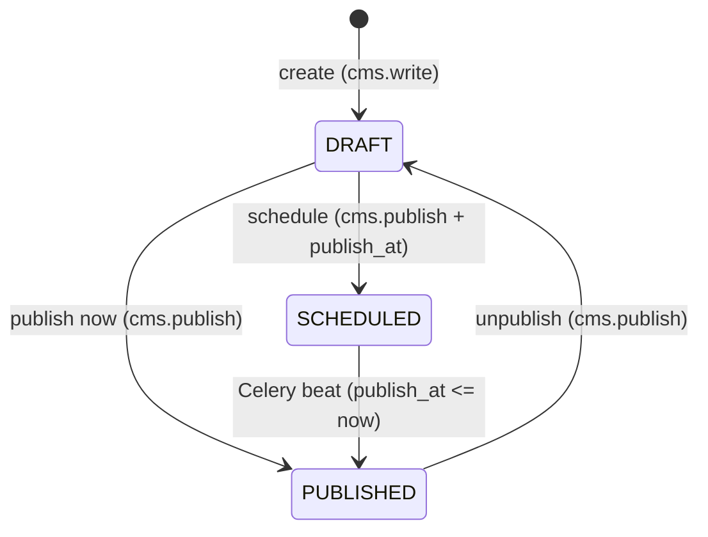

# CMS Sprint #3 — SEO Meta, Publishing Workflow, Tiptap Validation

## Summary

Three features harden the CMS before public traffic lands. SEO meta adds structured, auto-derived page metadata, a sitemap, and a Google Preview in the editor. The publishing workflow introduces `DRAFT / PUBLISHED / SCHEDULED` states with a new `cms.publish` role. Tiptap content validation closes the current no-validation gap at the API boundary.

---

## Problem Frame

The public site ships with empty `<title>` and `<meta description>` tags, no `robots.txt`, and no sitemap — causing direct SEO damage from day one. Every PATCH to a page is immediately live; there is no staging step. The backend accepts any JSON as `content`, meaning a corrupted Tiptap document silently reaches the database and breaks rendering on the public site.

---

## Key Decisions

- **Per-field `is_manual_override`** — stored as a dict (e.g., `{"title": true, "description": false}`) rather than a single boolean. A single boolean would permanently disable all auto-derivation the moment any one field is manually edited, defeating the auto-derivation value for the remaining fields.

- **Google Ping removed from Sprint #3** — `robots.txt` pointing to `/sitemap.xml` is sufficient; search engines discover sitemaps without explicit pings. Ping deferred to backlog.

- **Scheduled SLA is ±5 minutes** — Celery beat runs at a 5-minute interval, so a page scheduled for `14:37` publishes at the next beat (e.g., `14:40`). This is explicitly acceptable for CMS use; any expectation of second-level accuracy is incorrect.

---

## Actors

- A1. **CMS Editor** (`cms.write`) — creates and edits content; pages stay in `DRAFT`.
- A2. **CMS Publisher** (`cms.publish`) — promotes pages to `PUBLISHED` or `SCHEDULED`.
- A3. **Public Visitor** — reads from the public API; sees only `PUBLISHED` content.
- A4. **Celery Beat Worker** — promotes `SCHEDULED` pages whose `publish_at ≤ now()` to `PUBLISHED`.

---

## Requirements

**SEO Meta**

- R1. `SitePageContent.meta` stores a structured `MetaSchema` object with fields: `title` (string, max 60 chars), `description` (string, max 160 chars), `canonical` (URL string), `og_image` (S3 key string), `schema_org` (free-form JSON-LD object).
- R2. On content save, if `is_manual_override.title` is absent or `false`, `title` is auto-derived from the first H1 node in the Tiptap document.
- R3. On content save, if `is_manual_override.description` is absent or `false`, `description` is auto-derived from the text of the first paragraph node.
- R4. `is_manual_override` is a per-field dict; each key corresponds to a `MetaSchema` field; a `true` value prevents auto-derivation for that field on subsequent content saves.
- R5. When a meta field is explicitly set via the meta PATCH endpoint, the corresponding `is_manual_override` key is set to `true`.
- R6. `GET /api/v1/public/sitemap.xml` returns a standard XML sitemap listing all `PUBLISHED` pages for the tenant, with `<loc>` and `<lastmod>` from `updated_at`.
- R7. `GET /robots.txt` returns a response allowing all crawlers and referencing `/sitemap.xml`.
- R8. The CMS editor renders a Google-style SERP preview (title, URL, description) below the meta form fields, with character-count indicators (title ≤60, description ≤160).

**Publishing Workflow**

- R9. `SitePageContent` gains a `status` field with three values: `DRAFT`, `PUBLISHED`, `SCHEDULED`; default for new pages is `DRAFT`.
- R10. `SitePageContent` gains a nullable `publish_at` DateTimeField (UTC); required when `status = SCHEDULED`, null otherwise.
- R11. A user with `cms.write` may create and update a page in `DRAFT` status.
- R12. A user with `cms.publish` may transition a page to `PUBLISHED` (immediate) or `SCHEDULED` (with `publish_at`).
- R13. The Celery beat task `publish_scheduled_pages` queries pages with `status=SCHEDULED` and `publish_at ≤ now()`, transitions them to `PUBLISHED` in batches; scheduled publish accuracy is ±5 minutes.
- R14. Any transition to `PUBLISHED` — whether immediate or via beat — emits a `PagePublished` Outbox event inside the same database transaction, dispatched via `transaction.on_commit()`.
- R15. `Permission("cms", "publish")` is added to `rbac_permissions.py` and included in the seed migration.

**Public API Safety**

- R16. `get_page_content()` queries `status=PUBLISHED, is_deleted=False`; pages in `DRAFT` or `SCHEDULED` return the same graceful-degradation empty response as a missing page (`{"slug": "...", "content": {}, "meta": {}}`).

**Tiptap Content Validation**

- R17. The CMS PATCH endpoint validates the `content` field against `TiptapDocSchema` — a Pydantic v2 discriminated union of supported Tiptap v2 node types — before any database write.
- R18. Content that fails schema validation returns HTTP 422 with an error detail containing the path to the first failing node.
- R19. Documents with unrecognized node types or unrecognized mark attributes are rejected; the valid node whitelist must be updated when Tiptap extensions change.

---

## Key Flows

- F1. **Scheduled publish**
  - **Trigger:** Celery beat fires (5-minute interval).
  - **Actors:** A4.
  - **Steps:** Task queries `status=SCHEDULED, publish_at__lte=now(), is_deleted=False` filtered by tenant. For each result: open transaction → set `status=PUBLISHED` → write `PagePublished` Outbox event → commit → `on_commit` dispatches to Redis.
  - **Covers:** R13, R14.

- F2. **Meta auto-derivation on content save**
  - **Trigger:** CMS editor saves content (PATCH `/cms/pages/{slug}/`).
  - **Actors:** A1.
  - **Steps:** Validate `content` (R17). For each `MetaSchema` field: if `is_manual_override[field]` is not `true`, derive value from content per R2–R3. Write merged `meta` to DB.
  - **Covers:** R2, R3, R4.

**Publishing state machine:**

---

## Acceptance Examples

- AE1. **DRAFT page not visible on public site**
  - **Covers:** R16.
  - **Given:** Page with `slug="services"` exists in `DRAFT`.
  - **When:** Public visitor requests `GET /api/v1/public/cms/services/`.
  - **Then:** Response is `200` with `content: {}, meta: {}` — same as a missing page.

- AE2. **Scheduled page publishes within SLA**
  - **Covers:** R13, R14.
  - **Given:** Page with `status=SCHEDULED`, `publish_at=14:37 UTC`.
  - **When:** Celery beat fires at `14:40 UTC`.
  - **Then:** Page status → `PUBLISHED`; `PagePublished` Outbox event emitted.

- AE3. **Per-field override — title protected, description still auto-derives**
  - **Covers:** R4, R5.
  - **Given:** Editor manually sets `title = "Услуги компании | Комплект"`; `is_manual_override = {"title": true}`.
  - **When:** Editor saves content with a new H1 node and a new first paragraph.
  - **Then:** `title` remains `"Услуги компании | Комплект"` (not overwritten); `description` is re-derived from the new first paragraph.

- AE4. **Tiptap validation rejects unknown node type**
  - **Covers:** R17, R18, R19.
  - **Given:** PATCH `/api/v1/cms/pages/home/` with `content` containing node `{"type": "iframe", "attrs": {"src": "..."}}`.
  - **When:** CMS API validates against `TiptapDocSchema`.
  - **Then:** Response is `422` with error detail including the path `content.doc.content[N]`.

- AE5. **Auto-derive title from H1 when no manual override**
  - **Covers:** R2, R4.
  - **Given:** Page has `is_manual_override = {}` (no overrides set).
  - **When:** Editor saves content whose first H1 text is `"Подключение электричества"`.
  - **Then:** `meta.title` is set to `"Подключение электричества"`.

---

## Scope Boundaries

**Deferred to backlog:**
- Google Ping on publish — robots.txt + sitemap is sufficient for Sprint #3.

**Deferred to Sprint #4:**
- Gallery UI — `SiteImage` model exists, UI not built.
- Content Versioning (`SitePageRevision`) — rollback without a developer.

**Deferred to Sprint #5:**
- ERP Object Showcase — live bridge from ERP objects to public site.

**Outside Sprint #3 scope:**
- Live preview (Redis draft rendering) — rejected in ideation.
- Per-section RBAC — premature at current team size.
- A/B content variants.

---

## Dependencies / Assumptions

- Celery beat is running and configured with a ≤5-minute interval.
- Transactional Outbox infrastructure is present (`transaction.on_commit()` pattern in place).
- `BaseEnterpriseModel` provides `tenant_id`, `is_deleted`, `updated_at` on `SitePageContent`.
- RBAC infrastructure (`rbac_permissions.py` seed migration pattern) supports adding `cms.publish` without a destructive migration.
- `TiptapDocSchema` whitelist covers at minimum: `doc`, `paragraph`, `heading`, `bulletList`, `orderedList`, `listItem`, `image`, `link` mark, `bold` mark, `italic` mark, `blockquote`, `codeBlock`, `hardBreak`, `horizontalRule`. Planning confirms final list.

---

## Outstanding Questions

**Deferred to planning:**
- `schema_org` field validation: accept any JSON object, or validate against a minimal JSON-LD shape?
- `robots.txt` delivery: Django view vs static file served by nginx?
- `is_manual_override` storage location: sub-key inside `meta` JSONField, or separate `JSONField` on the model?
- Exact Celery queue for `publish_scheduled_pages` (likely `default` or new `cms` queue).
