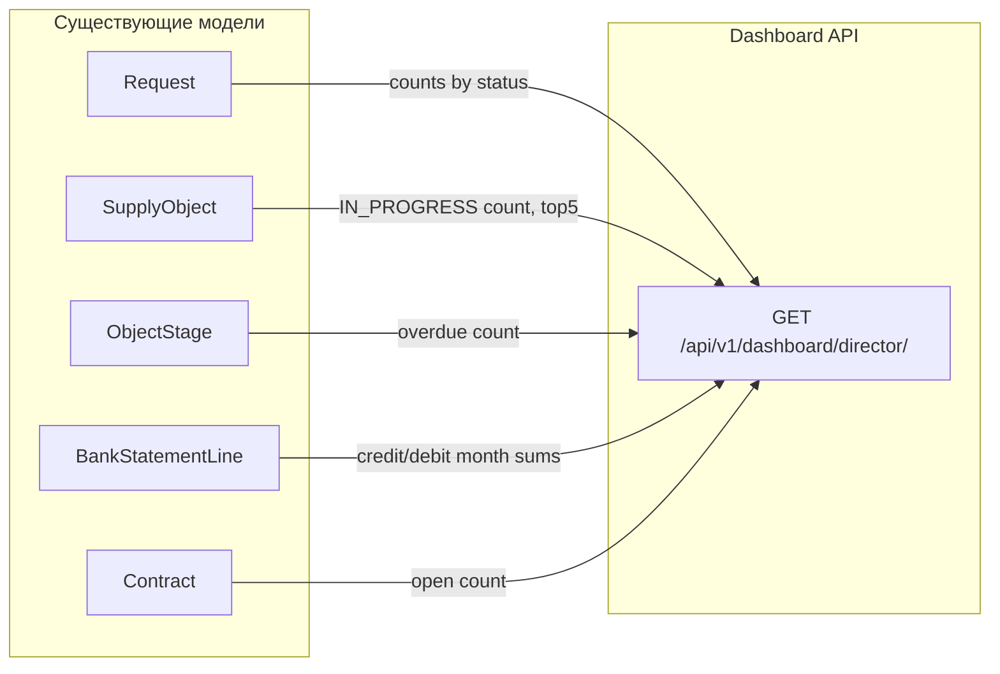

# Sprint C — Операционная зрелость

## Контекст

Sprint B завершён: закрыт операционный контур (Контрагенты, Договоры, Объекты, Файлы, Карта, Финансы, Банковские выписки, CMS, Public Site).

Sprint C фокусируется на том, чтобы ERP стал реальным рабочим инструментом для директора и команды, а не демонстрационным стендом.

**Важное открытие:** банковский импорт `1CClientBankExchange` (КЛ→1С) **уже полностью реализован** в `apps/payments` — парсер, модели, сервис, API, frontend. Sprint C только верифицирует его на реальном файле.

## Scope Decision

| Блок | Статус | Обоснование |
|------|--------|-------------|
| **C1: Дашборд руководителя** | Строить | Главный запрос директора; данные уже в БД |
| **C2: Задачи и поручения** | Строить | Замена Telegram/WhatsApp координации |
| **C3: Проверка ролей** | Операционное | Тест 4 ролей с реальными пользователями |
| **C4: Банковский файл smoke-тест** | Тест + фикс | Парсер готов; верифицировать на реальном файле `kl_to_1c.txt` |
| Импорт клиентов из 1С | ❌ Sprint D | Ждём файл |
| BI / аналитика / видеозвонки | ❌ Не строить | Слишком рано |

## Не входит в Sprint C

- Мобильное приложение
- Real-time push-уведомления (WebSocket уже есть, но push через браузер — отдельная задача)
- Drill-down / детализация KPI по клику
- Excel-импорт банковских выписок
- Задачи с тредами/комментариями (MVP — только основной флоу)
- Автоматическое связывание задач с договорами/объектами через AI

---

## C1: Дашборд руководителя

### Постановка

Отдельная страница `/dashboard/director` с KPI-виджетами для директора. Читает агрегированные данные из существующих моделей. Без drill-down — только обзор.

**Ответ на вопрос:** отдельная страница, не апгрейд существующего `/dashboard`.

### KPI-виджеты

| Виджет | Источник данных | Метрика |
|--------|----------------|---------|
| Заявки за период | `apps/requests` → `Request` | Количество по статусам: NEW / ASSIGNED / PROCESSING / CONVERTED / CLOSED |
| Объекты в работе | `apps/objects` → `SupplyObject` | Количество статус=`IN_PROGRESS`; топ-5 по имени |
| Просроченные этапы | `apps/objects` → `ObjectStage` | Этапы с planned_end_date < today и status ≠ COMPLETED |
| Поступления / Расход | `apps/payments` → `BankStatementLine` | Сумма direction=credit и direction=debit за текущий месяц |
| Незакрытые договоры | `apps/contracts` → `Contract` | Количество договоров не в статусе CLOSED/CANCELLED |

### API

Новый endpoint на бэкенде:

```
GET /api/v1/dashboard/director/
Permission: read, dashboard (или staff)
Response: DashboardDirectorSummaryOut
```

Поля ответа:
- `requests_by_status`: `{new: N, assigned: N, processing: N, converted: N, closed: N}`
- `objects_in_progress_count`: int
- `objects_top5`: `[{id, name, status}]`
- `overdue_stages_count`: int
- `payments_credit_month`: str (сумма)
- `payments_debit_month`: str (сумма)
- `open_contracts_count`: int
- `period_from`, `period_to`: ISO8601

### Расположение бэкенда

Новый модуль `apps/dashboard/` (query-only, нет services):
- `apps/dashboard/queries/director_queries.py` — агрегаты
- `apps/dashboard/api.py` — один Router, один endpoint
- `apps/dashboard/schemas/director_dto.py` — DTO

Не использовать: read replica не критична для MVP (данные не real-time, допускается основная база).

### Frontend

- Новый route: `frontend/src/app/dashboard/director/page.tsx`
- Добавить ссылку в боковую навигацию (видна только пользователям с ролью `director` или выше)
- Компонент: сетка KPI-карточек (2×3 или 3×2), без таблиц
- TanStack Query: `useQuery(['dashboard-director'])`, staleTime 60 сек
- Данные в реальном времени не требуются; кнопка «Обновить» достаточна

### Success Criteria

- Директор открывает страницу и видит числа из реальных данных (не `0` повсюду)
- Все 5 виджетов рендерятся без ошибок при пустых данных
- RBAC: страница недоступна роли `foreman` (403 → редирект)

---

## C2: Задачи и поручения (MVP)

### Постановка

Директор или менеджер ставит задачу → назначает ответственного → устанавливает срок → прикрепляет файлы → получает уведомление о выполнении. Заменяет WhatsApp-группы и Telegram-боты для рабочей координации.

### Domain

Новый Django-домен: `apps/tasks/`

Структура по архитектурным законам проекта:
```
apps/tasks/
  models/task.py
  models/task_attachment.py
  services/task_service.py
  repositories/task_repo.py
  queries/task_queries.py
  schemas/task_dto.py
  api.py
  migrations/
  tests/
    unit/test_task_service.py
    queries/test_task_queries.py
    permissions/test_task_rbac.py
```

### Модель Task

Ключевые поля (наследует `BaseEnterpriseModel`):
- `title`: CharField(max_length=255)
- `description`: TextField(blank=True)
- `status`: TextChoices → `OPEN`, `IN_PROGRESS`, `DONE`, `CANCELLED`
- `priority`: TextChoices → `LOW`, `NORMAL`, `HIGH`
- `created_by_id`: UUID (FK к User через tenant, no ORM FK cross-domain)
- `assigned_to_id`: UUID (nullable)
- `due_date`: DateField (nullable)
- `entity_type`: CharField(max_length=50, blank=True) — `contract`, `object`, `contragent`, `request`, или пусто
- `entity_id`: UUID (nullable) — ID привязанной сущности
- `closed_at`: DateTimeField (nullable)
- `closed_by_id`: UUID (nullable)

Нет ORM FK на другие домены (ADR-0005). Ссылка на сущность через `entity_type` + `entity_id` (polymorphic soft-link).

### Модель TaskAttachment

- `task_id`: FK к Task
- `file_id`: UUID (ref к `apps/files`, без ORM FK)
- `attached_by_id`: UUID

### API

```
GET    /api/v1/tasks/                 # список (cursor pagination, фильтры: status, assigned_to, entity)
POST   /api/v1/tasks/                 # создать
GET    /api/v1/tasks/{id}/            # детали
PATCH  /api/v1/tasks/{id}/            # изменить title/description/priority/due_date/assigned_to
POST   /api/v1/tasks/{id}/status/     # сменить статус (OPEN → IN_PROGRESS → DONE)
POST   /api/v1/tasks/{id}/cancel/     # отменить
POST   /api/v1/tasks/{id}/files/      # прикрепить файл (file_id)
DELETE /api/v1/tasks/{id}/files/{fid}/# открепить файл
```

### RBAC

| Действие | Роли |
|----------|------|
| Создать задачу | `director`, `manager`, `accountant` |
| Назначить ответственного | `director`, `manager` |
| Изменить свою задачу | creator или assigned_to |
| Просмотр всех задач | `director`, `manager` |
| Просмотр своих задач | любой сотрудник |
| Удалить/отменить | creator или `director` |

Разрешения: `tasks.read`, `tasks.write`, `tasks.delete`

### Уведомления

При изменении статуса задачи (особенно DONE) — push через `apps/notifications` в очередь `notifications`. Payload: `{task_id, title, new_status, changed_by}`. Получатели: creator + assigned_to.

Событие: `TaskStatusChangedEvent` (Transactional Outbox → Celery → notifications queue).

### Frontend

- `frontend/src/app/dashboard/tasks/page.tsx` — список задач (фильтры, создание)
- `frontend/src/app/dashboard/tasks/[id]/page.tsx` — детали задачи (смена статуса, файлы)
- Shared API: `frontend/src/shared/api/tasks.ts`
- Добавить виджет «Мои задачи» на дашборд руководителя (count открытых)

### Success Criteria

- Директор создаёт задачу, назначает менеджера — менеджер видит её в своём списке
- Менеджер переводит в DONE — директор получает уведомление в `/dashboard/notifications`
- Задача привязывается к договору (`entity_type=contract, entity_id=UUID`) — видна в списке задач
- Файл прикрепляется через существующий механизм `apps/files`

---

## C3: Проверка ролей

### Постановка

Создать 4 тестовых пользователя, каждый с одной ролью. Провести ручное тестирование: что видит каждая роль, что недоступно. Зафиксировать баги.

### Роли и scope доступа

| Роль | Ожидаемый доступ |
|------|-----------------|
| `director` | Всё: read + write + delete + дашборд руководителя |
| `manager` | read + write объекты/договоры/контрагенты; нет delete; нет финансов |
| `accountant` | read всё; write только payments; нет delete |
| `foreman` | только свои объекты (read); нет contracts; нет финансов |

### Алгоритм

1. Создать пользователей через Django admin или `manage.py createsuperuser`
2. Назначить роли через `/dashboard/admin/roles`
3. Войти под каждым → пройти golden path: создать/открыть/изменить сущность
4. Проверить, что 403 возникает там, где ожидается
5. Зафиксировать баги в `docs/solutions/rbac/` по каждой аномалии

### Credentials (dev)

| Username | Role | Password |
|----------|------|----------|
| `dir_test` | director | `Test123!` |
| `mgr_test` | manager | `Test123!` |
| `acc_test` | accountant | `Test123!` |
| `foreman_test` | foreman | `Test123!` |

Создать через:
```bash
docker compose -f docker-compose.dev.yml exec backend python manage.py shell -c "
from apps.users.models import User
for u, r in [('dir_test','director'), ('mgr_test','manager'), ('acc_test','accountant'), ('foreman_test','foreman')]:
    obj, _ = User.objects.get_or_create(username=u, defaults={'email': f'{u}@test.com'})
    obj.set_password('Test123!')
    obj.save()
print('Done')
"
```

Роли назначить через UI `/dashboard/admin/roles`.

---

## C4: Банковский файл — smoke-тест

### Постановка

Парсер `KlTo1CParser` и API `POST /api/v1/payments/statements/` уже реализованы. Необходимо загрузить реальный файл `kl_to_1c.txt` и верифицировать корректность парсинга.

### Файл

`kl_to_1c.txt` — реальная выписка ВТБ:
- Счёт: `40702810601320000266`
- Период: 01.06.2026–08.06.2026
- НачальныйОстаток: `1 143 258,28 ₽`
- ВсегоПоступило: `66 183,00 ₽`
- ВсегоСписано: `1 180 669,09 ₽`
- КонечныйОстаток: `28 772,19 ₽`

### Проверки

После загрузки через `POST /api/v1/payments/statements/`:
1. `status = parsed` (не `parse_failed`)
2. `account_number = "40702810601320000266"`
3. `opening_balance ≈ 1143258.28`, `closing_balance ≈ 28772.19`
4. Количество `BankStatementLine`: соответствует числу `СекцияДокумент` в файле
5. Строки с `direction = credit`: содержат поступления от СОСТРА и ЭТАЛОН
6. Строки с `direction = debit`: содержат ЕНП, зарплаты, оплаты поставщикам

### Ожидаемые фиксы

- Если парсер не справляется с кодировкой Windows-1251 — исправить `_decode_file()`
- Если `НазначениеПлатежа` обрезается — проверить field limit в парсере
- Если `Плательщик1`/`Получатель1` не маппятся на `counterparty_name` — исправить маппинг

### Success Criteria

Загрузка реального файла → статус `parsed` → все транзакции распознаны без `parse_error`.

---

## Приоритет выполнения

```
Week 1: C4 (smoke-тест банковского файла — быстро) → C3 (роли — операционное)
Week 2: C1 (дашборд руководителя — backend API + frontend)
Week 3: C2 (задачи — новый домен, наибольший объём)
```

---

## Data Sources Map (для дашборда)



---

## Ограничения

- Domain Isolation (ADR-0005): `apps/tasks` не импортирует модели из других доменов
- `apps/dashboard` только читает: Query-only, нет Services, нет Outbox
- Migration Policy: новые поля добавляются nullable (Expand & Contract)
- Задачи MVP: нет комментариев, нет тредов, нет упоминаний (@mention)
- Дашборд: нет real-time WebSocket обновлений (polling достаточно для MVP)
