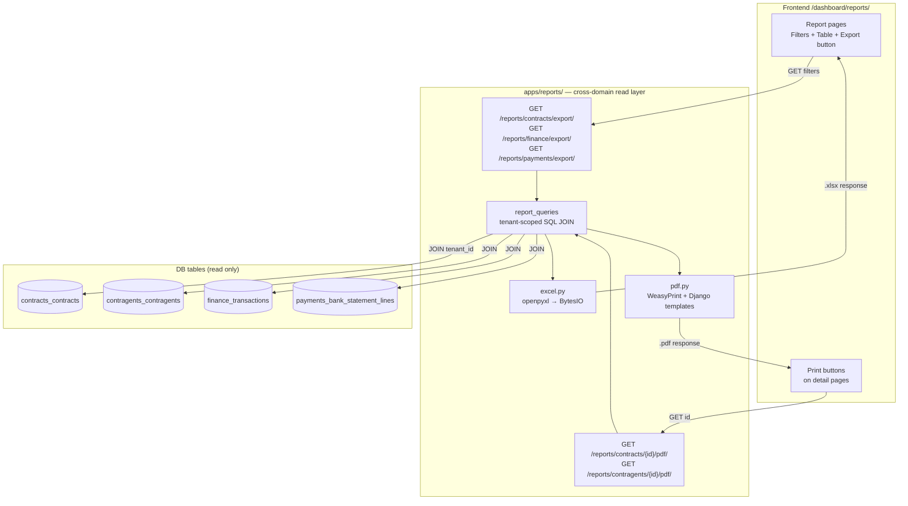

# feat: Reports, Export, Cross-Navigation, and PDF Print Forms

## Summary

Три последовательно-приоритизированных блока: (P1) Excel-экспорт для трёх отчётов (Договоры, Финансы, Выписки) с серверной фильтрацией; (P2) двунаправленная навигация между Договором и Контрагентом; (P3) PDF-печать договора и карточки контрагента через WeasyPrint. Реализуется как новый `apps/reports/` домен — явное исключение ADR-0005 для cross-domain read-only проекций.

---

## Problem Frame

После нескольких месяцев эксплуатации бухгалтер запросит Excel. Пользователь, просматривающий договор, не может сразу перейти к контрагенту — и наоборот. При реальном документообороте неизбежно появится запрос на печатные формы. Все три потребности решаются одним циклом работы без новых БД-таблиц и без Celery.

---

## Requirements

| ID | Требование |
|----|------------|
| R1 | Отчёт «Договоры»: фильтры по статусу, ресурсу, периоду, контрагенту; экспорт в `.xlsx` |
| R2 | Отчёт «Финансы»: фильтры по периоду, договору, типу, статусу; экспорт в `.xlsx` |
| R3 | Отчёт «Выписки»: строки банковских выписок с фильтром по статусу матчинга; экспорт в `.xlsx` |
| R4 | Страница договора содержит ссылку на контрагента |
| R5 | Страница контрагента содержит вкладку со списком договоров |
| R6 | `GET /reports/contracts/{id}/pdf/` → print-ready PDF договора |
| R7 | `GET /reports/contragents/{id}/pdf/` → PDF карточки контрагента |

---

## Key Technical Decisions

### KTD-1: Excel через openpyxl, синхронный HttpResponse

`openpyxl` — pure Python, нет C-расширений, стандарт в Django-проектах. Синхронный ответ достаточен при объёме ERP (<10k строк). Ответ: `BytesIO` + `HttpResponse` с `Content-Type: application/vnd.openxmlformats-officedocument.spreadsheetml.sheet` и `Content-Disposition: attachment`. Celery-задача не нужна; добавить в будущем при превышении 10k строк.

### KTD-2: Новый домен `apps/reports/` — задокументированное исключение ADR-0005

Отчёты по природе cross-domain: отчёт по договорам требует имени контрагента; финансовый отчёт — номера договора. `apps/reports/` — выделенный read-only слой с правом на SQL JOIN через границы доменов при обязательном `tenant_id`-скопе. Это явное, задокументированное исключение к ADR-0005: отчётность — не бизнес-логика, а cross-cutting проекция.

### KTD-3: RBAC переиспользует существующие ресурсы

Отчёт договоров: `require_permission("read", "contracts")`. Финансовый: `require_permission("read", "finance")`. Выписки: `require_permission("read", "payments")`. PDF договора: `require_permission("read", "contracts")`. PDF контрагента: `require_permission("read", "contragents")`. Новый RBAC-ресурс не создаётся.

### KTD-4: Фильтр `contragent_id` на `/contracts/` — общий пре-реквизит P1 и P2

`get_contracts_page()` получает `contragent_id: Optional[UUID]` как новый ORM-фильтр. Это разблокирует и вкладку Контрагент→Договоры (P2), и фильтрацию в отчёте (P1). Требует регенерации TypeScript SDK.

### KTD-5: P2 — нет изменений схемы бэкенда

`ContractResponseSchema` уже содержит `contragent_id`. Страница договора получает имя контрагента через отдельный `useContragent(contragent_id)` (хук уже существует). Новое поле в схеме не нужно.

### KTD-6: PDF через WeasyPrint (HTML-шаблон → PDF)

WeasyPrint конвертирует Django-шаблон в PDF. Требует системных пакетов в Dockerfile: `libpango-1.0-0 libpangocairo-1.0-0 libcairo2 libgdk-pixbuf2.0-0`. Это простейший путь для Django: вёрстка через CSS, никакого программного рисования.

### KTD-7: Endpoints на `/api/v1/reports/`

Новый router зарегистрирован в `config/urls.py` под `/reports/`. Три endpoint экспорта + два PDF endpoint. Все возвращают файлы (Content-Disposition: attachment).

---

## High-Level Technical Design

### Архитектура Reports-слоя



### P2 — навигация без нового бэкенда

```mermaid
graph LR
    ContractDetail -->|useContragent(contragent_id)| ContraAPI["/api/v1/contragents/{id}/"]
    ContractDetail -->|Link| ContraPage["/dashboard/contragents/{id}"]
    ContraPage -->|useContracts({contragent_id})| ContrList["/api/v1/contracts/?contragent_id="]
    ContraPage -->|tab| ContractsList[Список договоров]
```

---

## Scope Boundaries

### В скоупе
- P1: три Excel-отчёта с фильтрами
- P2: ссылка Договор→Контрагент, вкладка Контрагент→Договоры
- P3: PDF договора, PDF карточки контрагента

### Deferred to Follow-Up Work
- PDF «Акт» и «Счёт» — требует уточнения финансовой модели (нет domain entity)
- Сохранённые / запланированные шаблоны отчётов
- Async Celery-экспорт (нужен при >10k строк)
- CSV как альтернатива Excel
- Пагинация превью на странице отчёта (экспорт — полный датасет)

### Out of scope (явно отложено)
Calendar, Tasks, Materialized Views, Prometheus/Grafana

---

## Implementation Units

### U1. Prerequisites: зависимости, фильтр contracts, SDK-регенерация

**Goal:** Добавить `openpyxl` и `weasyprint` в requirements; добавить системные пакеты WeasyPrint в Dockerfile; добавить `contragent_id`-фильтр на contracts list; регенерировать TypeScript SDK.

**Requirements:** R1 (фильтр), R4/R5 (навигация), R6/R7 (PDF)

**Dependencies:** нет

**Files:**
- `backend/requirements/base.txt` — добавить `openpyxl>=3.1`, `weasyprint>=60`
- `backend/Dockerfile.dev` — в блок `apt-get` добавить: `libpango-1.0-0 libpangocairo-1.0-0 libcairo2 libgdk-pixbuf2.0-0`
- `backend/apps/contracts/queries/contract_queries.py` — параметр `contragent_id: Optional[uuid.UUID] = None` в `get_contracts_page()`
- `backend/apps/contracts/api.py` — `contragent_id: Optional[uuid.UUID] = Query(None)` в `list_contracts()`; пробрасывать в `get_contracts_page()`
- `frontend/src/shared/api/generated/schema.d.ts` — регенерировать после изменения схемы
- `frontend/src/shared/api/contracts.ts` — добавить `contragent_id?: string` в тип параметров `useContracts`

**Approach:** В `get_contracts_page()` добавить `if contragent_id: qs = qs.filter(contragent_id=contragent_id)` по аналогии с `status`-фильтром. После изменения API запустить регенерацию SDK (`make gen-sdk` или `docker compose exec backend python manage.py export_openapi_schema | ...`).

**Patterns to follow:** `apps/contracts/queries/contract_queries.py` — паттерн `if status: qs = qs.filter(status=status)`.

**Test scenarios:**
- `GET /contracts/?contragent_id={uuid}` возвращает только договоры с совпадающим `contragent_id`
- `GET /contracts/?status=ACTIVE&contragent_id={uuid}` — комбинированный фильтр работает
- `GET /contracts/` без `contragent_id` — backward compatible, возвращает все договоры тенанта
- Tenant isolation: `contragent_id` чужого тенанта → пустой список

**Verification:** Contracts API возвращает отфильтрованные результаты. `useContracts({ contragent_id })` компилируется без TS-ошибок.

---

### U2. `apps/reports/` — scaffold домена

**Goal:** Создать skeleton модуля reports: Django-приложение, router, утилиты Excel и PDF, регистрация в INSTALLED_APPS и URL-конфиге.

**Requirements:** R1–R7

**Dependencies:** U1

**Files:**
- `backend/apps/reports/__init__.py`
- `backend/apps/reports/apps.py`
- `backend/apps/reports/api.py` — пустой `Router(tags=["reports"])`
- `backend/apps/reports/utils/excel.py` — `make_excel_response(wb: Workbook, filename: str) -> HttpResponse`
- `backend/apps/reports/utils/pdf.py` — `make_pdf_response(html: str, filename: str) -> HttpResponse`
- `backend/config/settings/base.py` — добавить `"apps.reports"` в INSTALLED_APPS
- `backend/config/urls.py` — `api.add_router("/reports/", reports_router)`

**Approach:** `excel.py`: `BytesIO` → `wb.save(buffer)` → `HttpResponse(buffer.getvalue(), content_type=...)` с `Content-Disposition: attachment; filename="{filename}"`. `pdf.py`: `weasyprint.HTML(string=html).write_pdf()` → `HttpResponse(pdf_bytes, content_type="application/pdf")`.

**Patterns to follow:** Регистрация роутера — `config/urls.py`. Паттерн HttpResponse — `apps/files/api/`.

**Test scenarios:**
- `make_excel_response(wb, "x.xlsx")` возвращает `HttpResponse` с `Content-Type: application/vnd.openxmlformats-officedocument.spreadsheetml.sheet`
- `Content-Disposition` содержит `attachment; filename="x.xlsx"`
- `make_pdf_response(html, "x.pdf")` возвращает `HttpResponse` с `Content-Type: application/pdf`

**Verification:** `python -c "import apps.reports"` в контейнере работает. Unit-тесты утилит проходят.

---

### U3. Отчёт по договорам — query + endpoint

**Goal:** `GET /api/v1/reports/contracts/export/` возвращает `.xlsx` со всеми договорами тенанта, прошедшими фильтры, включая наименование и ИНН контрагента через JOIN.

**Requirements:** R1

**Dependencies:** U1, U2

**Files:**
- `backend/apps/reports/queries/contract_report_query.py`
- `backend/apps/reports/api.py` — endpoint `GET /contracts/export/`
- `backend/apps/reports/tests/test_contract_report.py`

**Approach:** `contract_report_query.py` допускает импорт `from apps.contragents.models.contragent import Contragent` — это легальный cross-domain импорт внутри `apps/reports/` (задокументированное исключение ADR-0005). ORM: `Contract.objects.filter(tenant_id=...).select_related()` или аннотация через Subquery для contragent name/inn. Фильтры: `status`, `resource_type`, `date_from: date`, `date_to: date` (по `created_at`), `contragent_id`. Суммы / 100 для перевода копеек в рубли.

Колонки Excel: `№`, `Номер договора`, `Наименование`, `Статус`, `Вид ресурса`, `Контрагент`, `ИНН`, `Сумма (руб.)`, `Оплачено (руб.)`, `Остаток (руб.)`, `Дата создания`.

**Patterns to follow:** `apps/contracts/queries/contract_queries.py` — ORM-паттерны. `apps/reports/utils/excel.py` — формирование ответа.

**Test scenarios:**
- `GET /reports/contracts/export/` возвращает 200, `Content-Type: application/vnd.openxmlformats-officedocument.spreadsheetml.sheet`
- Workbook содержит строку-заголовок с корректными именами столбцов
- Фильтр `status=ACTIVE` — в файле только активные договоры
- Фильтр `date_from=2026-01-01&date_to=2026-06-30` — только договоры из периода
- Столбцы «Контрагент» и «ИНН» заполнены через JOIN
- Tenant isolation: договоры другого тенанта в экспорт не попадают
- Пустой результат: валидный workbook с заголовком, 0 строк данных
- Без аутентификации → 403

**Verification:** Экспорт возвращает `.xlsx`, открывающийся в Excel. Все тест-сценарии зелёные.

---

### U4. Финансовый отчёт — query + endpoint

**Goal:** `GET /api/v1/reports/finance/export/` возвращает транзакции с фильтром по периоду и номером договора через JOIN.

**Requirements:** R2

**Dependencies:** U2

**Files:**
- `backend/apps/reports/queries/finance_report_query.py`
- `backend/apps/reports/api.py` — endpoint `GET /finance/export/`
- `backend/apps/reports/tests/test_finance_report.py`

**Approach:** JOIN `finance_transactions` × `contracts_contracts` по `contract_id` для получения `contract_number`. Фильтры: `date_from`, `date_to` (по `value_date`), `contract_id`, `transaction_type`, `status`. Суммы / 100.

Колонки: `Дата`, `Номер договора`, `Тип операции`, `Статус`, `Сумма (руб.)`, `ИНН контрагента`, `Внешний реф.`.

**Test scenarios:**
- Возвращает xlsx с корректным `Content-Type`
- Фильтр `date_from/date_to` по `value_date` работает корректно
- Транзакции со статусом `REVERSED` включены если не отфильтрованы
- Tenant isolation соблюдается
- Пустой результат: workbook с заголовком

**Verification:** Все тесты зелёные. Excel-файл содержит номера договоров.

---

### U5. Отчёт по выпискам — query + endpoint

**Goal:** `GET /api/v1/reports/payments/export/` возвращает строки банковских выписок с фильтром по статусу матчинга.

**Requirements:** R3

**Dependencies:** U2

**Files:**
- `backend/apps/reports/queries/payments_report_query.py`
- `backend/apps/reports/api.py` — endpoint `GET /payments/export/`
- `backend/apps/reports/tests/test_payments_report.py`

**Approach:** JOIN `payments_bank_statement_lines` × `payments_bank_statements` для `account_number`. Фильтры: `statement_id`, `match_status`, `date_from`, `date_to` (по `transaction_date`). Добавить итоговую строку: всего строк, совпавших, несовпавших.

Колонки: `Дата`, `Сумма`, `Направление`, `Контрагент`, `ИНН`, `Описание`, `Реквизит`, `Статус матчинга`, `Уверенность (%)`, `ID договора`.

**Test scenarios:**
- Возвращает xlsx с корректным `Content-Type`
- `match_status=UNMATCHED` — только несопоставленные строки
- `statement_id` сужает результат до одной выписки
- Итоговая строка с подсчётами присутствует
- Tenant isolation соблюдается

**Verification:** Все тесты зелёные.

---

### U6. Frontend: раздел «Отчёты» + навигация

**Goal:** Добавить `/dashboard/reports/` как новый раздел: индексная страница с тремя карточками, пункт в боковом меню.

**Requirements:** R1, R2, R3

**Dependencies:** U1 (SDK регенерирован)

**Files:**
- `frontend/src/app/dashboard/reports/page.tsx` — три карточки-ссылки на подотчёты
- `frontend/src/shared/api/reports.ts` — утилита `downloadReport(url: string)` для триггера скачивания
- `frontend/src/app/dashboard/layout.tsx` — добавить `{ href: '/dashboard/reports', label: 'Отчёты', permission: 'contracts.read' }` в `NAV_ITEMS`

**Approach:** `downloadReport` создаёт временный `<a href download>` и кликает его программно. Индексная страница — три карточки с описанием и кнопкой «Открыть».

**Test scenarios:**
- Пункт «Отчёты» виден для пользователей с `contracts.read`
- Индексная страница рендерится без ошибок
- Каждая карточка ведёт на соответствующий подмаршрут

**Verification:** Пункт меню появляется, страница загружается.

---

### U7. Страница отчёта «Договоры»

**Goal:** `/dashboard/reports/contracts/` — форма фильтров, превью-таблица, кнопка «Экспорт в Excel».

**Requirements:** R1

**Dependencies:** U6, U3

**Files:**
- `frontend/src/app/dashboard/reports/contracts/page.tsx`

**Approach:** Фильтры: `status` (select), `resource_type` (select), `date_from/date_to` (date inputs), `contragent_id` (UUID input). Превью — первые 20 строк через существующий `useContracts` хук. Кнопка «Экспорт» вызывает `downloadReport('/api/v1/reports/contracts/export/?' + params)`.

**Test scenarios:**
- Страница рендерится без ошибок
- Изменение фильтра `status` обновляет превью-таблицу
- Кнопка «Экспорт» инициирует скачивание `.xlsx`
- Empty state при нулевом результате

**Verification:** Кнопка экспорта скачивает файл в браузере.

---

### U8. Страница отчёта «Финансы»

**Goal:** `/dashboard/reports/finance/` — фильтр по периоду, превью, экспорт.

**Requirements:** R2

**Dependencies:** U6, U4

**Files:**
- `frontend/src/app/dashboard/reports/finance/page.tsx`

**Approach:** Фильтры: `date_from/date_to`, `transaction_type`, `status`. Превью через `useTransactions`. Кнопка → `downloadReport('/api/v1/reports/finance/export/?' + params)`.

**Test scenarios:**
- Страница рендерится без ошибок
- Кнопка «Экспорт» скачивает `.xlsx`
- Фильтр периода применяется к превью-таблице

**Verification:** Кнопка экспорта работает в браузере.

---

### U9. Страница отчёта «Выписки»

**Goal:** `/dashboard/reports/payments/` — фильтр по статусу матчинга, счётчик несовпавших строк, экспорт.

**Requirements:** R3

**Dependencies:** U6, U5

**Files:**
- `frontend/src/app/dashboard/reports/payments/page.tsx`

**Approach:** Фильтры: `match_status` (select: Все / Совпало / Не совпало / Спорно), `date_from/date_to`, `statement_id`. Показывать счётчик несовпавших строк над таблицей. Кнопка → `downloadReport('/api/v1/reports/payments/export/?' + params)`.

**Test scenarios:**
- Страница рендерится без ошибок
- Фильтр `UNMATCHED` показывает только несопоставленные
- Счётчик несовпавших строк виден
- Кнопка «Экспорт» скачивает `.xlsx`

**Verification:** Кнопка экспорта работает в браузере.

---

### U10. Contract detail → ссылка на контрагента

**Goal:** Страница договора показывает имя контрагента как ссылку на `/dashboard/contragents/{id}` если `contragent_id` заполнен.

**Requirements:** R4

**Dependencies:** U1 (только frontend-изменение)

**Files:**
- `frontend/src/app/dashboard/contracts/[id]/page.tsx`

**Approach:** Добавить компонент `ContragentLink` в detail-секцию страницы договора. Компонент вызывает `useContragent(contragent_id)` (хук уже существует), рендерит `<Link href={/dashboard/contragents/${id}}>`. Показывать skeleton пока загружается. Если `contragent_id === null` — секция не рендерится.

**Patterns to follow:** `useContragent` хук в `frontend/src/shared/api/contragents.ts`.

**Test scenarios:**
- Договор с `contragent_id` показывает «Контрагент: [имя]» с кликабельной ссылкой
- Договор без `contragent_id` (null) — секции «Контрагент» нет
- Клик по ссылке ведёт на `/dashboard/contragents/{id}`
- Пока загружается имя — skeleton-заглушка

**Verification:** Визуальная проверка — страница договора ссылается на контрагента.

---

### U11. Contragent detail → вкладка «Договоры»

**Goal:** Страница контрагента содержит вкладку «Договоры» со списком связанных договоров.

**Requirements:** R5

**Dependencies:** U1 (фильтр `contragent_id` на contracts list)

**Files:**
- `frontend/src/app/dashboard/contragents/[id]/page.tsx`

**Approach:** Добавить два таба на страницу контрагента: «Обзор» (текущий контент) и «Договоры». Вкладка «Договоры» вызывает `useContracts({ contragent_id: id })` (существующий хук, новый параметр из U1). Список договоров: `contract_number`, статус-badge, ссылка на каждый договор. Empty state «Договоров нет».

**Patterns to follow:** `frontend/src/app/dashboard/contracts/page.tsx` — рендеринг элемента списка договоров.

**Test scenarios:**
- Страница контрагента имеет два таба
- Вкладка «Договоры» показывает список связанных договоров
- Каждый элемент ведёт на `/dashboard/contracts/{id}`
- Empty state «Договоров нет» при отсутствии договоров
- Skeleton при загрузке

**Verification:** Визуальная проверка — контрагент показывает список договоров.

---

### U12. PDF-endpoint договора + WeasyPrint-сервис

**Goal:** `GET /api/v1/reports/contracts/{id}/pdf/` возвращает print-ready PDF с данными договора.

**Requirements:** R6

**Dependencies:** U2

**Files:**
- `backend/apps/reports/pdf_service.py` — `render_contract_pdf(contract_id, ctx) -> bytes`
- `backend/templates/reports/contract_pdf.html` — HTML-шаблон для WeasyPrint
- `backend/apps/reports/api.py` — endpoint `GET /contracts/{contract_id}/pdf/`
- `backend/apps/reports/tests/test_pdf_service.py`

**Approach:** `pdf_service.py` получает договор через `ContractRepository.get_by_id(contract_id)` (tenant-scoped, выбрасывает `PermissionDenied` при несовпадении тенанта). В reports-слое запрашивает имя контрагента через JOIN. Рендерит шаблон `contract_pdf.html` через `django.template.loader.render_to_string`, передаёт HTML в `weasyprint.HTML(string=html_str).write_pdf()`. Шаблон: A4, секции — реквизиты, предмет договора, финансовые условия.

**Test scenarios:**
- `GET /reports/contracts/{id}/pdf/` → 200, `Content-Type: application/pdf`
- 404 для несуществующего `contract_id`
- 404 для `contract_id` другого тенанта (anti-IDOR)
- 403 без `read:contracts` permission
- Тело ответа — непустые байты (валидный PDF)

**Verification:** Все тесты зелёные. PDF открывается в браузере.

---

### U13. PDF-endpoint карточки контрагента

**Goal:** `GET /api/v1/reports/contragents/{id}/pdf/` возвращает PDF-карточку контрагента.

**Requirements:** R7

**Dependencies:** U12

**Files:**
- `backend/apps/reports/pdf_service.py` — добавить `render_contragent_pdf(contragent_id, ctx) -> bytes`
- `backend/templates/reports/contragent_pdf.html`
- `backend/apps/reports/api.py` — endpoint `GET /contragents/{contragent_id}/pdf/`
- `backend/apps/reports/tests/test_pdf_service.py` — расширить

**Approach:** `ContragentRepository.get_by_id(contragent_id)` — tenant-scoped. В reports-слое запросить агрегаты (`linked_contracts_count`, `total_paid`) через JOIN с `contracts_contracts` и `finance_transactions`. Шаблон: наименование, ИНН, тип, сводка по договорам. `require_permission("read", "contragents")`.

**Test scenarios:**
- `GET /reports/contragents/{id}/pdf/` → 200, `Content-Type: application/pdf`
- 404 для несуществующего или чужого `contragent_id`
- 403 без `read:contragents`

**Verification:** Все тесты зелёные. PDF визуально корректен.

---

### U14. Кнопки печати на страницах Договор и Контрагент

**Goal:** Добавить кнопку «Скачать PDF» на страницы деталей договора и контрагента.

**Requirements:** R6, R7

**Dependencies:** U12, U13

**Files:**
- `frontend/src/app/dashboard/contracts/[id]/page.tsx`
- `frontend/src/app/dashboard/contragents/[id]/page.tsx`

**Approach:** В панели действий (рядом с кнопками редактирования/удаления) добавить `<a href="/api/v1/reports/contracts/{id}/pdf/" download>` стилизованный как `Button variant="outline"`. Аналогично для контрагента. Видимость кнопки: `useCan('contracts.read')` / `useCan('contragents.read')`.

**Test scenarios:**
- Кнопка «Скачать PDF» видна для пользователей с `contracts.read`
- Клик инициирует скачивание `.pdf`-файла
- Кнопка на странице контрагента видна при `contragents.read`

**Verification:** Визуальная проверка. Кнопка скачивает PDF.

---

## System-Wide Impact

- `apps/reports/` — новый домен без миграций (чистый read-only)
- `Dockerfile.dev` — новые системные пакеты WeasyPrint; требует `docker compose build backend`
- SDK регенерируется после U1 (новый query-параметр contracts)
- Два новых шаблона Django в `backend/templates/reports/`
- `config/settings/base.py` и `config/urls.py` — по одной строке

---

## Risks & Dependencies

| Риск | Митигация |
|------|-----------|
| WeasyPrint системные зависимости отсутствуют в контейнере | Явная установка в Dockerfile.dev; проверять `weasyprint --version` в CI |
| Большой объём экспорта (>10k строк) → медленный ответ | Задокументировано: добавить Celery-задачу при превышении. Лимит 10k строк не указывать явно — добавить TODO-комментарий |
| `contragent_id` на `contracts_contracts` может быть NULL | Отчёт обрабатывает NULL gracefully: столбцы «Контрагент» и «ИНН» остаются пустыми |
| Cross-domain JOIN в `apps/reports/` создаёт неявную связь | Задокументировать в `__init__.py` модуля как явное исключение ADR-0005 |
| ADR-0005 CI-проверка может заблокировать import в `apps/reports/` | Убедиться, что CI-правило распространяется только на `apps/contracts/`, `apps/finance/` и т.д., но не на `apps/reports/` |

---

## Deferred to Implementation

- Точные имена CSS-классов в HTML-шаблонах PDF (определяются при рендеринге)
- Способ SDK-рeгенерации (makefile target или manual command)
- Формат `Content-Disposition` filename для кириллических имён файлов (RFC 5987 vs простое ASCII)
