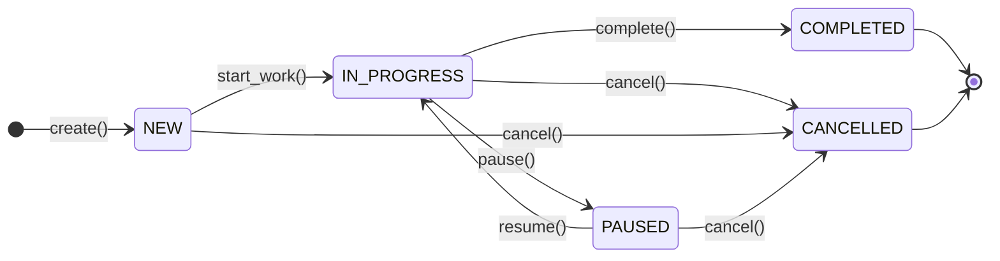
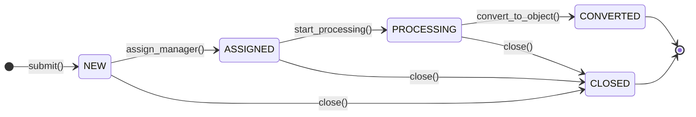
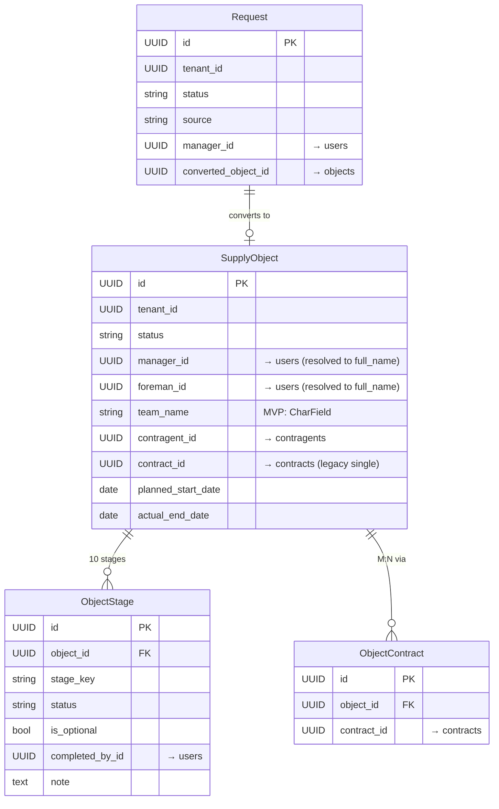
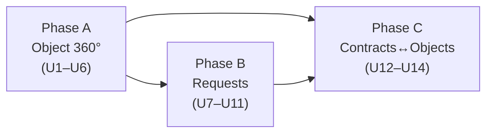

# feat: Object 360°, Requests, and Contracts↔Objects M:N

## Summary

Три последовательные фазы, образующие центральный операционный модуль ERP:

**(A) Object 360°** — расширение существующего `apps/objects/` до полноценного операционного модуля: статусная машина, фиксированный чеклист из 10 этапов, ответственные (менеджер/прораб), плановые и фактические даты, полный CRUD API и фронтенд (список + 360°-карточка с вкладками).

**(B) Requests → Object** — новый домен `apps/requests/` с воронкой заявок NEW → ASSIGNED → PROCESSING → CONVERTED → CLOSED и атомарной конвертацией заявки в SupplyObject через `ObjectCreatorProtocol` (ADR-0005).

**(C) Contract↔Object M:N** — junction-таблица `ObjectContract`, API link/unlink и вкладки «Договоры» на Object 360° и «Объекты» на Contract 360°.

Зависимости фаз: A → B (конвертация заявки создаёт SupplyObject) → C (ObjectContract ссылается на SupplyObject.id).

---

## Problem Frame

После реализации финансового фундамента (Этап 0) в системе нет операционного центра: директор не видит статус объектов, менеджер не видит воронку заявок, прораб не имеет чеклиста работ, договор не связан с физическим объектом. Эти три фазы закрывают весь операционный провал.

---

## Requirements

| ID | Требование |
|----|------------|
| R1 | SupplyObject имеет статус (NEW / IN_PROGRESS / PAUSED / COMPLETED / CANCELLED), плановые и фактические даты, ответственных (manager_id, foreman_id) |
| R2 | К каждому объекту привязан фиксированный чеклист из 10 этапов; каждый можно завершить, пропустить или вернуть в работу |
| R3 | Список объектов: фильтры по статусу, типу ресурса, менеджеру; cursor-пагинация |
| R4 | Object 360°: вкладки Основное / Этапы / Договоры; имена ответственных — через users API (паттерн useContragent) |
| R5 | Request хранит: имя клиента, телефон, адрес, тип ресурса, комментарий, источник (WEBSITE / MANUAL / PHONE), статус |
| R6 | Воронка Request: NEW → ASSIGNED (назначен менеджер) → PROCESSING → CONVERTED → CLOSED |
| R7 | Действие «Конвертировать в объект»: атомарно создаёт SupplyObject из Request и ставит статус CONVERTED |
| R8 | Contract↔Object M:N через `ObjectContract`; один объект может быть привязан к нескольким договорам |
| R9 | Object 360° → вкладка «Договоры» показывает связанные контракты с навигацией |
| R10 | Contract 360° → вкладка «Объекты» показывает связанные объекты с навигацией |

---

## Key Technical Decisions

### KTD-1: ObjectStage — фиксированный чеклист в коде, auto-create при создании объекта

10 этапов определены как `ObjectStageKey` enum — не в БД-таблице шаблонов. При каждом `ObjectCreateService.execute()` атомарно создаются 10 записей `ObjectStage` со статусом PENDING. `SITE_VISIT`, `INSTALLATION`, `TESTING` помечены `is_optional=True` — пользователь может перевести их в SKIPPED. Добавление нового этапа требует кодового изменения + Celery-backfill нового этапа (SKIPPED) для существующих объектов.

### KTD-2: Персонал — UUID в модели, разрешение имён на Query Side через UserInfoProtocol

`manager_id`, `foreman_id` на `SupplyObject` и `completed_by_id` на `ObjectStage` — `UUIDField` без ORM FK (ADR-0005). **Однако API возвращает разрешённые имена**: `manager: {id, full_name} | null`, `foreman: {id, full_name} | null` — директор не должен видеть сырые UUID.

Разрешение имён происходит в Query Side через `UserInfoProtocol` (новый Protocol в `apps/common/contracts/user_info_contracts.py`): метод `get_users_display(ids: list[UUID]) -> dict[UUID, UserDisplayDTO]`. Реализация в `apps/users/` делает batch-запрос в рамках tenant. Инжектируется в `get_object_detail()` и `get_objects_page()`.

**Team — MVP через `team_name: CharField`**: отдельная сущность Team (состав бригады, участники) — следующий этап. Сейчас `team_name: CharField(max_length=255, blank=True)` на SupplyObject — достаточно для отображения «Бригада №1», без нормализации.

### KTD-3: Request → Object конвертация через ObjectCreatorProtocol (ADR-0005)

По аналогии с `FinanceTransactionFinder`: `apps/common/contracts/objects_contracts.py` определяет `Protocol ObjectCreatorProtocol` с методом `create_supply_object(data: ObjectCreationDTO) -> UUID`. Реализация в `apps/objects/contracts/object_creator_impl.py`. `RequestConvertService` принимает протокол как аргумент; в API-слое инжектируется `DjangoObjectCreator()`. Конвертация атомарна: Request.status=CONVERTED и вызов creator в одной транзакции через `transaction.atomic()`.

### KTD-4: ObjectContract — intra-domain FK + cross-domain UUID ref

`ObjectContract` живёт в `apps/objects/models/object_contract.py`. ORM FK к `SupplyObject` (intra-domain — легально). `contract_id` — UUID без FK (ADR-0005). Уникальный индекс `(object_id, contract_id)`. Существующее поле `SupplyObject.contract_id` остаётся как «основной договор» (одиночная ссылка) — не удаляется в этом плане; депрекация через E&C — отдельный цикл после стабилизации M:N.

### KTD-5: RBAC ресурс requests — новая строка в PolicyEngine

`apps/requests/api.py` использует `require_permission("read"/"write", "requests")`. Новый RBAC-ресурс регистрируется в data migration: `Permission(action="read", resource="requests")` + `Permission(action="write", resource="requests")` добавляются в стандартные роли (`Director`, `Manager`).

---

## High-Level Technical Design

### Статусные машины


*SupplyObject.status*


*Request.status*

### Модель данных (ключевые связи)



### Фазовая зависимость



---

## Scope Boundaries

### В скоупе
- Phase A: SupplyObject расширения, ObjectStage, CRUD API, список + 360° фронтенд
- Phase B: apps/requests/, воронка, конвертация в Object
- Phase C: ObjectContract M:N, API, две вкладки на фронтенде

### Deferred to Follow-Up Work
- Этап 6 (Задачи): замена Telegram-поручений — отдельный домен
- Этап 7 (Фото и комментарии): timeline-комментарии на объекте
- Этап 8 (Мобильная работа): PWA/мобильный UX
- Этап 9 (Карта объектов): dashboard с GIS-картой
- Депрекация `SupplyObject.contract_id` → полный переход на ObjectContract (Expand & Contract, отдельный план)
- Batch users API endpoint (`/users/by-ids/`) — текущий план использует одиночные запросы, достаточно при <10 объектах на экране

### Out of scope
Публичный сайт (Этап 1), Подрядчики (Этап 10), Интеграции (Этап 12).

---

## Implementation Units

---

### U1. SupplyObject model extensions + migration

**Goal:** Расширить `SupplyObject` полями статуса, описания, дат и ответственных. Создать миграцию.

**Requirements:** R1

**Dependencies:** нет

**Files:**
- `backend/apps/objects/models/supply_object.py` — добавить `ObjectStatus`, поля
- `backend/apps/objects/migrations/0002_supply_object_extensions.py`

**Approach:** Новые поля:
```
status: CharField(ObjectStatus.choices, default=ObjectStatus.NEW, db_index=True)
description: TextField(blank=True, default="")
planned_start_date: DateField(null=True, blank=True)
planned_end_date: DateField(null=True, blank=True)
actual_start_date: DateField(null=True, blank=True)
actual_end_date: DateField(null=True, blank=True)
manager_id: UUIDField(null=True, blank=True, db_index=True)   # → users
foreman_id: UUIDField(null=True, blank=True, db_index=True)   # → users
team_name: CharField(max_length=255, blank=True, default="")  # MVP: "Бригада №1"
```
`status` с `default=NEW` — безопасно для PostgreSQL (DEFAULT применяется к существующим строкам при DDL, без full table scan). Миграция — одна операция `AddField` × 8 полей, обратима через `RemoveField`.

**Patterns to follow:** `apps/contracts/models/contract.py` — паттерн `ContractStatus(TextChoices)`, `db_index=True` на статусе.

**Test scenarios:**
- Новый `SupplyObject` создаётся с `status=NEW` по умолчанию
- `manager_id` и `foreman_id` принимают `None`
- Применение/откат миграции проходит без ошибок

**Verification:** `SupplyObject.objects.filter(status='NEW')` выполняется. Миграция применяется чисто.

---

### U2. ObjectStage модель + auto-create в ObjectCreateService

**Goal:** Создать `ObjectStage` модель с 10 предопределёнными ключами. При каждом создании объекта атомарно создавать 10 записей этапов. `StageUpdateService` для обновления статуса этапа.

**Requirements:** R2

**Dependencies:** U1

**Files:**
- `backend/apps/objects/models/object_stage.py` — `ObjectStageKey`, `ObjectStageStatus`, `ObjectStage`
- `backend/apps/objects/migrations/0003_object_stage.py`
- `backend/apps/objects/services/object_service.py` — расширить `ObjectCreateService.execute()` авто-созданием этапов
- `backend/apps/objects/services/stage_service.py` — новый `StageUpdateService`
- `backend/apps/objects/repositories/stage_repo.py` — `StageRepository`
- `backend/apps/objects/tests/test_stage_service.py`

**Approach:**

`ObjectStageKey` (enum, 10 значений):
`REQUEST_RECEIVED(10)`, `SITE_VISIT(20)`, `COST_ESTIMATION(30)`, `CONTRACT_SIGNING(40)`, `INITIAL_PAYMENT(50)`, `INSTALLATION(60)`, `TESTING(70)`, `FINAL_PAYMENT(80)`, `ACT_SIGNING(90)`, `CLOSURE(100)`.

Число в скобках — значение поля `order`.

Опциональные (`is_optional=True`): `SITE_VISIT`, `INSTALLATION`, `TESTING`.

`ObjectStage` поля: `object` (ForeignKey → SupplyObject, CASCADE, intra-domain FK), `stage_key`, `status(PENDING/IN_PROGRESS/COMPLETED/SKIPPED)`, `order`, `is_optional`, `completed_at(DateTime,null)`, `completed_by_id(UUID,null)`, `note(Text)`. UniqueConstraint `(object_id, stage_key)`.

`ObjectCreateService.execute()` — в одном `transaction.atomic()`: создать `SupplyObject`, затем `ObjectStage.objects.bulk_create([...10 записей...])`.

`StageUpdateService.update(object_id, stage_key, status, note, completed_by_id)`:
- Проверить `is_optional=True` если статус = SKIPPED
- Non-optional этапы нельзя перевести в SKIPPED → raise `ValidationError`
- `completed_at` устанавливается при `status=COMPLETED`
- Атомарный `update()` через `StageRepository`

**Patterns to follow:** `apps/objects/services/object_service.py` — паттерн `ObjectCreateService`, `ObjectRepository.create()`. `apps/contracts/services/` — паттерн `transaction.atomic()`.

**Test scenarios:**
- После `ObjectCreateService.execute()` в БД ровно 10 записей `ObjectStage` для объекта
- 3 из них имеют `is_optional=True` (SITE_VISIT, INSTALLATION, TESTING)
- `StageUpdateService`: `SITE_VISIT → SKIPPED` — успех
- `StageUpdateService`: `REQUEST_RECEIVED → SKIPPED` → `ValidationError` (non-optional)
- `StageUpdateService`: `COST_ESTIMATION → COMPLETED` устанавливает `completed_at`
- `StageUpdateService`: SKIPPED → PENDING (unskip) работает
- Создание объекта без опциональных пропусков — все 10 этапов PENDING
- Tenant isolation: чужой `object_id` → PermissionDenied

**Verification:** Все тест-сценарии зелёные. Bulk create выполняется в одной транзакции.

---

### U3. Backend API — полный CRUD + stage transitions

**Goal:** PATCH endpoint для обновления полей объекта; GET detail с полным списком этапов; PATCH endpoint для обновления статуса этапа.

**Requirements:** R1, R2, R3

**Dependencies:** U1, U2

**Files:**
- `backend/apps/common/contracts/user_info_contracts.py` — `UserDisplayDTO`, `UserInfoProtocol`
- `backend/apps/users/contracts/user_info_impl.py` — `DjangoUserInfoProvider(UserInfoProtocol)`
- `backend/apps/objects/api.py` — добавить `PATCH /{id}/`, `PATCH /{id}/stages/{stage_key}/`
- `backend/apps/objects/schemas/object_dto.py` — `SupplyObjectUpdateRequest`, `SupplyObjectDetailResponse`, `ObjectStageResponse`, `StageUpdateRequest`
- `backend/apps/objects/queries/object_queries.py` — расширить `get_object_detail()` для включения этапов и разрешённых имён; добавить фильтры по `status`, `manager_id` в `get_objects_page()`
- `backend/apps/objects/services/object_service.py` — `ObjectUpdateService`
- `backend/apps/objects/tests/test_object_api.py` — расширить

**Approach:**

`UserInfoProtocol` (в `apps/common/contracts/user_info_contracts.py`):
- `UserDisplayDTO(frozen dataclass)`: `user_id: UUID`, `full_name: str`
- `UserInfoProtocol.get_users_display(ids: list[UUID], tenant_id: UUID) -> dict[UUID, UserDisplayDTO]`
- `DjangoUserInfoProvider` в `apps/users/contracts/` — выполняет batch `User.objects.filter(id__in=ids, tenant_id=tenant_id)`, возвращает dict. Инжектируется в query функции.

`SupplyObjectDetailResponse` включает:
```
manager: UserDisplayDTO | None
foreman: UserDisplayDTO | None
team_name: str
stages: list[ObjectStageResponse]
```
`get_object_detail(object_id, user_info: UserInfoProtocol)` — получает объект, собирает `[manager_id, foreman_id]`, вызывает `user_info.get_users_display(ids)`, возвращает enriched DTO.

`PATCH /{id}/` — обновляет: `name`, `address`, `description`, `status`, `planned_start_date`, `planned_end_date`, `actual_start_date`, `actual_end_date`, `manager_id`, `foreman_id`, `team_name`. Частичное обновление (все поля Optional). Запрещённые переходы: `COMPLETED → IN_PROGRESS` (без явного reopen). Через `ObjectUpdateService.execute(object_id, data)`.

`PATCH /{id}/stages/{stage_key}/` — принимает `{ status, note?, completed_by_id? }`. Делегирует `StageUpdateService.update()`.

`GET /{id}/` — возвращает `SupplyObjectDetailResponse` с `manager/foreman` как объектами `{id, full_name}`, `team_name`, `stages` (упорядочены по `order`).

`GET /` — добавить query-params: `status`, `manager_id` к существующим фильтрам.

**Patterns to follow:** `apps/contracts/api.py` — паттерн partial update через Pydantic Optional fields. `apps/objects/api.py` — существующий паттерн `require_permission`.

**Test scenarios:**
- `GET /{id}/` возвращает `manager: {id, full_name}`, не сырой UUID
- `GET /{id}/` с объектом без manager → `manager: null`
- `GET /{id}/` возвращает `stages` список из 10 элементов упорядоченных по `order`
- `GET /{id}/` возвращает `team_name` строкой (пустая строка если не задана)
- `PATCH /{id}/` с `{"status": "IN_PROGRESS"}` → 200, объект обновлён
- `PATCH /{id}/` с `{"team_name": "Бригада №2"}` → 200
- `PATCH /{id}/` без авторизации → 403
- `PATCH /{id}/` чужого тенанта → 404/403
- `PATCH /{id}/stages/SITE_VISIT/` с `{"status": "SKIPPED"}` → 200
- `PATCH /{id}/stages/REQUEST_RECEIVED/` с `{"status": "SKIPPED"}` → 422
- `GET /?status=IN_PROGRESS` возвращает только активные объекты тенанта
- `UserInfoProtocol.get_users_display([])` → пустой dict (no DB query)
- `DjangoUserInfoProvider` соблюдает tenant isolation в batch-запросе

**Verification:** Все тесты зелёные. OpenAPI схема обновлена с новыми полями.

---

### U4. SDK регенерация + frontend типы

**Goal:** Регенерировать TypeScript SDK после изменений схемы бэкенда. Добавить/обновить хуки в `frontend/src/shared/api/objects.ts`.

**Requirements:** R1–R4

**Dependencies:** U3

**Files:**
- `frontend/src/shared/api/generated/` — регенерировать
- `frontend/src/shared/api/objects.ts` — хуки `useObjects`, `useObject`, `useUpdateObject`, `useUpdateObjectStage`

**Approach:** Запустить `make gen-sdk` (или эквивалент). Добавить хуки на TanStack Query:
- `useObjects(filters)` — GET /objects/ с фильтрами
- `useObject(id)` — GET /objects/{id}/ с stages
- `useUpdateObject(id)` — mutation PATCH /objects/{id}/
- `useUpdateObjectStage(objectId, stageKey)` — mutation PATCH /objects/{id}/stages/{key}/

**Patterns to follow:** `frontend/src/shared/api/contracts.ts` — TanStack Query hooks pattern.

**Test scenarios:**
- `useObject(id)` возвращает объект с полем `stages: ObjectStageResponse[]`
- `useUpdateObjectStage` инвалидирует кэш `useObject` после успеха
- TypeScript компиляция без ошибок (`tsc --noEmit`)

**Verification:** `tsc --noEmit` успешен. Хуки компилируются без ошибок.

---

### U5. Frontend: Objects list page

**Goal:** Заменить заглушку `/dashboard/objects/` полноценной страницей со списком, фильтрами и статус-бейджами.

**Requirements:** R3

**Dependencies:** U4

**Files:**
- `frontend/src/app/dashboard/objects/page.tsx`

**Approach:** Компоненты:
- Filter bar: `status` (select), `resource_type` (select), `manager_id` (UUID input или future lookup). Query params в URL.
- Таблица: Название объекта, Адрес, Тип ресурса, Статус (бейдж с цветом), Менеджер (UUID → имя через users), Дата создания, ссылка на деталь.
- Cursor pagination (Next / Previous кнопки).
- Empty state «Объектов нет».
- Кнопка «Создать объект» (модальное окно с формой).

Статус-бейджи: NEW=серый, IN_PROGRESS=синий, PAUSED=жёлтый, COMPLETED=зелёный, CANCELLED=красный.

**Patterns to follow:** `frontend/src/app/dashboard/contracts/page.tsx` — список с фильтрами и пагинацией. Статус-бейджи из `apps/contracts`.

**Test scenarios:**
- Страница рендерится без ошибок
- Фильтр по `status=IN_PROGRESS` обновляет список
- Empty state при нулевом результате
- Клик на объект ведёт на `/dashboard/objects/{id}`

**Verification:** Визуальная проверка. Список загружается с реальными данными.

---

### U6. Frontend: Object 360° detail page

**Goal:** `/dashboard/objects/{id}/` — 360°-карточка с вкладками: Основное (поля + ответственные), Этапы (чеклист), Договоры (Phase C, placeholder до U13).

**Requirements:** R4

**Dependencies:** U4, U5

**Files:**
- `frontend/src/app/dashboard/objects/[id]/page.tsx`
- `frontend/src/app/dashboard/objects/[id]/components/StagesChecklist.tsx`
- `frontend/src/app/dashboard/objects/[id]/components/ObjectMainTab.tsx`

**Approach:**

Три вкладки (tabs компонент):

**«Основное»**: поля SupplyObject. Manager/Foreman: `useUser(manager_id)` — аналог `useContragent`. Ссылка на контрагента через `useContragent(contragent_id)`. Кнопки «Редактировать» (inline form), «Сменить статус».

**«Этапы»**: список из 10 stages, упорядочен по `order`. Каждый этап:
- Иконка статуса (PENDING=⬜, IN_PROGRESS=🔵, COMPLETED=✅, SKIPPED=➖)
- Название этапа (из локального маппинга `stage_key → label`)
- Кнопки: «В работе» / «Завершить» / «Пропустить» (только is_optional=true) / «Вернуть»
- Поле комментария (expandable)
Мутация через `useUpdateObjectStage`.

**«Договоры»**: placeholder "Функция появится в следующем обновлении" до реализации Phase C.

**Patterns to follow:** `frontend/src/app/dashboard/contragents/[id]/page.tsx` — паттерн вкладок, skeleton-загрузка, breadcrumb.

**Test scenarios:**
- Страница загружается без ошибок, три вкладки видны
- Вкладка «Этапы» показывает 10 строк
- «Завершить» на COST_ESTIMATION → этап переходит в COMPLETED (оптимистичное обновление)
- «Пропустить» на SITE_VISIT (is_optional) → переходит в SKIPPED
- «Пропустить» на REQUEST_RECEIVED → кнопка отсутствует (не опциональный)
- Manager/Foreman имена загружаются (skeleton → имя)

**Verification:** Визуальная проверка. Browser QA — чеклист работает интерактивно.

---

### U7. Request модель + миграция + ObjectCreatorProtocol

**Goal:** Создать `apps/requests/` домен: модель Request, миграция, Protocol для конвертации в объект.

**Requirements:** R5, R7

**Dependencies:** U1 (SupplyObject должен принимать расширенные поля)

**Files:**
- `backend/apps/requests/__init__.py`
- `backend/apps/requests/apps.py`
- `backend/apps/requests/models/__init__.py`
- `backend/apps/requests/models/request.py` — `RequestStatus`, `RequestSource`, `Request`
- `backend/apps/requests/migrations/0001_initial.py`
- `backend/apps/common/contracts/objects_contracts.py` — `ObjectCreationDTO`, `ObjectCreatorProtocol`
- `backend/apps/objects/contracts/__init__.py`
- `backend/apps/objects/contracts/object_creator_impl.py` — `DjangoObjectCreator`
- `backend/config/settings/base.py` — добавить `"apps.requests"` в INSTALLED_APPS

**Approach:**

```
Request поля:
  client_name: CharField(255)
  client_phone: CharField(20)
  client_email: CharField(255, blank=True)
  address: CharField(500)
  resource_type: CharField(ResourceType.choices)
  comment: TextField(blank=True)
  source: CharField(RequestSource.choices, default=MANUAL)
  status: CharField(RequestStatus.choices, default=NEW, db_index=True)
  manager_id: UUIDField(null=True)
  converted_object_id: UUIDField(null=True)
  converted_at: DateTimeField(null=True)

  Meta: db_table = "requests_requests"
```

`ObjectCreationDTO(frozen dataclass)`: name, address, resource_type, contragent_id?, source_request_id?.

`ObjectCreatorProtocol`: метод `create_supply_object(data: ObjectCreationDTO) -> UUID`.

`DjangoObjectCreator(ObjectCreatorProtocol)` в `apps/objects/contracts/`: вызывает `ObjectCreateService.execute()`, возвращает UUID.

**Patterns to follow:** `apps/common/contracts/finance_contracts.py` — паттерн Protocol + DTO. `apps/contracts/models/contract.py` — паттерн модели.

**Test scenarios:**
- `Request` создаётся с `status=NEW`
- `DjangoObjectCreator.create_supply_object(dto)` создаёт SupplyObject и возвращает его UUID
- `isinstance(DjangoObjectCreator(), ObjectCreatorProtocol)` → True (runtime_checkable)
- Миграция применяется / откатывается без ошибок

**Verification:** `python -c "import apps.requests"` в контейнере. Unit-тесты Protocol зелёные.

---

### U8. Request service + repository

**Goal:** `RequestRepository` с tenant isolation, сервисы для каждого шага воронки.

**Requirements:** R6, R7

**Dependencies:** U7

**Files:**
- `backend/apps/requests/repositories/request_repo.py`
- `backend/apps/requests/services/request_create_service.py`
- `backend/apps/requests/services/request_workflow_service.py` — assign, process, convert, close
- `backend/apps/requests/tests/test_request_workflow.py`

**Approach:**

`RequestRepository`: паттерн `ObjectRepository` — `get_queryset()` фильтрует по `tenant_id` и `is_deleted=False`.

`RequestCreateService.execute(data)` → создаёт Request, возвращает его.

`RequestWorkflowService`:
- `assign(request_id, manager_id)`: NEW|ASSIGNED → ASSIGNED
- `start_processing(request_id)`: ASSIGNED → PROCESSING
- `convert(request_id, creator: ObjectCreatorProtocol)`: PROCESSING → CONVERTED; `transaction.atomic()`: создать объект через creator, установить `converted_object_id`, `converted_at`, `status=CONVERTED`
- `close(request_id)`: NEW|ASSIGNED|PROCESSING → CLOSED

Все методы проверяют допустимость перехода и бросают `ValidationError` при нарушении.

**Patterns to follow:** `apps/contracts/services/contract_activate_service.py` — паттерн перехода статуса с `transaction.atomic()`.

**Test scenarios:**
- `assign()` переводит NEW → ASSIGNED, устанавливает manager_id
- `assign()` на CONVERTED → ValidationError
- `convert()` атомарно создаёт SupplyObject и ставит CONVERTED
- `convert()` при ошибке ObjectCreator откатывает транзакцию (Request остаётся PROCESSING)
- `close()` работает из NEW, ASSIGNED, PROCESSING
- `close()` на CONVERTED → ValidationError
- Tenant isolation: операции на чужой заявке → PermissionDenied

**Verification:** Все тест-сценарии зелёные. `convert()` проходит без реального DB-вызова (mock ObjectCreatorProtocol в unit-тестах).

---

### U9. Request API endpoints + RBAC + sidebar nav

**Goal:** CRUD endpoints для заявок, все шаги воронки, регистрация RBAC-ресурса.

**Requirements:** R5, R6, R7

**Dependencies:** U8

**Files:**
- `backend/apps/requests/schemas/request_dto.py`
- `backend/apps/requests/api.py`
- `backend/config/urls.py` — зарегистрировать requests router
- `backend/config/settings/base.py` — `"apps.requests"` уже добавлен в U7
- `backend/apps/requests/migrations/0002_rbac_data.py` — data migration: Permission(read/write, requests)

**Approach:**

Endpoints:
```
GET  /requests/           → list (cursor pagination, фильтры: status, manager_id, resource_type)
POST /requests/           → create (require_permission write, requests)
GET  /requests/{id}/      → detail
POST /requests/{id}/assign/      → body: {manager_id}
POST /requests/{id}/process/     → no body
POST /requests/{id}/convert/     → no body; создаёт объект через DjangoObjectCreator()
POST /requests/{id}/close/       → no body
```

`convert/` endpoint в ответ возвращает `{ "object_id": UUID }` для навигации на фронтенде.

Data migration 0002: `Permission.objects.bulk_create([..read,write для requests..])` для ролей Director и Manager.

**Patterns to follow:** `apps/objects/api.py` — паттерн `require_permission`, Router, cursor pagination. `apps/contracts/api.py` — action endpoints через `POST /{id}/action/`.

**Test scenarios:**
- `GET /requests/` → 200 с cursor pagination
- `POST /requests/` с валидными данными → 201
- `POST /requests/{id}/convert/` → 201 с `object_id` в теле; объект создан
- `GET /requests/` без авторизации → 403
- Tenant isolation: чужая заявка в convert → 403/404
- `POST /requests/{id}/assign/` без `manager_id` → 422

**Verification:** OpenAPI схема содержит новые endpoints. Все тесты зелёные.

---

### U10. Frontend: Requests list page + sidebar nav

**Goal:** `/dashboard/requests/` — список заявок с фильтрами, статус-воронка, пункт в боковом меню.

**Requirements:** R5, R6

**Dependencies:** U9 (SDK регенерирован после U9)

**Files:**
- `frontend/src/app/dashboard/requests/page.tsx`
- `frontend/src/shared/api/requests.ts` — хуки `useRequests`, `useRequest`, `useCreateRequest`, `useAssignRequest`, `useConvertRequest`, `useCloseRequest`
- `frontend/src/app/dashboard/layout.tsx` — добавить `{ href: '/dashboard/requests', label: 'Заявки', permission: 'requests.read' }` в `NAV_ITEMS`

**Approach:** Воронка-счётчики над таблицей (NEW / ASSIGNED / PROCESSING). Таблица: клиент, адрес, тип ресурса, источник, статус (бейдж), ответственный, дата. Фильтры: status, resource_type. Кнопка «Новая заявка» → modal с формой. Пункт меню «Заявки» виден для `requests.read`.

**Patterns to follow:** `frontend/src/app/dashboard/contracts/page.tsx` — паттерн списка.

**Test scenarios:**
- Пункт «Заявки» в навигации для пользователя с `requests.read`
- Страница загружается, счётчики воронки видны
- Кнопка «Новая заявка» открывает форму
- Empty state «Заявок нет»

**Verification:** Визуальная проверка. Nav link кликабелен.

---

### U11. Frontend: Request detail + Convert to Object

**Goal:** `/dashboard/requests/{id}/` — деталь заявки, кнопки действий по воронке, «Конвертировать в объект» с навигацией.

**Requirements:** R6, R7

**Dependencies:** U10

**Files:**
- `frontend/src/app/dashboard/requests/[id]/page.tsx`

**Approach:** Отображение всех полей заявки. Action bar с доступными кнопками по статусу:
- NEW: «Назначить менеджера» (выбор менеджера → `useAssignRequest`), «Закрыть»
- ASSIGNED: «Взять в работу», «Закрыть»
- PROCESSING: **«Конвертировать в объект»** (основная CTA), «Закрыть»
- CONVERTED: ссылка «Перейти к объекту» (`/dashboard/objects/{converted_object_id}`)
- CLOSED: только просмотр

«Конвертировать в объект» — предварительный confirmation dialog («Создать объект на основе заявки?»), затем `useConvertRequest.mutate()`, при успехе — `router.push('/dashboard/objects/' + data.object_id)`.

**Patterns to follow:** `frontend/src/app/dashboard/contragents/[id]/page.tsx` — detail page pattern.

**Test scenarios:**
- Страница PROCESSING показывает кнопку «Конвертировать в объект»
- После конвертации — redirect на страницу объекта
- Страница CONVERTED показывает ссылку на объект
- Кнопки соответствуют статусу заявки

**Verification:** Визуальная проверка и Browser QA конвертации end-to-end.

---

### U12. ObjectContract model + service + API

**Goal:** M:N junction таблица ObjectContract, сервис link/unlink, API endpoints.

**Requirements:** R8

**Dependencies:** U1

**Files:**
- `backend/apps/objects/models/object_contract.py` — `ObjectContract`
- `backend/apps/objects/migrations/0004_object_contract.py`
- `backend/apps/objects/repositories/object_contract_repo.py`
- `backend/apps/objects/services/object_contract_service.py` — `ObjectContractService`
- `backend/apps/objects/api.py` — добавить endpoints для contracts link

**Approach:**

`ObjectContract` поля: `object` (FK → SupplyObject, CASCADE, intra-domain), `contract_id` (UUID, cross-domain без FK), `tenant_id` (скопировать из SupplyObject при создании).
UniqueConstraint `(object_id, contract_id)`. Индекс `(contract_id, tenant_id)` для обратного поиска.

`ObjectContractService`:
- `link(object_id, contract_id)` — проверить SupplyObject существует (tenant scope), `get_or_create ObjectContract`
- `unlink(object_id, contract_id)` — soft_delete или прямой DELETE (физическое удаление — нет финансовой истории в junction)

Endpoints добавляются в `apps/objects/api.py`:
```
POST   /objects/{id}/contracts/          → body: {contract_id}, link
DELETE /objects/{id}/contracts/{cid}/    → unlink
GET    /objects/{id}/contracts/          → list contract_ids [{contract_id, ...}]
```

Обратный поиск для фронтенда Contract→Objects через существующий `GET /objects/?contract_id=` (фильтрует по `SupplyObject.contract_id` — legacy) или через объединение. Для Phase C добавить отдельный эндпоинт:
```
GET    /objects/by-contract/{contract_id}/  → list SupplyObject через ObjectContract JOIN
```

**Patterns to follow:** `apps/objects/repositories/object_repo.py`. `apps/objects/services/object_service.py`. `apps/common/models/base.py` — BaseEnterpriseModel.

**Test scenarios:**
- `POST /objects/{id}/contracts/` с валидным `contract_id` → 201
- Повторный link с тем же `contract_id` → 200 (idempotent: get_or_create)
- `DELETE /objects/{id}/contracts/{cid}/` → 204, запись удалена
- `GET /objects/{id}/contracts/` → список UUID договоров
- `GET /objects/by-contract/{contract_id}/` → объекты, привязанные через ObjectContract
- Tenant isolation: нельзя привязать чужой объект
- Миграция: forward/backward без ошибок

**Verification:** Все тесты зелёные. M:N работает через API.

---

### U13. Frontend: Object 360° → вкладка «Договоры»

**Goal:** Заменить placeholder на работающую вкладку «Договоры» в Object 360°.

**Requirements:** R9

**Dependencies:** U12, U4

**Files:**
- `frontend/src/app/dashboard/objects/[id]/page.tsx` — обновить вкладку «Договоры»
- `frontend/src/app/dashboard/objects/[id]/components/ContractsTab.tsx`
- `frontend/src/shared/api/objects.ts` — добавить `useObjectContracts`, `useLinkContract`, `useUnlinkContract`

**Approach:**

Вкладка «Договоры» (компонент `ContractsTab`):
- Список связанных договоров: `useObjectContracts(objectId)` → список `contract_id[]`
- Для каждого ID: `useContract(contract_id)` → имя + статус + номер + ссылка на `/dashboard/contracts/{id}`
- Кнопка «Добавить договор»: UUID input → `useLinkContract.mutate()`
- Кнопка «Отвязать» (иконка ×) → `useUnlinkContract.mutate()`
- Empty state «Договоров нет»

**Patterns to follow:** `frontend/src/app/dashboard/contragents/[id]/page.tsx` — вкладка «Договоры» (Phase P2 из предыдущего плана, `useContracts({contragent_id})`).

**Test scenarios:**
- Вкладка показывает список связанных договоров
- Клик по договору ведёт на `/dashboard/contracts/{id}`
- Добавить/Отвязать обновляют список (инвалидация кэша)
- Empty state при 0 договорах

**Verification:** Визуальная проверка. Привязка/отвязка работает в браузере.

---

### U14. Frontend: Contract detail → вкладка «Объекты»

**Goal:** Добавить вкладку «Объекты» на страницу детали договора.

**Requirements:** R10

**Dependencies:** U12

**Files:**
- `frontend/src/app/dashboard/contracts/[id]/page.tsx` — добавить вкладку «Объекты»
- `frontend/src/shared/api/objects.ts` — добавить `useContractObjects(contractId)`

**Approach:**

На странице Contract 360° добавить новую вкладку «Объекты». Хук `useContractObjects(contractId)` вызывает `GET /objects/by-contract/{contractId}/`. Список объектов: Название, Адрес, Статус (бейдж), тип ресурса, ссылка на `/dashboard/objects/{id}`. Empty state «Объектов нет».

**Patterns to follow:** `frontend/src/app/dashboard/contracts/[id]/page.tsx` — существующая структура страницы, текущие вкладки.

**Test scenarios:**
- Новая вкладка «Объекты» появляется на странице договора
- Список объектов загружается
- Клик ведёт на `/dashboard/objects/{id}`
- Empty state при 0 объектах

**Verification:** Визуальная проверка. Browser QA навигации Contract → Object и обратно.

---

## System-Wide Impact

- 3 новых домена/расширения: `apps/requests/` (новый), `apps/objects/` (расширение), `apps/objects/models/object_contract.py` (новый)
- 4 новых миграции: `0002_supply_object_extensions`, `0003_object_stage`, `apps/requests/0001_initial`, `0004_object_contract`
- 1 data migration: RBAC permissions для `requests`
- 2 новых Protocol: `apps/common/contracts/objects_contracts.py` (`ObjectCreatorProtocol`), `apps/common/contracts/user_info_contracts.py` (`UserInfoProtocol`)
- SDK регенерация после U3 и U9
- `config/settings/base.py` — `"apps.requests"` в INSTALLED_APPS
- `config/urls.py` — регистрация requests router
- `frontend/src/app/dashboard/layout.tsx` — новый пункт «Заявки» в nav

---

## Risks & Dependencies

| Риск | Митигация |
|------|-----------|
| `ObjectStage` bulk_create — 10 INSERT на каждое создание объекта | `bulk_create` в одной транзакции; при >100 объектах/сутки не критично |
| ADR-0005: `DjangoObjectCreator` в `apps/objects/contracts/` импортирует `ObjectCreateService` — это intra-domain, не cross-domain | Допустимо: оба в одном домене. CI-проверка не затронута |
| Phase C: `GET /objects/by-contract/{id}/` добавляет JOIN через ObjectContract — нагрузка | Индекс `(contract_id, tenant_id)` на ObjectContract; JOIN дешевле full scan |
| Конвертация Request → Object: если ObjectCreator бросает исключение, транзакция откатывается | `transaction.atomic()` гарантирует атомарность. Покрыто тест-сценарием |
| `SupplyObject.contract_id` + ObjectContract — два способа связи с договором | Документировано как техдолг; `contract_id` помечается `# legacy` комментарием |

---

## Deferred to Implementation

- Точные CSS-классы бейджей статуса и иконки этапов
- Способ SDK-регенерации (makefile target или manual)
- UI для выбора менеджера в заявке — UUID input vs. lookup dropdown (достаточно UUID для первой версии)
- Нужен ли `GET /users/{id}/` эндпоинт для отображения имён или достаточно `GET /users/` с фильтром — проверить при реализации U5/U6
