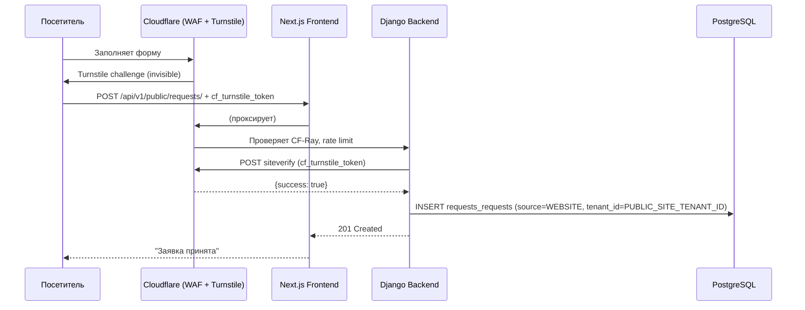
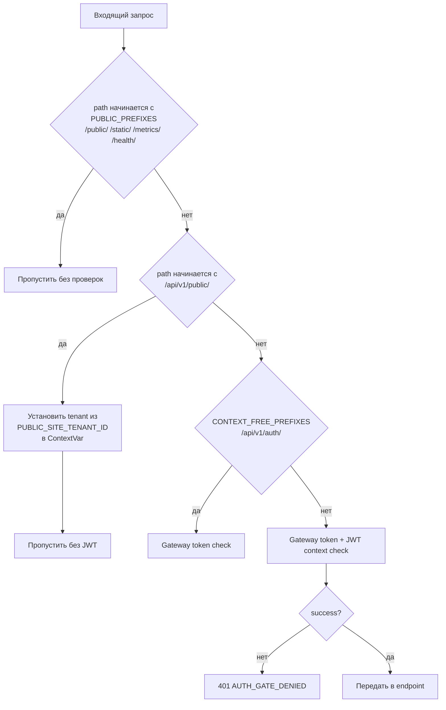
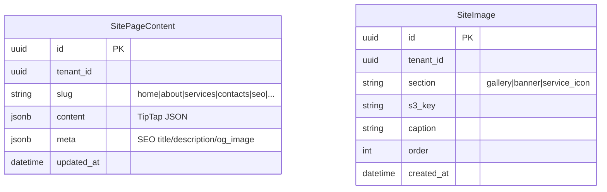

## Summary

Добавить публичный маркетинговый сайт в существующее Next.js приложение (7 страниц + форма заявки), CMS-раздел в ERP Dashboard для редактирования контента без деплоя, и кнопку «Войти» в публичном хедере. Форма заявки создаёт `Request` в ERP через защищённый Cloudflare Turnstile публичный endpoint.

---

## Problem Frame

Публичный сайт компании существует отдельно от ERP. Контент правится разработчиком. Заявки с сайта не попадают в систему автоматически. Цель — один портал: сайт + ERP на одном домене и одном Next.js приложении.

---

## Requirements Trace

| Req | Источник | Единица реализации |
|-----|----------|-------------------|
| F1 — публичные страницы без аутентификации | AE-1, AE-6 | U7, U8 |
| F2 — форма заявки → Request в ERP | AE-2, AE-3, AE-4 | U5, U9 |
| F3 — вход сотрудника через /login | AE-5 | U7 (кнопка Войти) |
| F4 — редактирование контента в CMS | AE-7, AE-8, AE-9 | U6, U11 |
| D2 — публичный endpoint вне RBAC | — | U4, U5 |
| D3 — Cloudflare Turnstile | — | U5 |
| D4 — tenant из env | — | U4 |

---

## Key Technical Decisions

**KTD-1: SSR без кэша для публичных страниц**
Глобальный `export const dynamic = 'force-dynamic'` уже выставлен в `frontend/src/app/layout.tsx`. Cloudflare кэширует на edge. ISR с on-demand revalidation не нужен — сложность без выигрыша при наличии CF.

**KTD-2: TipTap JSON в `JSONField`**
Rich-text хранится как ProseMirror JSON (`{type: "doc", content: [...]}`) в `django.db.models.JSONField`. Не HTML — нет XSS-рисков, не нужна санация. На фронте рендерится через `@tiptap/react` `generateHTML()` или `<EditorContent readonly>`.

**KTD-3: `/api/v1/public/` prefix + новый раздел `PUBLIC_PREFIXES`**
`AsgiTenantEnforcementMiddleware` уже имеет `PUBLIC_PREFIXES`. Добавляем `/api/v1/public/` с особой ветвью: пропускает gateway-token check И устанавливает tenant из `settings.PUBLIC_SITE_TENANT_ID` в ContextVar. Это отличает public от `/public/` (статика) и от `/api/v1/auth/` (context-free).

**KTD-4: Cloudflare Turnstile server-side verify**
Endpoint принимает `cf_turnstile_token` в теле запроса. Backend делает `POST https://challenges.cloudflare.com/turnstile/v0/siteverify` с `secret` из `settings.CF_TURNSTILE_SECRET_KEY`. При неудаче возвращает HTTP 422. Rate limiting — на уровне CF WAF (правило по IP).

**KTD-5: ADR-0023 для security model**
Решение о публичном endpoint без аутентификации фиксируется в `docs/adr/0023-public-lead-form-security-model.md` (см. U1).

---

## High-Level Technical Design

### Маршрутизация запросов (публичная форма)



### Middleware decision tree



### Модель данных CMS



---

## Output Structure (новые файлы)

```
backend/apps/site/
├── __init__.py
├── apps.py
├── migrations/
│   └── 0001_initial.py
├── models/
│   ├── __init__.py
│   └── site_content.py        # SitePageContent, SiteImage
├── schemas/
│   ├── __init__.py
│   ├── public_dto.py           # PublicLeadFormRequest, PublicPageContentResponse
│   └── cms_dto.py              # CmsPageContentResponse, CmsPageUpdateRequest
├── queries/
│   └── cms_queries.py
├── services/
│   ├── turnstile_service.py    # verify_turnstile()
│   └── cms_update_service.py
├── api/
│   ├── __init__.py
│   ├── public_api.py           # router для /api/v1/public/
│   └── cms_api.py              # router для /api/v1/cms/
└── tests/
    ├── test_public_api.py
    └── test_cms_api.py

docs/adr/
└── 0023-public-lead-form-security-model.md

frontend/src/app/(public)/
├── layout.tsx                  # Public layout (header + footer)
├── page.tsx                    # / Главная
├── about/page.tsx
├── services/
│   ├── page.tsx
│   └── [slug]/page.tsx
├── contacts/page.tsx
├── privacy/page.tsx
└── terms/page.tsx

frontend/src/shared/ui/public/
├── PublicHeader.tsx
└── PublicFooter.tsx

frontend/src/app/dashboard/cms/
├── page.tsx                    # CMS index
└── [section]/page.tsx          # Editor per section
```

---

## Scope Boundaries

### В скопе
- 7 публичных страниц (контент из CMS)
- Форма заявки с Turnstile → Request в ERP
- CMS в Dashboard (rich-text TipTap, простые поля, галерея)
- Кнопка «Войти» в публичном хедере
- ADR-0023
- ResourceType: добавить SEWAGE, CONSTRUCTION

### Deferred to Follow-Up Work
- Онлайн-оплата заявок
- Трекинг статуса заявки по SMS/ссылке
- Многоязычность
- Страница «Сотрудники»

### Outside this product's identity
- Кабинет клиента / личный кабинет
- Саморегистрация сотрудников
- Блог / новостной раздел

---

## Implementation Units

---

### U1. ADR-0023 — Public Lead Form Security Model

**Goal:** Зафиксировать архитектурное решение о публичном endpoint без аутентификации.

**Requirements:** D2, D3, D4

**Dependencies:** нет

**Files:**
- `docs/adr/0023-public-lead-form-security-model.md` (создать)

**Approach:** Описать: почему Turnstile, а не reCAPTCHA; как tenant-from-config защищает от multi-tenant утечки; почему `/api/v1/public/` prefix выбран вместо отдельного Django-приложения. Формат — стандартный ADR (Context, Decision, Consequences).

**Patterns to follow:** `docs/adr/0007-api-gateway-trust-boundary.md` — формат и структура.

**Test scenarios:** `Test expectation: none — документационный артефакт.`

**Verification:** Файл ADR создан, зафиксирован в реестре `docs/adr/` and reflected in `AGENTS.md` where an operational rule is needed.

---

### U2. ResourceType migration — SEWAGE, CONSTRUCTION

**Goal:** Добавить виды деятельности «Водоотведение» и «Строительство» в модель Request.

**Requirements:** F2 (форма заявки должна принимать все виды из публичного сайта)

**Dependencies:** нет

**Files:**
- `backend/apps/requests/models/request.py` (изменить)
- `backend/apps/requests/migrations/0002_add_resource_types.py` (создать)

**Approach:** Добавить `SEWAGE = "SEWAGE", "Водоотведение"` и `CONSTRUCTION = "CONSTRUCTION", "Строительство"` в `ResourceType`. Миграция только `AlterField` — additive, нет блокирующих изменений.

**Patterns to follow:** `backend/apps/requests/migrations/0001_initial.py`

**Test scenarios:**
- Создать Request с `resource_type=SEWAGE` — без ошибок
- Создать Request с `resource_type=CONSTRUCTION` — без ошибок
- Старые значения ELECTRICITY, GAS, WATER, HEAT, OTHER — продолжают работать

**Verification:** `make migrate` проходит; `Request.objects.create(resource_type="SEWAGE", ...)` не бросает исключение.

---

### U3. `apps/site` — Django app, модели, миграция

**Goal:** Создать Django-приложение `apps.site` с моделями `SitePageContent` и `SiteImage`.

**Requirements:** F4, AE-7, AE-9

**Dependencies:** нет (независимо от U2)

**Files:**
- `backend/apps/site/__init__.py`
- `backend/apps/site/apps.py`
- `backend/apps/site/models/__init__.py`
- `backend/apps/site/models/site_content.py`
- `backend/apps/site/migrations/0001_initial.py`
- `backend/config/settings/base.py` (добавить `"apps.site"` в `LOCAL_APPS`)
- `backend/apps/site/tests/__init__.py`

**Approach:**
- `SitePageContent(BaseEnterpriseModel)`: поля `slug CharField(max_length=50, db_index=True)`, `content JSONField(default=dict)`, `meta JSONField(default=dict)`. Уникальность по `(tenant_id, slug)`.
- `SiteImage(BaseEnterpriseModel)`: поля `section CharField`, `s3_key CharField`, `caption CharField(blank=True)`, `order PositiveSmallIntegerField(default=0)`.
- Оба наследуют `BaseEnterpriseModel` (tenant_id, is_deleted, etc.) согласно rule 4.6.

**Patterns to follow:** `backend/apps/objects/models/supply_object.py` — пример BaseEnterpriseModel наследника.

**Test scenarios:**
- `SitePageContent.objects.create(tenant_id=..., slug="home", content={})` — без ошибок
- `SitePageContent.objects.filter(tenant_id=..., slug="home")` — возвращает запись
- Попытка создать дубль `(tenant_id, slug)` — IntegrityError

**Verification:** `make makemigrations site && make migrate` — без ошибок; таблицы `site_page_content` и `site_images` существуют.

---

### U4. Middleware — public tenant context injection

**Goal:** Расширить `AsgiTenantEnforcementMiddleware` для `/api/v1/public/`: пропустить gateway+JWT, установить tenant из `settings.PUBLIC_SITE_TENANT_ID`.

**Requirements:** D2, D4

**Dependencies:** U3 (tenant должен существовать в БД)

**Files:**
- `backend/apps/common/tenancy/middleware.py` (изменить)
- `backend/config/settings/base.py` (добавить `PUBLIC_SITE_TENANT_ID`, `CF_TURNSTILE_SECRET_KEY`)
- `backend/config/settings/local.py` (заглушки для dev)
- `backend/apps/common/tests/test_public_middleware.py` (создать)

**Approach:**
```
PUBLIC_API_PREFIX = "/api/v1/public/"
```
В `__call__` добавить ветвь до `CONTEXT_FREE_PREFIXES`:
```
if path.startswith(PUBLIC_API_PREFIX):
    tenant_id = UUID(settings.PUBLIC_SITE_TENANT_ID)
    set_tenant_id(tenant_id)
    # user_id: None — публичный запрос
    return self.get_response(request)
```
`get_tenant_id()` в endpoint'ах работает штатно. `get_user_id()` не вызывается (публичные endpoints не требуют actor_id).

**Patterns to follow:** `backend/apps/common/tenancy/middleware.py` — существующая структура ветвей.

**Test scenarios:**
- GET `/api/v1/public/cms/home/` без заголовков → 200 (tenant установлен из settings)
- GET `/api/v1/cms/` без JWT → 401 (PUBLIC_API_PREFIX не совпадает, идёт в обычную ветвь)
- `PUBLIC_SITE_TENANT_ID` не задан в settings → `ImproperlyConfigured` при старте
- Запрос к `/api/v1/public/` с некорректным UUID в `PUBLIC_SITE_TENANT_ID` → 500 логируется, 503 возвращается

**Verification:** `docker compose exec backend pytest apps/common/tests/test_public_middleware.py -v` — все тесты зелёные.

---

### U5. Public API router — GET content + POST lead form

**Goal:** Эндпоинты без аутентификации: получение контента страницы и создание заявки с Turnstile-верификацией.

**Requirements:** F1, F2, AE-1, AE-2, AE-3, AE-4

**Dependencies:** U3, U4

**Files:**
- `backend/apps/site/api/public_api.py` (создать)
- `backend/apps/site/schemas/public_dto.py` (создать)
- `backend/apps/site/services/turnstile_service.py` (создать)
- `backend/apps/site/queries/public_queries.py` (создать)
- `backend/config/urls.py` (добавить `public_router` на `/api/v1/public/`)
- `backend/apps/site/tests/test_public_api.py` (создать)

**Approach:**

`public_api.py` — два endpoint:
- `GET /api/v1/public/cms/{slug}/` → `PublicPageContentResponse(slug, content, meta)`. Читает `SitePageContent` по `(tenant_id, slug)`, возвращает `{}` если не найдено (graceful degradation).
- `POST /api/v1/public/requests/` → `PublicLeadFormRequest(client_name, client_phone, address, resource_type, client_email?, comment?, cf_turnstile_token)`. Вызывает `verify_turnstile()`, затем `RequestCreateService.execute(source="WEBSITE")`.

`turnstile_service.py`:
- `verify_turnstile(token: str, remote_ip: str) -> bool`
- POST к `https://challenges.cloudflare.com/turnstile/v0/siteverify` с `secret` и `response`
- `httpx` синхронный клиент, timeout=5s

**Patterns to follow:**
- `backend/apps/requests/api.py` — структура endpoint без RBAC
- `backend/apps/requests/services/request_create_service.py` — вызов сервиса

**Test scenarios:**
- `POST /api/v1/public/requests/` с валидными данными + mock Turnstile success → 201, Request создан с `source=WEBSITE`, `tenant_id=PUBLIC_SITE_TENANT_ID`
- Covers AE-2: Request создан, статус NEW
- Covers AE-4: Turnstile возвращает `{success: false}` → 422 `CAPTCHA_FAILED`
- Covers AE-3: пустой `client_name` → 422 Pydantic validation
- `GET /api/v1/public/cms/home/` → 200, возвращает `{slug: "home", content: {}}` если нет записи
- `GET /api/v1/public/cms/home/` → 200 с content после создания `SitePageContent`
- Turnstile timeout (httpx TimeoutException) → 503 `EXTERNAL_SERVICE_UNAVAILABLE`

**Verification:** `pytest apps/site/tests/test_public_api.py -v` — все тесты зелёные.

---

### U6. CMS API router — CRUD + `cms.write` RBAC

**Goal:** Эндпоинты для редактирования контента: получение и обновление `SitePageContent`, галерея изображений.

**Requirements:** F4, AE-7, AE-8, AE-9

**Dependencies:** U3, U4

**Files:**
- `backend/apps/site/api/cms_api.py` (создать)
- `backend/apps/site/schemas/cms_dto.py` (создать)
- `backend/apps/site/services/cms_update_service.py` (создать)
- `backend/apps/site/queries/cms_queries.py` (создать)
- `backend/apps/common/security/rbac_permissions.py` (добавить `cms.write`, `cms.read`)
- `backend/config/urls.py` (добавить `cms_router` на `/api/v1/cms/`)
- `backend/apps/site/tests/test_cms_api.py` (создать)

**Approach:**

`cms_api.py` — endpoints:
- `GET /api/v1/cms/pages/{slug}/` → `CmsPageContentResponse` — `@require_permission("read", "cms")`
- `PATCH /api/v1/cms/pages/{slug}/` → `CmsPageContentResponse` — `@require_permission("write", "cms")`. Upsert по `(tenant_id, slug)`.
- `GET /api/v1/cms/gallery/` → список `SiteImage` — `@require_permission("read", "cms")`
- `POST /api/v1/cms/gallery/` → upload через существующий files-модуль — `@require_permission("write", "cms")`

`cms_update_service.py`: `update_or_create_page(slug, content, meta, tenant_id)` — через `SitePageContent.objects.update_or_create(tenant_id=tenant_id, slug=slug, defaults={...})`.

**Patterns to follow:**
- `backend/apps/requests/api.py` — `@require_permission` паттерн
- `backend/apps/common/security/rbac_permissions.py` — регистрация новых permissions

**Test scenarios:**
- `GET /api/v1/cms/pages/home/` с валидным JWT + `cms.read` → 200
- Covers AE-8: `GET /api/v1/cms/` без `cms.write` → 403
- `PATCH /api/v1/cms/pages/about/` с `{content: {...TipTap JSON...}}` → 200, запись обновлена
- Covers AE-7: после PATCH `GET /api/v1/public/cms/about/` отдаёт новый контент
- `PATCH /api/v1/cms/pages/home/` в пустую БД → 201 upsert (создаётся запись)
- Covers AE-9: `POST /api/v1/cms/gallery/` с изображением → 201, SiteImage создан с `s3_key`

**Verification:** `pytest apps/site/tests/test_cms_api.py -v` — все тесты зелёные.

---

### U7. Frontend — routing restructure, `(public)` group, layout

**Goal:** Убрать редирект с `/`, создать route group `(public)` с общим layout (хедер + футер + кнопка «Войти»).

**Requirements:** F1, F3, AE-1, AE-5, AE-6

**Dependencies:** нет backend-зависимостей

**Files:**
- `frontend/src/app/page.tsx` (удалить redirect, файл удаляется или заменяется)
- `frontend/src/app/(public)/layout.tsx` (создать)
- `frontend/src/shared/ui/public/PublicHeader.tsx` (создать)
- `frontend/src/shared/ui/public/PublicFooter.tsx` (создать)

**Approach:**

Текущий `app/page.tsx` содержит `redirect('/dashboard')` — удалить файл. Next.js будет рендерить `(public)/page.tsx` для `/`.

`(public)/layout.tsx`:
- `<PublicHeader>` + `{children}` + `<PublicFooter>`
- НЕ содержит `Providers` (они в корневом `layout.tsx`)
- Server Component

`PublicHeader`:
- Логотип + навигация (Главная, О компании, Услуги, Контакты)
- Кнопка «Войти» → `href="/login"`

Covers AE-6: сотрудник открывает `/` — видит публичный сайт, не редирект на `/dashboard`.

**Patterns to follow:** `frontend/src/app/(auth)/login/page.tsx` — пример route group layout.

**Test scenarios:**
- `GET /` → рендерится `(public)/layout.tsx` с хедером и футером, без редиректа (Covers AE-1)
- `GET /` для залогиненного пользователя → публичный сайт (Covers AE-6, нет редиректа)
- Кнопка «Войти» → `href="/login"` (Covers AE-5)
- `GET /dashboard` → продолжает работать (dashboard route group изолирован)

**Verification:** `npx tsc --noEmit` без ошибок; `GET /` возвращает HTML без `Location: /dashboard`.

---

### U8. Frontend — 7 публичных страниц с CMS-контентом

**Goal:** Создать все публичные страницы с SSR-загрузкой контента из CMS API.

**Requirements:** F1, F4, AE-1, AE-7

**Dependencies:** U7, U10 (SDK должен содержать `PublicPageContentResponse`)

**Files:**
- `frontend/src/app/(public)/page.tsx` (Главная)
- `frontend/src/app/(public)/about/page.tsx`
- `frontend/src/app/(public)/services/page.tsx`
- `frontend/src/app/(public)/services/[slug]/page.tsx`
- `frontend/src/app/(public)/contacts/page.tsx`
- `frontend/src/app/(public)/privacy/page.tsx`
- `frontend/src/app/(public)/terms/page.tsx`
- `frontend/src/shared/ui/public/TiptapRenderer.tsx` (создать)

**Approach:**

Каждая страница — Server Component. Получает контент через `fetch('/api/v1/public/cms/{slug}/', {cache: 'no-store'})` на сервере.

`TiptapRenderer.tsx`:
- `'use client'` (нужен для `@tiptap/react`)
- Принимает `content: object` (TipTap JSON)
- Использует `generateHTML(content, extensions)` из `@tiptap/core` или `EditorContent` в `readonly` режиме

Страницы имеют skeleton-разделы (hero, преимущества, этапы, отзывы, форма) — контент приходит из CMS, структура зафиксирована в TSX.

Обработка пустого контента: если CMS не настроен (новая установка), показывать placeholder-тексты.

**Patterns to follow:**
- `frontend/src/app/dashboard/requests/[id]/page.tsx` — SSR page pattern
- `frontend/src/shared/api/requests.ts` — fetch hook pattern

**Test scenarios:**
- `GET /` → HTML содержит секции hero, преимущества, форма заявки
- `GET /about` → рендерится без ошибок, 200 OK
- `GET /services/electricity` → страница услуги с контентом из CMS slug `services-electricity`
- CMS вернул пустой `content` → placeholder-текст, нет ошибок
- TipTap JSON `{type:"doc", content:[{type:"paragraph", ...}]}` → рендерится как `<p>`

**Verification:** `tsc --noEmit` без ошибок; все 7 страниц отдают 200 в browser-qa.

---

### U9. Frontend — форма заявки с Cloudflare Turnstile

**Goal:** Форма на Главной с Turnstile-верификацией и отправкой на `/api/v1/public/requests/`.

**Requirements:** F2, AE-2, AE-3, AE-4

**Dependencies:** U7, U10

**Files:**
- `frontend/src/app/(public)/components/LeadForm.tsx` (создать)
- `frontend/src/shared/api/public.ts` (создать — `useSubmitLeadForm` hook)

**Approach:**

`LeadForm.tsx`:
- `'use client'`
- Поля: Имя*, Телефон*, Тип услуги (select из ResourceType), Email, Комментарий
- Cloudflare Turnstile: `@marsidev/react-turnstile` — invisible виджет
- `onSuccess(token)` → сохраняем token в state
- `handleSubmit` → `fetch('POST /api/v1/public/requests/', {body: {..., cf_turnstile_token: token}})`
- После успеха: inline сообщение «Заявка принята, мы свяжемся с вами»

Для dev-режима: `CF_TURNSTILE_SITE_KEY=1x00000000000000000000AA` (тестовый ключ CF, всегда success).

**Patterns to follow:**
- `frontend/src/app/(auth)/login/page.tsx` — React Hook Form + zod pattern

**Test scenarios:**
- Covers AE-2: заполнить форму валидными данными → успешный ответ, показать подтверждение
- Covers AE-3: отправить без имени → zod validation блокирует, кнопка недоступна
- Turnstile token получен → добавлен в тело запроса
- `resource_type=SEWAGE` присутствует в select-опциях
- После успешной отправки форма очищается, кнопка не двойной отправки (disabled during pending)

**Verification:** `tsc --noEmit` без ошибок; форма отправляется в browser-qa тесте.

---

### U10. SDK regeneration + API hooks

**Goal:** Регенерировать TS SDK после добавления public и CMS endpoint'ов; добавить типизированные hooks.

**Requirements:** Все frontend units зависят от корректных типов

**Dependencies:** U5, U6

**Files:**
- `frontend/src/shared/api/generated/schema.d.ts` (auto-generated)
- `frontend/src/shared/api/cms.ts` (создать)
- `frontend/src/shared/api/public.ts` (создать)

**Approach:**
- `make generate-sdk` → обновляет `schema.d.ts`
- `cms.ts`: `useCmsPage(slug)`, `useSaveCmsPage()` через TanStack Query
- `public.ts`: `useSubmitLeadForm()` — `useMutation` wrapper

**Patterns to follow:** `frontend/src/shared/api/requests.ts`, `frontend/src/shared/api/admin.ts`

**Test scenarios:** `Test expectation: none — генерируемый артефакт, типобезопасность проверяется tsc.`

**Verification:** `make generate-sdk` завершается без ошибок; `tsc --noEmit` на frontend без ошибок.

---

### U11. Frontend — CMS Dashboard раздел (TipTap редактор)

**Goal:** Раздел `/dashboard/cms/` для редактирования контента директором.

**Requirements:** F4, AE-7, AE-8, AE-9

**Dependencies:** U6, U10

**Files:**
- `frontend/src/app/dashboard/cms/page.tsx` (создать — index с навигацией по разделам)
- `frontend/src/app/dashboard/cms/[section]/page.tsx` (создать — редактор раздела)
- `frontend/src/app/dashboard/layout.tsx` (изменить — добавить CMS в nav, если есть `cms.read`)

**Approach:**

`cms/page.tsx` — список разделов: Главная, О компании, Услуги, Контакты, SEO, Баннеры, Галерея. Каждый раздел — карточка-ссылка на `/dashboard/cms/{section}`.

`cms/[section]/page.tsx`:
- `'use client'`
- Загружает `GET /api/v1/cms/pages/{section}/` через `useCmsPage(section)`
- TipTap editor в режиме редактирования (`<EditorContent editor={editor}>`)
- Простые поля (телефон, email, адрес) — обычные `<input>`
- Кнопка «Сохранить» → `PATCH /api/v1/cms/pages/{section}/`
- Кнопка «Предпросмотр» → открывает публичную страницу в новой вкладке

Covers AE-8: frontend читает JWT-роли из AuthStore, скрывает/перенаправляет если нет `cms.write`.

**Patterns to follow:**
- `frontend/src/app/dashboard/requests/[id]/page.tsx` — detail page с мутацией
- `frontend/src/app/dashboard/admin/` — пример dashboard раздела с RBAC-gate

**Test scenarios:**
- `GET /dashboard/cms/` с `cms.read` → список разделов, 200
- Covers AE-8: без `cms.write` → редирект или 403-страница
- `GET /dashboard/cms/about` → TipTap editor загружается с существующим контентом
- Нажать «Сохранить» → PATCH выполнен, toast «Сохранено»
- Covers AE-9: загрузить изображение в Галерея → SiteImage создан, превью показано
- После сохранения публичная страница `/about` отдаёт новый текст

**Verification:** `tsc --noEmit` без ошибок; browser-qa: директор меняет текст, сохраняет, публичная страница обновляется.

---

## Risks & Dependencies

| # | Риск | Митигация |
|---|------|-----------|
| R1 | `get_tenant_id()` выбрасывает `PermissionDenied` если `PUBLIC_SITE_TENANT_ID` не задан | `ImproperlyConfigured` при старте Django (проверка в `AppConfig.ready()`) |
| R2 | Turnstile timeout блокирует форму | `httpx` timeout=5s → 503 с retry-advice; CF WAF как первая линия |
| R3 | TipTap JSON incompatibility между версиями | Зафиксировать версию `@tiptap/core` в `package.json` |
| R4 | `PUBLIC_SITE_TENANT_ID` указывает на несуществующий tenant | Валидировать tenant в `AppConfig.ready()` |
| R5 | SSR fetch публичного контента медленный при холодном старте | CF кэширует на edge; при необходимости — ISR в будущем без изменения API |

---

## Open Questions (deferred to implementation)

| # | Вопрос |
|---|--------|
| Q-i1 | Конкретный slug-формат для услуг: `services-electricity` или `services/electricity`? Решить при реализации U8. |
| Q-i2 | Нужен ли отдельный `meta.og_image` upload endpoint или использовать существующий `files` модуль? |
| Q-i3 | Конкретные TipTap extensions (Bold, Italic, Link, List, Heading) — определить при создании editor в U11. |

---

## Sources & Research

- `backend/apps/common/tenancy/middleware.py` — `AsgiTenantEnforcementMiddleware` паттерн, `PUBLIC_PREFIXES`
- `backend/apps/requests/models/request.py` — `RequestSource.WEBSITE` уже существует
- `backend/apps/requests/services/request_create_service.py` — переиспользуется в U5
- `backend/config/urls.py` — паттерн регистрации router'ов
- `frontend/src/app/layout.tsx` — `export const dynamic = 'force-dynamic'` (глобальный SSR)
