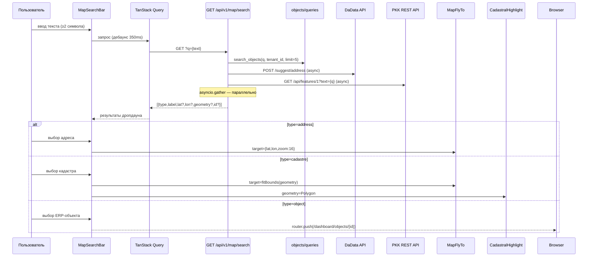

# feat: Единый поиск на карте + слой ЗОУИТ

## Summary

Добавить в `/dashboard/map` единую строку поиска, агрегирующую три источника через один
backend endpoint: ERP-объекты (по имени), адреса (DaData) и кадастровые участки (PKK).
Заменить слой OpenRailwayMap на охранные зоны ЗОУИТ Росреестра с feature-флагом.

---

## Problem Frame

Менеджер получает адрес или кадастровый номер и не может быстро найти его на карте — нет
поиска. Слой "Коммуникации" показывает только ж/д (OpenRailwayMap), тогда как для
электро-, газо- и водоснабжения нужны охранные зоны инженерных сетей (ЗОУИТ).

---

## Requirements Trace

| ID | Требование |
|----|-----------|
| F1 | Поиск по адресу → DaData → flyTo точке (zoom 16) |
| F2 | Поиск по кадастровому номеру → PKK API → flyTo + highlight polygon |
| F3 | Поиск по названию ERP-объекта → Object 360° |
| F4 | ЗОУИТ layer заменяет OpenRailwayMap; fallback если сервис недоступен |
| R1 | Единая строка поиска, тип запроса определяется автоматически |
| R2 | Агрегация на backend — DaData ключ не выставляется клиенту |
| R3 | Дебаунс 300–400ms, минимум 2 символа |
| R4 | DADATA_API_KEY через Django settings (env) |
| R5 | MAP_ZOUIT_ENABLED feature-флаг в settings |

---

## Key Technical Decisions

**Backend aggregation (не client-side):** DaData ключ остаётся на сервере. Один endpoint
`GET /api/v1/map/search?q=` агрегирует три источника параллельно (asyncio.gather) и
возвращает единый JSON. Frontend делает один запрос через TanStack Query.

**Размещение search endpoint:** `apps/map/api/search_api.py` — новый тонкий app без доменных
моделей. Импортирует из `apps/objects/queries/` только DTO (не ORM-модели) — допустимо по
ADR-0005 (запрет на импорт Model-классов, не Query-функций возвращающих DTO).

**ЗОУИТ URL:** `pkk.rosreestr.ru/arcgis/rest/services/PKK6/ZuitsPolygons/MapServer/tile/{z}/{y}/{x}`
— верифицируется при реализации. Если endpoint недоступен: `MAP_ZOUIT_ENABLED=False`,
слой деградирует до OpenRailwayMap. Tile URL проверить в браузере при zoom ≥ 10 над
любым городом — должна отображаться штриховка охранных зон.

**MapFlyTo bridge:** `useMap()` из react-leaflet работает только внутри `<MapContainer>`.
Компонент `<MapFlyTo target={...} />` рендерится как `null`, вызывает `map.flyTo()` /
`map.fitBounds()` через `useEffect` при смене `target`.

**Cadastral highlight pane:** Leaflet рендерит слои в фиксированном порядке. Для
отображения polygon поверх маркеров создаём кастомный pane с zIndex 450 (выше
`markerPane=600` не нужно, достаточно выше `tilePane=200`). Пульсация — CSS animation.

---

## High-Level Technical Design



---

## Scope Boundaries

**В scope:** F1–F4, R1–R5, новые apps/map/ и apps/integration/ (без доменных моделей),
MapSearchBar + MapFlyTo + CadastralHighlight компоненты.

**Deferred to Follow-Up Work:**
- Поиск по координатам (lat, lon) вручную
- LocationSection интеграция (поиск при создании объекта)
- Кэш DaData ответов (Redis TTL)
- Поиск по контрагентам и договорам на карте

**Не в scope:** маршрутизация, измерения, редактирование геометрий, мобильная карта,
тепловые карты, кадастровые отчёты PDF, НСПД (требует Госуслуги-авторизацию).

---

## Open Questions

- ЗОУИТ tile URL: верифицировать `PKK6/ZuitsPolygons/MapServer/tile/{z}/{y}/{x}` при
  реализации. Запасной вариант — `PKK6/ZONES/MapServer` или оставить OpenRailwayMap + флаг.
- Timeout для DaData и PKK: предлагается 3s; если один источник тормозит, возвращать
  частичный результат (без упавшего источника).

---

## Implementation Units

### U1. Backend: integration clients (DaData + PKK)

**Goal:** HTTP-клиенты для DaData Suggestions API и PKK REST API; используются из U2.

**Requirements:** R2, R4

**Dependencies:** —

**Files:**
- `backend/apps/integration/__init__.py` (create)
- `backend/apps/integration/dadata_client.py` (create)
- `backend/apps/integration/pkk_client.py` (create)
- `backend/config/settings/base.py` (modify — добавить `DADATA_API_KEY`)

**Approach:**
- `DaDataClient`: async httpx, метод `suggest_address(q: str, limit: int = 5) -> list[AddressSuggestion]`.
  Headers: `Authorization: Token {settings.DADATA_API_KEY}`, `Content-Type: application/json`.
  Endpoint: `https://suggestions.dadata.ru/suggestions/api/4_1/rs/suggest/address`.
  Таймаут 3s. Возвращает `AddressSuggestion(label, lat, lon)`.
- `PKKClient`: async httpx, метод `search_cadastre(q: str) -> CadastreResult | None`.
  Endpoint: `https://pkk.rosreestr.ru/api/features/1?text={q}&limit=1`.
  Таймаут 3s. Парсит `features[0].geometry` (Polygon/MultiPolygon) + центроид.
  При ошибке/timeout возвращает `None` (не падает весь поиск).
- Оба клиента — plain async functions, не классы-синглтоны, чтобы не хранить состояние.
- `DADATA_API_KEY = env("DADATA_API_KEY", default="")` — пустая строка = DaData отключён,
  адресный поиск вернёт пустой список.

**Patterns to follow:** `backend/apps/site/services/turnstile_service.py` — httpx, timeout,
обработка ошибок, возврат `None` при неуспехе.

**Test scenarios:**
- `suggest_address("Краснодар Северная")` → список `AddressSuggestion` с непустыми `lat`/`lon`
  (mock httpx response с фикстурой из реального DaData ответа)
- `suggest_address("")` → пустой список без HTTP-запроса
- DaData timeout (mock) → возвращает `[]` без исключения
- `search_cadastre("23:43:0123456:789")` → `CadastreResult` с `geometry` и `center`
- PKK вернул пустой `features` → `None`
- PKK timeout (mock) → `None`

**Verification:** `pytest apps/integration/tests/ -v` — все 6 сценариев зелёные.

---

### U2. Backend: map search API endpoint

**Goal:** `GET /api/v1/map/search?q=` — агрегирует ERP-объекты + DaData + PKK параллельно.

**Requirements:** F1, F2, F3, R1, R2, R3

**Dependencies:** U1

**Files:**
- `backend/apps/map/__init__.py` (create)
- `backend/apps/map/apps.py` (create)
- `backend/apps/map/api/__init__.py` (create)
- `backend/apps/map/api/search_api.py` (create)
- `backend/apps/map/schemas/search_dto.py` (create)
- `backend/config/urls.py` (modify — добавить `/api/v1/map/`)
- `backend/config/settings/base.py` (modify — добавить `apps.map` в INSTALLED_APPS)

**Approach:**
- Django Ninja Router, endpoint: `@router.get("/search", response=list[MapSearchResult])`
- Аутентификация стандартная (JWT, тот же Guard что и весь `/api/v1/`).
- Параметр `q: str = Query(min_length=2, max_length=200)`.
- Tenant isolation: ERP-объекты фильтруются через tenant-aware manager из `apps/objects/queries/`.
- Импорт из `apps/objects/queries/`: функция `search_objects_for_map(q, tenant_id, limit)` —
  возвращает list[ObjectMapDTO]. Это DTO (не Model), допустимо по ADR-0005.
- `asyncio.gather` для параллельного вызова DaData + PKK + objects query.
- `MapSearchResult` schema (Pydantic):
  ```
  type: Literal["object", "address", "cadastre"]
  label: str
  id: str | None        # для type=object
  lat: float | None
  lon: float | None
  geometry: dict | None  # GeoJSON для type=cadastre
  ```
- Результаты объединяются: objects первыми (приоритет ERP), затем addresses, затем cadastre.
  Лимит: 5 + 5 + 1 = max 11 результатов.
- Partial results: если один источник упал (exception caught), возвращаем остальные.

**Patterns to follow:** `backend/apps/objects/api/` — структура Django Ninja Router + схемы.
`backend/apps/site/api/public_api.py` — async endpoint pattern.

**Test scenarios:**
- `GET /api/v1/map/search?q=Солнечный` → results contain type=object with matching name
- `GET /api/v1/map/search?q=23:43:0123456:789` (кадастровый формат) → type=cadastre result
- `GET /api/v1/map/search?q=Краснодар Северная` → type=address results from DaData mock
- `GET /api/v1/map/search?q=a` (< 2 символа) → 422 validation error
- DaData упал (mock exception) → ответ 200 с objects + cadastre (без addresses)
- Другой тенант: объекты tenant_id=A не видны tenant_id=B запросу

**Verification:** `pytest apps/map/tests/ -v` — endpoint coverage + tenant isolation + partial
results. TypeScript SDK регенерируется после добавления endpoint.

---

### U3. Backend: `search_objects_for_map` query

**Goal:** Query-функция для поиска ERP-объектов по имени, вызываемая из U2.

**Requirements:** F3, R2

**Dependencies:** —

**Files:**
- `backend/apps/objects/queries/map_search.py` (create)

**Approach:**
- Функция `search_objects_for_map(q: str, tenant_id: UUID, limit: int = 5) -> list[ObjectMapDTO]`
- `ObjectMapDTO(id, name, address, lat, lon, status)` — только то, что нужно поиску.
- QuerySet: `Object.objects.filter(tenant_id=tenant_id, is_deleted=False)` +
  `.filter(Q(name__icontains=q) | Q(address__icontains=q))` + `[:limit]`
- Читает с read-replica (`.using("replica")`) по правилу 4.12.
- Не выполняет JOIN'ов, не грузит relations — минимальный SELECT.

**Patterns to follow:** `backend/apps/objects/queries/` — существующие query-функции.

**Test scenarios:**
- `search_objects_for_map("Солнечный", tenant_id)` → возвращает объекты с "Солнечный" в имени
- `search_objects_for_map("xyz_notexist", tenant_id)` → `[]`
- Объект другого тенанта не возвращается
- `is_deleted=True` объект не возвращается
- `limit=2`: возвращает не более 2 результатов

**Verification:** `pytest apps/objects/tests/ -k map_search -v` — 5 сценариев зелёные.

---

### U4. Frontend: useMapSearch hook + типы

**Goal:** TanStack Query хук для вызова `/api/v1/map/search`, типы результатов.

**Requirements:** R1, R3

**Dependencies:** U2 (backend endpoint должен быть доступен; для frontend можно мокировать)

**Files:**
- `frontend/src/shared/api/map.ts` (create)
- `frontend/src/shared/api/generated/` (regenerate SDK after U2)

**Approach:**
- `useMapSearch(q: string)`: TanStack Query `useQuery` с `queryKey: ['map-search', q]`.
- `enabled: q.trim().length >= 2` — не запрашиваем при коротких строках.
- `staleTime: 30_000` — результаты свежие 30s (поисковый autocomplete).
- Дебаунс 350ms реализуется в `MapSearchBar` (U5), не в хуке — хук принимает уже
  дебаунсированную строку.
- `MapSearchResult` type из сгенерированного SDK; если SDK ещё не регенерирован —
  временный локальный тип в `map.ts`.
- Тип выбранного результата: `SelectedResult = { type, lat?, lon?, geometry?, id? }`.

**Patterns to follow:** `frontend/src/shared/api/objects.ts` — useQuery паттерн, типы.

**Test scenarios:**
- `useMapSearch("")` → `{ data: undefined, isLoading: false }` (не делает запроса)
- `useMapSearch("Солнечный")` → `isLoading=true` → данные при разрешении
- (unit) тип `MapSearchResult` содержит все ожидаемые поля

**Verification:** `tsc --noEmit` без ошибок; хук виден в React DevTools при вводе в строку.

---

### U5. Frontend: MapSearchBar + MapFlyTo + CadastralHighlight компоненты

**Goal:** Строка поиска с дропдауном результатов, bridge для flyTo, polygon highlight.

**Requirements:** F1, F2, F3, R1

**Dependencies:** U4

**Files:**
- `frontend/src/shared/ui/map/MapSearchBar.tsx` (create)
- `frontend/src/shared/ui/map/MapFlyTo.tsx` (create)
- `frontend/src/shared/ui/map/CadastralHighlight.tsx` (create)
- `frontend/src/shared/ui/map/MapView.tsx` (modify — добавить `highlightGeometry?` prop)
- `frontend/src/shared/ui/map/index.ts` (modify — реэкспорт новых компонентов)

**Approach:**

`MapSearchBar`:
- `<div>` с `<input>` (контролируемый) + `<ul>` dropdown.
- `useDebounce(query, 350)` — либо tiny `useDebounce` hook в shared/hooks, либо inline.
- Передаёт дебаунсированный запрос в `useMapSearch`.
- Dropdown: каждый `<li>` — результат с иконкой по типу (📍 адрес, 🗺 кадастр, 📦 объект).
- `onSelect(result)`: вызывает `onResult(result)` callback из пропсов.
- Закрывается при Escape и при клике вне.
- Не зависит от Leaflet — это pure React компонент в тулбаре страницы.

`MapFlyTo`:
- Рендерится внутри `<MapContainer>` (передаётся как child или через new prop).
- `const map = useMap()`.
- `useEffect(() => { if (!target) return; if (target.bounds) map.fitBounds(target.bounds);
  else map.flyTo([target.lat, target.lon], 16); }, [target])`.
- Возвращает `null`.

`CadastralHighlight`:
- Рендерится внутри `<MapContainer>`.
- Props: `geometry: GeoJSON.Geometry | null`.
- При `geometry=null` — рендерит `null`.
- При наличии geometry — `<Polygon positions={...} pathOptions={{ color: '#f59e0b', dashArray: '6 4', fillOpacity: 0.15 }} pane="cadastralHighlight" />`.
- Кастомный pane создаётся через `useMap().createPane('cadastralHighlight')` + zIndex 450
  при первом рендере.

`MapView` changes:
- Новый prop: `highlightGeometry?: GeoJSON.Geometry | null`
- Новый prop: `flyTarget?: { lat: number; lon: number; zoom?: number } | { bounds: LatLngBoundsExpression } | null`
- Рендерит `<MapFlyTo target={flyTarget} />` и `<CadastralHighlight geometry={highlightGeometry} />`
  внутри MapContainer.

**Patterns to follow:** `frontend/src/shared/ui/map/ObjectMarker.tsx` — Leaflet child component.
`frontend/src/shared/ui/map/MapView.tsx` — существующая структура props.

**Test scenarios:**
- `MapSearchBar`: ввод "Краснодар" → dropdown появляется с результатами (mock useMapSearch)
- `MapSearchBar`: выбор address result → `onResult` вызывается с `{type:'address', lat, lon}`
- `MapSearchBar`: выбор object result → `onResult` вызывается с `{type:'object', id}`
- `MapSearchBar`: Escape → dropdown закрывается
- `MapFlyTo`: при смене `target` → `map.flyTo` вызывается (mock useMap)
- `CadastralHighlight`: `geometry=null` → ничего не рендерится
- `CadastralHighlight`: `geometry=Polygon` → `<Polygon>` в DOM с pane='cadastralHighlight'

**Verification:** компоненты импортируются без ошибок; `tsc --noEmit` чистый.

---

### U6. Frontend: интеграция в map page + ЗОУИТ layer

**Goal:** Подключить поиск в `/dashboard/map`; заменить OPENINFRA_TILES на ЗОУИТ.

**Requirements:** F1–F4, R5

**Dependencies:** U5, U4, U1 (для ЗОУИТ)

**Files:**
- `frontend/src/shared/ui/map/tile-providers.ts` (modify — OPENINFRA_TILES)
- `frontend/src/app/dashboard/map/page.tsx` (modify — добавить MapSearchBar, state)
- `backend/config/settings/base.py` (modify — MAP_ZOUIT_ENABLED)
- `backend/config/settings/local.py` (modify — MAP_ZOUIT_ENABLED = True для разработки)
- `frontend/.env.local.example` (modify — документация новых переменных)

**Approach:**

`tile-providers.ts`:
```
// ЗОУИТ (охранные зоны): ЛЭП, газопроводы, водоканалы, линии связи
// Verify URL при реализации; fallback = OpenRailwayMap если недоступен
export const OPENINFRA_TILES = {
  url: 'https://pkk.rosreestr.ru/arcgis/rest/services/PKK6/ZuitsPolygons/MapServer/tile/{z}/{y}/{x}',
  attribution: '&copy; <a href="https://rosreestr.gov.ru">Росреестр ЗОУИТ</a>',
  maxZoom: 18,
  opacity: 0.65,
}
```

`map/page.tsx`:
- Добавить state: `flyTarget`, `highlightGeometry`, `selectedObjectId`.
- `onResult(result)`:
  - `type=address`: `setFlyTarget({lat, lon})`
  - `type=cadastre`: `setFlyTarget({bounds: ...})`, `setHighlightGeometry(geometry)`
  - `type=object`: `router.push('/dashboard/objects/' + result.id)`
- `MapSearchBar` в тулбаре (перед фильтрами).
- `<MapView ... flyTarget={flyTarget} highlightGeometry={highlightGeometry} />`
- Клик на карту → `setHighlightGeometry(null)` (снять подсветку кадастра).

`MAP_ZOUIT_ENABLED` — Django setting, читается фронтом через отдельный env endpoint
(отложено — см. Deferred) ИЛИ флаг выставляется напрямую в `tile-providers.ts` как константа
`MAP_ZOUIT_ENABLED = true` для MVP: если тайлы не грузятся, браузер просто не отображает
слой (Leaflet обрабатывает 404 тайлов без UI-ошибок).

**Patterns to follow:** `frontend/src/app/dashboard/map/page.tsx` — существующий state pattern.

**Test scenarios:**
- (integration/visual) Ввод "г. Краснодар, ул. Северная 1" → dropdown, выбор → карта летит к точке
- (integration/visual) Ввод "23:43:0123456:789" → карта летит, желтый дашд-polygon на участке
- (integration/visual) Ввод названия ERP-объекта → выбор → navigate to Object 360°
- (visual) Checkbox "Коммуникации" ON при zoom ≥ 10 → виден штриховой слой охранных зон
- `tsc --noEmit` без ошибок

**Verification:** browser-qa прогон по golden path (все три типа поиска + ЗОУИТ). `tsc` чистый.

---

## System-Wide Impact

- Новый `apps/map/` в INSTALLED_APPS, новый URL prefix `/api/v1/map/`.
- `apps/integration/` — новый модуль без migrations (pure integration layer).
- Новый env var `DADATA_API_KEY` (backend), нужно добавить в docker-compose.dev.yml.
- Регенерация TypeScript SDK после появления `/api/v1/map/search` endpoint.
- `test_endpoint_coverage.py` может потребовать обновления при добавлении нового роутера.

---

## Risks & Dependencies

| Риск | Вероятность | Митигация |
|------|-------------|-----------|
| ЗОУИТ tile URL недоступен/нестабилен | Средняя | Leaflet молча игнорирует 404 тайлы; `MAP_ZOUIT_ENABLED=False` + сохранить OpenRailwayMap как константу-fallback |
| PKK API заблокирует по rate limit / CORS | Низкая | PKK вызывается с backend (нет CORS); timeout 3s + возврат `None` |
| DaData free tier 10k/день исчерпан | Очень низкая | Внутренний ERP, реальное число пользователей < 20 |
| `apps/objects/queries/` import в `apps/map/` нарушает ADR-0005 | Низкая | Импортируем только DTO-функцию (не Model), не FK — допустимо; при сомнении — завернуть в Protocol в `apps/common/contracts/` |

---

## Deferred to Implementation

- Точный URL ЗОУИТ тайлов: проверить в браузере перед кодированием в U6.
- `MAP_ZOUIT_ENABLED` backend→frontend передача: для MVP фронт использует константу;
  будущий вариант — `/api/v1/config` endpoint или Next.js server-side env.
- `useDebounce` hook: взять из tiny package (`use-debounce`) или написать 4 строки inline.
