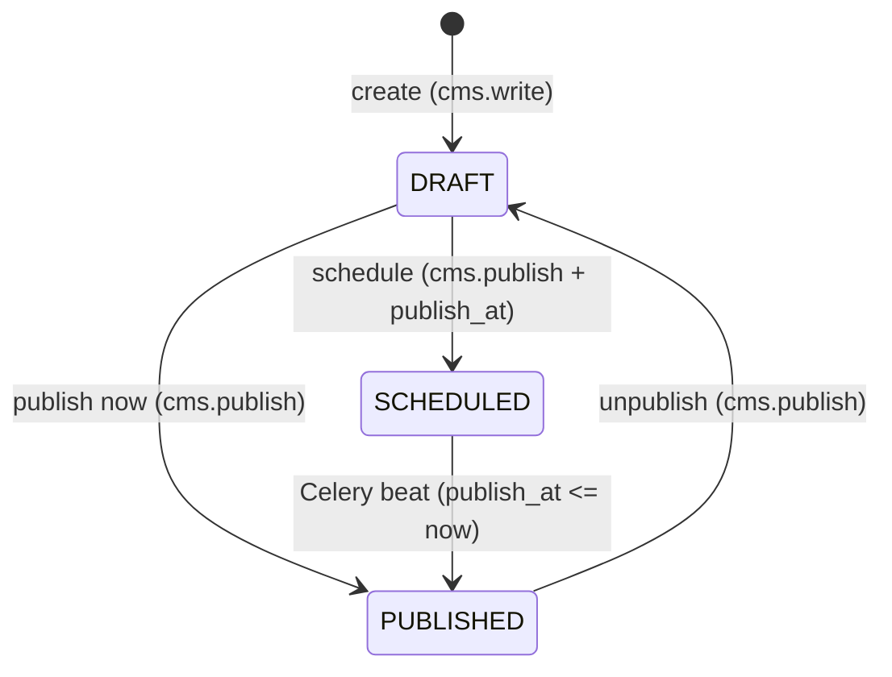
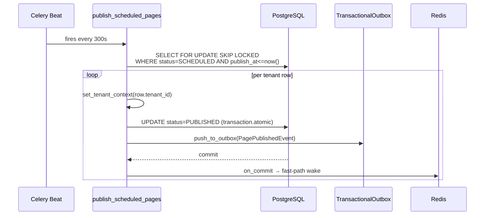

# CMS Sprint #3 — SEO Meta, Publishing Workflow, Tiptap Validation

## Summary

Three CMS features harden the public site before traffic lands: structured SEO metadata with per-field auto-derivation and sitemap; a `DRAFT / PUBLISHED / SCHEDULED` publishing workflow with `cms.publish` RBAC and Celery beat; and Pydantic v2 Tiptap content validation at the API boundary. All three are anchored by a mandatory `status='PUBLISHED'` filter in the public API — the only genuinely security-critical change in this sprint.

---

## Requirements

Inherited from brainstorm R1–R19 ([`docs/brainstorms/2026-06-17-cms-sprint-3-requirements.md`](docs/brainstorms/2026-06-17-cms-sprint-3-requirements.md)). Plan adds R20.

**SEO Meta**

- R1. `SitePageContent.meta` stores a `MetaSchema` object: `title` (≤60 chars), `description` (≤160 chars), `canonical` (URL string), `og_image` (S3 key string), `schema_org` (free-form JSON-LD object). Unset fields are `null`.
- R2. On content save, `title` is auto-derived from the first `heading` node in the Tiptap document unless `meta["_overrides"]["title"]` is `true`.
- R3. On content save, `description` is auto-derived from the text content of the first `paragraph` node unless `meta["_overrides"]["description"]` is `true`.
- R4. `meta["_overrides"]` is a per-field dict; `true` blocks auto-derivation for that field; absent keys are treated as `false`.
- R5. When a meta field is set via the PATCH endpoint, the service sets `meta["_overrides"][field] = true`.
- R6. `GET /api/v1/public/sitemap.xml` returns a standard XML sitemap listing all `PUBLISHED` pages for the tenant with `<loc>` and `<lastmod>` from `updated_at`.
- R7. `GET /robots.txt` returns a response allowing all crawlers and referencing `/sitemap.xml`.
- R8. The CMS editor renders a Google-style SERP preview below the meta fields with character-count indicators (title ≤60, description ≤160).

**Publishing Workflow**

- R9. `SitePageContent` gains `status: CharField(max_length=20, null=True, db_index=True)` with values `DRAFT`, `PUBLISHED`, `SCHEDULED`; default for new pages is `DRAFT`.
- R10. `SitePageContent` gains `publish_at: DateTimeField(null=True, blank=True)`.
- R11. A user with `cms.write` creates and edits pages; pages remain in `DRAFT` status.
- R12. A user with `cms.publish` may call `POST /api/v1/cms/pages/{slug}/publish/` to transition to `PUBLISHED` or `SCHEDULED` (with `publish_at`), or back to `DRAFT` (unpublish).
- R13. Celery beat task `publish_scheduled_pages` runs every 300 seconds; transitions `SCHEDULED` pages with `publish_at ≤ now()` to `PUBLISHED` with ±5-minute accuracy.
- R14. Any transition to `PUBLISHED` emits a `PagePublished` Outbox event inside `transaction.atomic()`, dispatched via `on_commit()`.
- R15. `Permission("cms", "publish")` is added to `rbac_permissions.py` and seeded in migration `0023_seed_cms_publish_permission.py`.
- R20. The status migration backfills all existing rows to `status='PUBLISHED'` within the same migration file — no separate Release N+1 backfill task.

**Public API Safety**

- R16. `get_page_content()` filters `status='PUBLISHED', is_deleted=False`; pages in `DRAFT` or `SCHEDULED` return the graceful-degradation empty response `{"slug": "...", "content": {}, "meta": {}}`.

**Tiptap Validation**

- R17. The CMS PATCH endpoint validates `content` against `TiptapDocSchema` before any DB write.
- R18. Content failing schema validation returns HTTP 422 with error detail containing the path to the first failing node.
- R19. Documents with unrecognized node types or mark attributes are rejected; the whitelist is updated when Tiptap extensions change.

---

## Key Technical Decisions

- **`meta["_overrides"]` sub-key, not a separate column**: `is_manual_override` is stored as a dict inside the existing `meta` JSONField under key `_overrides`. Avoids a DB column and migration; the entire meta state is co-located in one field.

- **Migration backfill in Release N**: The `status` column is added nullable and immediately backfilled to `PUBLISHED` via `RunSQL` within the same migration file. The public API filter (`status='PUBLISHED'`) lands in the same release. A temporary `IS NULL OR PUBLISHED` filter is rejected — it creates a code path that must be deleted later, and Sprint #3 has no live users requiring a rolling backfill.

- **Dedicated `POST /cms/pages/{slug}/publish/` endpoint**: Status transitions are separate from the PATCH content endpoint. RBAC is clean: `cms.write` for content edits, `cms.publish` for status transitions. The PATCH endpoint never touches `status`.

- **`TiptapDocSchema` as breaking SDK change**: `CmsPageUpdateRequest.content` changes from `dict | None` to `TiptapDocSchema | None`. The frontend TS SDK must be regenerated after U4 lands. Content already in the DB is untouched — validation is write-boundary only.

- **Strict `status='PUBLISHED'` filter**: The Release N backfill removes the need for `IS NULL OR PUBLISHED`. A single-value filter is simpler and correctly indexed by `db_index=True`.

- **Sitemap and robots.txt as plain Django views**: Registered in `config/urls.py` before the Ninja router catch-all. Avoids OpenAPI schema pollution from non-JSON content types (`text/xml`, `text/plain`). Sitemap path follows brainstorm R6: `/api/v1/public/sitemap.xml`.

- **Seed migration in `backend/apps/common/migrations/`**: RBAC seeding belongs to the `common` app, following the `0022_seed_requests_permission.py` pattern.

- **Celery beat on `default` queue**: Publishing is rare (human-initiated or low-frequency scheduled). A dedicated `cms` queue would idle constantly; `default` at 300s is sufficient.

---

## High-Level Technical Design

**Publication state machine:**



**Scheduled publish sequence:**



**Meta auto-derivation on content save:**

```
PATCH /cms/pages/{slug}/  (content, meta_patch)
  1. TiptapDocSchema.validate(content)         ← U4, raises 422 on failure
  2. derive title  = first heading node text   ← if _overrides.title != true
  3. derive desc   = first paragraph node text ← if _overrides.description != true
  4. for field, val in meta_patch.items():
       meta[field] = val
       meta["_overrides"][field] = true        ← R5
  5. upsert_page(slug, content, meta)
```

---

## Implementation Units

### U1. Status migration + model

- **Goal**: Add `status` and `publish_at` fields to `SitePageContent`; backfill all existing rows to `PUBLISHED`.
- **Files**:
  - `backend/apps/site/migrations/0002_sitepagecontent_status_publish_at.py` (create)
  - `backend/apps/site/models/site_content.py` (modify)
- **Follows**: `TextChoices` inner class (not PostgreSQL enum); `AddField(null=True)` per ADR-0002; `RunSQL` for backfill within migration `operations` list; `reverse_sql` to re-null the backfilled rows.
- **Test scenarios**:
  - Migration forward: all existing rows have `status='PUBLISHED'` after applying.
  - Migration backward: `status` is null on all rows after reversing; column removed.
  - New `SitePageContent` created via service has `status='DRAFT'` by default.
  - `PagePublicationStatus` choices cover exactly `DRAFT`, `PUBLISHED`, `SCHEDULED`.

---

### U2. RBAC registry + domain event

- **Goal**: Register `cms.publish` permission and define `PagePublishedEvent`.
- **Files**:
  - `backend/apps/common/security/rbac_permissions.py` (modify — add `Permission("cms", "publish")`)
  - `backend/apps/common/migrations/0023_seed_cms_publish_permission.py` (create)
  - `backend/apps/site/events/cms_events.py` (create)
- **Follows**: Seed migration pattern from `backend/apps/common/migrations/0022_seed_requests_permission.py`; domain event is `@dataclass(slots=True, frozen=True)` with mandatory fields `event_id`, `event_version`, `occurred_at`, `correlation_id`, `tenant_id`, `page_slug`; `EVENT_TYPE = "cms.PagePublished"`.
- **Test scenarios**:
  - Seed migration forward: `Permission("cms", "publish")` row exists in DB.
  - Seed migration backward: permission row removed.
  - User with `cms.publish` passes `@require_permission("publish", "cms")` — view returns 200.
  - User without `cms.publish` is rejected — returns 403.
  - `PagePublishedEvent` is frozen: mutation raises `FrozenInstanceError`.
  - `PagePublishedEvent` uses slots: `__slots__` attribute present.

---

### U3. MetaSchema + auto-derivation

- **Goal**: Define `MetaSchema`, implement auto-derivation logic, integrate into `CmsUpdateService`.
- **Files**:
  - `backend/apps/site/schemas/meta_schema.py` (create)
  - `backend/apps/site/schemas/cms_dto.py` (modify — add `MetaUpdateRequest` with all Optional fields)
  - `backend/apps/site/services/cms_update_service.py` (modify — add derivation + `_overrides` handling)
- **Follows**: Pydantic v2 `@field_validator` for length constraints; `model_config = ConfigDict(extra="forbid")`; all fields `Optional[str]` with defaults `None`; auto-derivation walks `tiptap_doc["content"]` list for first node of `type="heading"` (any level) and first `type="paragraph"`, extracting `text` from leaf nodes; `_overrides` key is read from and written to `meta` dict without touching other meta keys.
- **Test scenarios**:
  - `MetaSchema` rejects `title` > 60 chars with validation error.
  - `MetaSchema` rejects `description` > 160 chars.
  - Auto-derive: doc with H1 "Услуги" + first paragraph "Мы помогаем..." → `title="Услуги"`, `description="Мы помогаем..."`.
  - Auto-derive skips `title` if `meta["_overrides"]["title"] == true` (AE3: title stays protected).
  - Auto-derive skips `description` if `meta["_overrides"]["description"] == true`.
  - PATCH with explicit `title="Custom"` sets `meta["_overrides"]["title"] = true`.
  - Subsequent content save does not overwrite the protected `title` (AE3 from brainstorm).
  - Doc with no heading node: `title` unchanged.
  - Doc with no paragraph node: `description` unchanged.
  - `MetaUpdateRequest` with only `description` set: only `_overrides["description"]` is set to `true`; `title` override is unaffected.

---

### U4. Tiptap validation schema

- **Goal**: Define `TiptapDocSchema` discriminated union; wire into PATCH endpoint; reformat 422 to project envelope.
- **Files**:
  - `backend/apps/site/schemas/tiptap_schema.py` (create)
  - `backend/apps/site/schemas/cms_dto.py` (modify — replace `content: dict | None` with `content: TiptapDocSchema | None`)
  - `backend/apps/site/api/cms_api.py` (modify — add `RequestValidationError` exception handler reformatting to rule 6.6 envelope)
- **Follows**: Pydantic v2 `Annotated[Union[DocNode, ParagraphNode, HeadingNode, ...], Discriminator("type")]`; node whitelist: `doc`, `paragraph`, `heading`, `bulletList`, `orderedList`, `listItem`, `image`, `blockquote`, `codeBlock`, `hardBreak`, `horizontalRule`; marks whitelist: `bold`, `italic`, `link`; `model_config = ConfigDict(extra="forbid")` on each node class; 422 error re-format uses `code: "CONTENT_VALIDATION_ERROR"` per rule 6.6 — handler must be registered on the Ninja `api` instance, not at the Django middleware level.
- **Test scenarios**:
  - Valid Tiptap doc (doc + paragraph node) passes validation — request proceeds to DB write.
  - Node type `"iframe"` rejected — returns 422 with `error.code = "CONTENT_VALIDATION_ERROR"` (AE4).
  - `error.detail` contains the path to the failing node (e.g., `content.doc.content.0`).
  - Unknown mark attribute rejected — returns 422.
  - `content: null` accepted — no content validation (existing pages with content-only meta update).
  - Empty `content: {}` rejected — not a valid `TiptapDocSchema`.
  - Nested structure (heading inside doc, listItem inside bulletList) passes.
  - 422 response matches rule 6.6 envelope exactly: `error.code`, `error.message`, `error.detail`, `error.request_id` all present.

---

### U5. CMS publish service + endpoint

- **Goal**: Implement `CmsPublishService` (publish, schedule, unpublish) and `POST /cms/pages/{slug}/publish/`.
- **Files**:
  - `backend/apps/site/services/cms_publish_service.py` (create)
  - `backend/apps/site/schemas/cms_dto.py` (modify — add `PublishPageRequest(status, publish_at)`, `PublishPageResponse`)
  - `backend/apps/site/api/cms_api.py` (modify — add publish endpoint)
- **Follows**: `transaction.atomic()` wrapping `.select_for_update()` on the page row + `SitePageContent.objects.filter(...).update(status=...)` + `TransactionalOutboxService.push_to_outbox(PagePublishedEvent(...))` (see `backend/apps/common/services/outbox_service.py`); `on_commit` fast-path handled inside `push_to_outbox`; `Idempotency-Key: UUID` header required (rule 5.3) — enforce via existing idempotency middleware or explicit header check; `@require_permission("publish", "cms")`; `correlation_id = uuid.uuid4()` per call.
- **Test scenarios**:
  - `publish_page(slug)` transitions `DRAFT → PUBLISHED`; emits `PagePublished` Outbox record in same transaction.
  - `schedule_page(slug, publish_at)` transitions `DRAFT → SCHEDULED`; does not emit Outbox event.
  - `unpublish_page(slug)` transitions `PUBLISHED → DRAFT`; does not emit Outbox event.
  - `publish_page` on already-`PUBLISHED` page: idempotent — status unchanged, no duplicate Outbox event.
  - `schedule_page` with `publish_at` in the past → 422 `INVALID_PUBLISH_AT`.
  - `schedule_page` without `publish_at` → 422 `PUBLISH_AT_REQUIRED`.
  - `POST /publish/` without `Idempotency-Key` header → 400.
  - `POST /publish/` by user with only `cms.write` (not `cms.publish`) → 403.
  - `POST /publish/` on non-existent slug → 404.
  - `POST /publish/` on page belonging to a different tenant → 404 (tenant isolation).

---

### U6. Celery beat scheduled publisher

- **Goal**: Implement `publish_scheduled_pages` beat task; register schedule and imports in settings.
- **Files**:
  - `backend/apps/site/tasks/publisher.py` (create)
  - `backend/config/settings/base.py` (modify — `CELERY_BEAT_SCHEDULE`, `CELERY_IMPORTS`)
- **Follows**: `BaseEnterpriseTask`; `acks_late = True`; `max_retries = 5`; queue `default`; query: `SitePageContent.objects.filter(status='SCHEDULED', publish_at__lte=now(), is_deleted=False).select_for_update(skip_locked=True)`; per-row loop: `set_tenant_context(row.tenant_id)` then call `CmsPublishService.publish_page(row.slug)` inside `transaction.atomic()`; `CELERY_BEAT_SCHEDULE` entry: `schedule=300.0, queue='default'`; `CELERY_IMPORTS` must include `'apps.site.tasks.publisher'`.
- **Test scenarios**:
  - Task finds `status=SCHEDULED, publish_at <= now()` page and transitions it to `PUBLISHED`.
  - Task emits `PagePublished` Outbox event for each transitioned page (AE2 from brainstorm).
  - Task skips page with `publish_at > now()`.
  - Task skips page with `is_deleted=True`.
  - Concurrent task execution: `skip_locked=True` prevents double-publish (second worker sees 0 rows).
  - Tenant context is set per row: Outbox events contain the correct `tenant_id` for each page.
  - `CELERY_BEAT_SCHEDULE` in `base.py` has `schedule=300.0` and `queue='default'`.

---

### U7. Public API safety + sitemap + robots.txt

- **Goal**: Add `status='PUBLISHED'` filter to `get_page_content()`; add sitemap and robots.txt Django views.
- **Files**:
  - `backend/apps/site/queries/public_queries.py` (modify — add `status='PUBLISHED'` to `get_page_content()` filter)
  - `backend/apps/site/views/sitemap.py` (create — `SitemapView`, `RobotsView`)
  - `backend/config/urls.py` (modify — register both views before the Ninja router catch-all)
- **Follows**: `get_page_content()` returns the existing graceful-degradation empty response for non-matching pages; `SitemapView` queries `SitePageContent.objects.filter(status='PUBLISHED', is_deleted=False)` with tenant scope; response `Content-Type: text/xml`; `RobotsView` response `Content-Type: text/plain`; both are class-based Django views registered at `path("api/v1/public/sitemap.xml", ...)` and `path("robots.txt", ...)` respectively.
- **Test scenarios**:
  - `get_page_content("services")` on `DRAFT` page returns `{"slug": "services", "content": {}, "meta": {}}` (AE1 from brainstorm).
  - `get_page_content("services")` on `SCHEDULED` page returns same empty response.
  - `get_page_content("services")` on `PUBLISHED` page returns full content and meta.
  - `GET /api/v1/public/sitemap.xml` returns 200 with `Content-Type: text/xml`.
  - Sitemap contains `<loc>` and `<lastmod>` for each `PUBLISHED` page.
  - Sitemap omits `DRAFT` and `SCHEDULED` pages.
  - `GET /robots.txt` returns 200 with `Content-Type: text/plain`.
  - robots.txt body contains `User-agent: *`, `Allow: /`, and a `Sitemap:` line.

---

### U8. Frontend CMS editor

- **Goal**: Add meta editor panel, Google SERP preview, and status/publish controls to the CMS section editor.
- **Files**:
  - `frontend/src/shared/ui/cms/MetaEditor.tsx` (create)
  - `frontend/src/shared/ui/cms/SerpPreview.tsx` (create)
  - `frontend/src/shared/ui/cms/StatusWidget.tsx` (create)
  - `frontend/src/shared/ui/cms/index.ts` (create)
  - `frontend/src/app/dashboard/cms/[section]/page.tsx` (modify — integrate new components)
- **Dependency**: Backend API changes (U4, U5) must be merged and TS SDK regenerated (`make generate-sdk` or equivalent) before this unit. `CmsPageUpdateRequest.content` and the new publish endpoint must be present in the generated SDK.
- **Follows**: `useCan('cms.publish')` from existing RBAC hooks to gate the publish button; `useMutation` (TanStack Query) for `POST /publish/` call; character-count state uses controlled input length with color: neutral → amber at 80% of limit → red at limit; `SerpPreview` is client-side only (`"use client"`); `StatusWidget` shows current status badge and action button based on status + `useCan`.
- **Test scenarios** (browser QA):
  - Meta editor fields (title, description, canonical, og_image) are visible and editable.
  - `title` counter turns amber at >48 chars, red at >60 chars.
  - `description` counter turns amber at >128 chars, red at >160 chars.
  - SERP preview updates live as title and description are typed.
  - User with `cms.write` only: publish button absent.
  - User with `cms.publish`: publish button visible; clicking sends `POST /publish/`.
  - Scheduling: "Schedule" option shows date/time picker; submits with `publish_at`.
  - Status badge reflects current page status (DRAFT / PUBLISHED / SCHEDULED).
  - Saving content with no meta fields set: title and description auto-populate from the Tiptap document content.

---

## Scope Boundaries

**Deferred to backlog:**
- Google Ping on publish — robots.txt + sitemap is sufficient for Sprint #3.

**Deferred to Sprint #4:**
- Gallery UI — `SiteImage` model exists, UI not built.
- Content Versioning (`SitePageRevision`) — rollback without a developer.

**Deferred to Sprint #5:**
- ERP Object Showcase — live bridge from ERP objects to public site.

**Outside Sprint #3:**
- `schema_org` typed JSON-LD validation — accepted as free-form object.
- Sitemap caching / invalidation on `PagePublished` — simple per-request DB query is sufficient at current scale.
- Per-section RBAC — premature at current team size.
- Live preview via Redis draft rendering — rejected in ideation.

---

## Risks & Dependencies

- **Breaking SDK change (U4 → U8)**: `content: dict | None` → `TiptapDocSchema | None` breaks the generated TS SDK. U8 is blocked until the SDK is regenerated. Any frontend PRs open against the old SDK will have type conflicts.

- **Migration backfill scope**: The `RunSQL` backfill sets `status='PUBLISHED'` for all existing rows regardless of content. This is correct for Sprint #3 (no live users, no draft concept in the prior schema), but must not be applied to a production DB that already has content intentionally in draft state.

- **Celery beat registration silent failure**: If `CELERY_IMPORTS` in `base.py` does not include `'apps.site.tasks.publisher'`, the beat schedule entry is silently ignored. Verify after U6: `docker compose -f docker-compose.dev.yml exec celery celery -A config inspect registered | grep publish_scheduled`.

- **Tenant context in beat task**: Beat tasks have no request context. `set_tenant_context()` must be called per-row. Omitting it causes Outbox events to be written with `tenant_id=None`, which the dispatcher rejects.

- **Django Ninja 422 envelope**: Django Ninja wraps Pydantic `ValidationError` into its own 422 shape. The project error envelope (rule 6.6) requires an exception handler registered on the Ninja `api` instance for `RequestValidationError`. If an existing handler covers this, extend it; otherwise add a new handler in `cms_api.py` or the shared API config.
