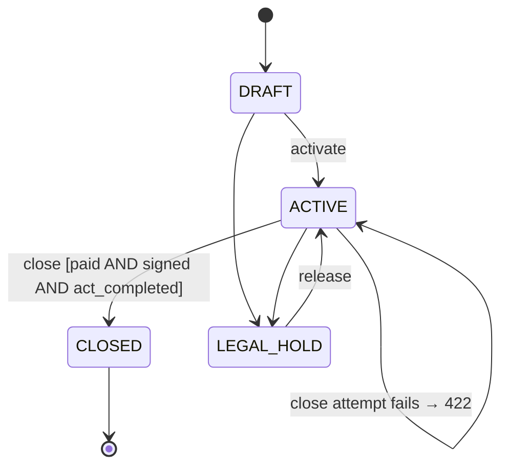
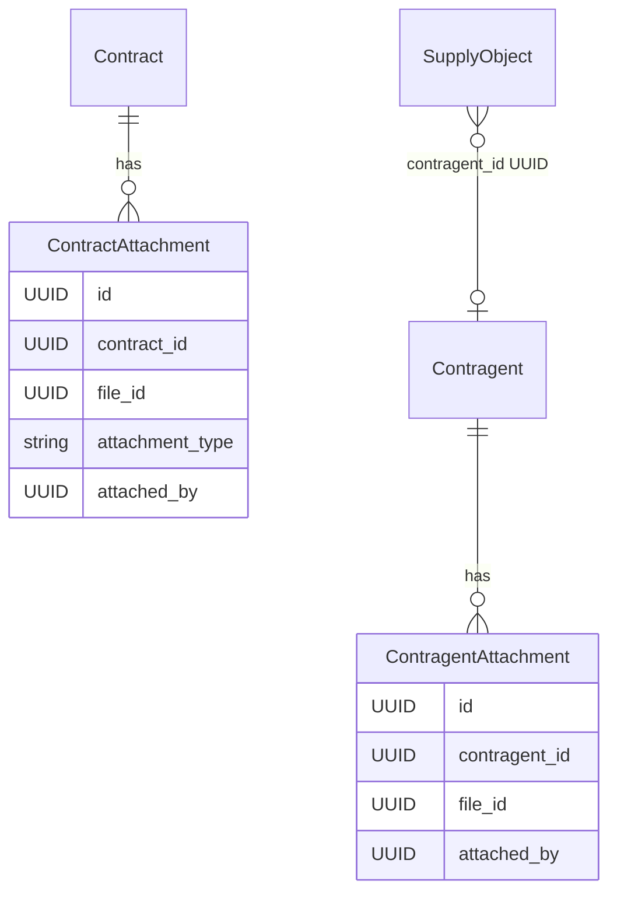

# feat: Sprint B — Operational Readiness

## Summary

Closes five operational workflow gaps so the ERP becomes a daily working tool. B1 verifies Sprint A backend changes end-to-end (P0 issues gate B2–B5; P1 fixed in parallel). B2 adds Contragent 360° with five tabs including event timeline. B3 completes contract lifecycle with a three-condition closure gate. B4 adds file attachment for contragents. B5 surfaces the existing `SupplyObject.contragent_id` FK in both Object 360° and Contragent 360°.

---

## Problem Frame

Sprint A backend (PATCH contragent, PATCH contract, activate, `contract_date`, file deletion) is implemented but not verified end-to-end through the UI. Contragent 360°, contract closure with document gates, and Object↔Contragent are partially wired in models but not exposed. Directors and managers use contracts daily — these gaps make the system unfit for production use. Sprint C (real data import) requires these to work correctly before it can proceed.

---

## Key Technical Decisions

- **B1 P0-only gate.** P0 defects (API 5xx, CRUD impossible, auth broken, file domain broken) block B2–B5. P1 issues (Excel export errors, file deletion UI, filter bugs) are fixed in parallel with B2–B5. P2 (perf, UX copy) are tech debt and do not block anything.

- **`attachment_type` on `ContractAttachment`, not on `FileRecord`.** The type captures the document's role in a specific contract context. One file can serve different roles in different contracts. Values: `CONTRACT_SIGNED`, `ACT_COMPLETED`, `ESTIMATE`, `INVOICE`, `OTHER`. Default: `OTHER`. Migration: nullable column first per ADR-0002 Expand & Contract.

- **Contract closure: three-condition gate.** All three must be true: (1) `paid_amount >= total_amount`; (2) a non-deleted `ContractAttachment` with `attachment_type=CONTRACT_SIGNED` exists; (3) a non-deleted `ContractAttachment` with `attachment_type=ACT_COMPLETED` exists. API returns 422 `CONTRACT_MISSING_REQUIRED_DOCUMENT` with `detail: {paid: bool, has_signed: bool, has_act: bool}`. Frontend renders a checklist of all three conditions.

- **Contragent История = OutboxRecord projection.** Follows the contract event log pattern in `apps/contracts/queries/event_log_queries.py`. Eight event types — emitted by their respective domains through `TransactionalOutbox`, queried by `payload_json__contragent_id`. No separate audit table.

- **`ContragentAttachment` in `apps/contragents/`.** UUID `file_id` field (no ORM FK to files domain). Mirrors `ContractAttachment` structure. The generic `FileAttachment` model in `apps/files/` is not used — contragents domain must not import from files domain (ADR-0005).

- **Объекты tab in Contragent 360° calls `GET /api/v1/objects/?contragent_id=...`.** Frontend makes a direct objects API call rather than a new contragents sub-endpoint. `SupplyObject.contragent_id` already exists in the model — only add the filter to the list query.

- **SDK regeneration via `make generate-sdk` at three points:** after B3 API changes (U6), after B4+B2 backend (U12), and after B5 (U14). All containers must be running.

---

## High-Level Technical Design

### Contract closure gate — state transitions (B3)



### New data models (B3, B4)



### Contragent История — event sources (B2)

```mermaid
flowchart LR
    A[ContragentCreated] --> OB[OutboxRecord]
    B[ContragentUpdated] --> OB
    C[ContractLinkedToContragent] --> OB
    D[ContractUnlinkedFromContragent] --> OB
    E[ObjectLinkedToContragent] --> OB
    F[ObjectUnlinkedFromContragent] --> OB
    G[ContragentFileAttached] --> OB
    H[ContragentFileDetached] --> OB
    OB -->|filter payload_json__contragent_id| Q[get_contragent_timeline]
    Q --> API["GET /contragents/{id}/timeline/"]
```



All 8 event types include `contragent_id` in payload. Each domain emits its own events.

---

## Implementation Units

### U1. B1 — Contragent CRUD end-to-end verification and P0 fixes

**Goal:** Verify contragent edit and delete flows work end-to-end; fix any P0 defects found.

**Requirements:** R1, R2 (see origin)

**Dependencies:** none

**Files:**
- `frontend/src/app/dashboard/contragents/[id]/page.tsx`
- `frontend/src/app/dashboard/contragents/[id]/edit/page.tsx`
- `frontend/src/shared/api/contragents.ts`
- `backend/apps/contragents/api.py` (if backend fix needed)

**Approach:** Browser QA: (1) edit a contragent name → save → verify updated name in list and detail; (2) delete → confirm → verify redirect to list and 404 on direct nav. The edit page uses `useUpdateContragent` with `{name}` body matching `ContragentUpdateRequest`. The delete flow uses `useDeleteContragent` with `onSuccess` redirect. Fix any issue inline.

**Patterns to follow:** `backend/apps/contragents/api.py` `update_contragent` and `delete_contragent` handlers; `frontend/src/app/dashboard/contragents/[id]/edit/page.tsx`.

**Test scenarios:**
- Edit name → save → updated name visible in detail view and list
- Delete → 204 → redirect to `/dashboard/contragents` → contragent gone from list
- Edit with empty name → inline validation error, no API call
- Delete legal-hold contragent → 422 → error displayed to user

**Verification:** Both CRUD flows complete without P0 errors.

---

### U2. B1 — Contract lifecycle end-to-end verification and P0 fixes

**Goal:** Verify edit, activate, and close flows for contracts; fix any P0 defects found.

**Requirements:** R3, R4, R5 (see origin)

**Dependencies:** none (can run in parallel with U1)

**Files:**
- `frontend/src/app/dashboard/contracts/[id]/page.tsx`
- `frontend/src/app/dashboard/contracts/create/page.tsx`
- `frontend/src/shared/api/contracts.ts`
- `backend/apps/contracts/api.py` (if backend fix needed)

**Approach:** Browser QA: (1) edit contract title + date → save → values updated; (2) activate DRAFT → status shows ACTIVE; (3) attempt close with no attachments → expect error message (pre-B3: "нет файлов"). Verify `contract_date` is editable and stored. Verify status badge updates without full page reload.

**Patterns to follow:** `backend/apps/contracts/api.py` `update_contract` at line 88, `activate_contract` at line 120, `close_contract` at line 132.

**Test scenarios:**
- Edit title + date → save → updated values in detail
- DRAFT → activate → status = ACTIVE in UI
- Edit ACTIVE contract fields → error "only DRAFT editable"
- Close ACTIVE contract with no attachments → error shown (not silent)

**Verification:** Edit, activate, and close-attempt flows work; no P0 defects remain.

---

### U3. B1 — Excel export and file deletion QA (P1 — parallel with B2–B5)

**Goal:** Verify three Excel exports and file deletion work; fix P1 issues in parallel with later blocks.

**Requirements:** R6 (see origin)

**Dependencies:** none (P1 — does not gate B2–B5)

**Files:**
- `frontend/src/app/dashboard/reports/contracts/page.tsx`
- `frontend/src/app/dashboard/reports/finance/page.tsx`
- `frontend/src/app/dashboard/reports/payments/page.tsx`
- `backend/apps/reports/api.py`

**Approach:** Click "Экспорт в Excel" on each page → verify `.xlsx` downloads with correct columns and non-empty data. Test empty result (all filters applied to return zero rows). Verify file detach in contract 360° removes file from attachment list. Fix any issue found.

**Test scenarios:**
- Contracts export → `contracts_report.xlsx` with correct columns and data
- Finance export → `finance_report.xlsx`
- Payments export → `payments_report.xlsx`
- Empty result export → valid `.xlsx` with headers, zero data rows
- File detach in contract 360° → file removed from attachment list

**Verification:** All three exports download correctly; file deletion works.

---

### U4. B3 — `AttachmentType` enum + `ContractAttachment.attachment_type` migration

**Goal:** Add `attachment_type` nullable field to `ContractAttachment`; define enum.

**Requirements:** R13 (see origin)

**Dependencies:** U1, U2 cleared P0 gate

**Files:**
- `backend/apps/contracts/models/attachment.py`
- `backend/apps/contracts/migrations/NNNN_add_attachment_type.py` (new)

**Approach:** Add `AttachmentType(models.TextChoices)` in the model file with values `CONTRACT_SIGNED`, `ACT_COMPLETED`, `ESTIMATE`, `INVOICE`, `OTHER`. Add `attachment_type = models.CharField(max_length=20, choices=AttachmentType.choices, null=True, blank=True)` to `ContractAttachment`. Migration: simple `AddField` (nullable — no table lock, safe). Include `RunSQL` to backfill existing records to `"OTHER"` in the same migration, since volume is expected to be small.

**Patterns to follow:** `ContragentType(models.TextChoices)` in `backend/apps/contragents/models/contragent.py`; `ContractAttachment` model in `backend/apps/contracts/models/attachment.py`.

**Test scenarios:**
- Migration forward applies without error on populated DB
- Migration backward reverses without error
- New `ContractAttachment` row without explicit type gets `null` (service sets `OTHER` in U6)

**Verification:** `makemigrations` + `migrate` succeeds; `attachment_type` column in `contracts_attachments` table.

---

### U5. B3 — Three-condition closure gate in `ContractClosurePolicy` + typed attachment queries

**Goal:** Update closure policy to require all three conditions; add typed query methods to `AttachmentRepository`.

**Requirements:** R15 (see origin)

**Dependencies:** U4

**Files:**
- `backend/apps/contracts/repositories/attachment_repo.py`
- `backend/apps/contracts/policies/closure_policy.py`

**Approach:**

In `AttachmentRepository`, add two methods:
- `has_type(contract_id, attachment_type) → bool` — returns True if a non-deleted record with the given type exists
- `get_closure_conditions(contract_id) → dict[str, bool]` — returns `{has_signed: bool, has_act: bool}` for 422 detail

In `ContractClosurePolicy.verify_closure_eligibility`, replace the single `has_ready_documents` check with three checks:
1. Keep existing `paid_amount < total_amount` check (preserves existing invariant)
2. Check `AttachmentRepository.has_type(contract_id, "CONTRACT_SIGNED")`
3. Check `AttachmentRepository.has_type(contract_id, "ACT_COMPLETED")`

Collect all failing conditions; raise `ValidationError` with `code="CONTRACT_MISSING_REQUIRED_DOCUMENT"` and detail listing which are unmet.

**Patterns to follow:** Existing `ContractClosurePolicy` structure in `backend/apps/contracts/policies/closure_policy.py`; `AttachmentRepository.list_file_ids` for queryset shape.

**Test scenarios:**
- All three conditions met → no exception
- Missing CONTRACT_SIGNED only → `ValidationError` with `has_signed=False` in detail
- Missing ACT_COMPLETED only → `ValidationError` with `has_act=False`
- Paid amount insufficient → raises error with `paid=False`
- All three conditions failed → detail shows all three as False
- Soft-deleted CONTRACT_SIGNED (`is_deleted=True`) → does not count, gate blocks

**Verification:** Unit tests in `backend/apps/contracts/tests/unit/test_closure_policy.py` pass; all combinations of failing conditions raise correct errors.

---

### U6. B3 — `AttachmentService` type parameter + API schemas + closure 422 detail + SDK regen

**Goal:** Thread `attachment_type` through `AttachmentService.attach()`; update request/response schemas; update close endpoint 422 response; regenerate SDK.

**Requirements:** R13, R14 (schema aspect), R15 (API response) (see origin)

**Dependencies:** U4, U5

**Files:**
- `backend/apps/contracts/schemas/attachment_dto.py`
- `backend/apps/contracts/services/attachment_service.py`
- `backend/apps/contracts/repositories/attachment_repo.py` (`create` method)
- `backend/apps/contracts/api.py` (`close_contract` handler)
- `frontend/src/shared/api/generated/schema.d.ts` (regenerated)

**Approach:**

`AttachFileRequest`: add `attachment_type: str = "OTHER"` with validation against `AttachmentType` values.
`AttachmentResponse`: add `attachment_type: str`.
`AttachmentRepository.create()`: accept and store `attachment_type` kwarg (defaults to `"OTHER"`).
`AttachmentService.attach()`: accept and pass through `attachment_type`.

`close_contract` endpoint: catch `ValidationError` from closure policy; return 422 with envelope per rule 6.6:
```json
{
  "error": {
    "code": "CONTRACT_MISSING_REQUIRED_DOCUMENT",
    "message": "...",
    "detail": {"paid": bool, "has_signed": bool, "has_act": bool}
  }
}
```

Run `make generate-sdk` after all backend changes in this unit.

**Patterns to follow:** `AttachFileRequest` in `backend/apps/contracts/schemas/attachment_dto.py`; `make_error_response` in `apps/common/api/errors.py`.

**Test scenarios:**
- `POST /contracts/{id}/attachments/` with `attachment_type=CONTRACT_SIGNED` → stored correctly
- `POST` without `attachment_type` → defaults to `OTHER`
- `POST` with invalid type → 400
- `GET /contracts/{id}/attachments/` → each attachment includes `attachment_type`
- `POST /contracts/{id}/close/` with missing CONTRACT_SIGNED → 422 with `detail.has_signed=false`
- `POST .../close/` with all conditions met → 200

**Verification:** API tests pass; `make generate-sdk` completes; SDK type for `AttachmentResponse` includes `attachment_type`.

---

### U7. B3 — Frontend: AsyncSelect for object search in contract form

**Goal:** Replace static object dropdown with async search in the contract create/edit form.

**Requirements:** R12 (see origin)

**Dependencies:** U1, U2 (P0 gate cleared)

**Files:**
- `frontend/src/shared/ui/AsyncSelect.tsx` (new)
- `frontend/src/shared/api/objects.ts` (verify `q` filter is available in hook)
- `frontend/src/app/dashboard/contracts/create/page.tsx`

**Approach:** Create `AsyncSelect` component: debounced text input (300ms delay), fires `GET /api/v1/objects/?q=...` on change, renders results dropdown. Use unconditionally in the contract form (simpler than checking object count threshold — avoids race condition on first load). The `useObjects` hook has `q` param support via generated SDK; verify in schema. Clear selection emits `null`.

**Patterns to follow:** Debounce pattern from map search feature; existing `select` elements in `frontend/src/app/dashboard/reports/contracts/page.tsx`.

**Test scenarios:**
- Type 3 chars → matching objects dropdown appears
- Select object → form field populated with ID and display name
- Clear selection → field cleared
- Empty input → no API call, no dropdown
- No matches → "Ничего не найдено" shown

**Verification:** Object selection in contract form works via async search.

---

### U8. B3 — Frontend: attachment type display, selector, and closure checklist

**Goal:** Show `attachment_type` label next to each file in contract 360°; allow type selection on attach; display closure conditions checklist.

**Requirements:** R14, R15 (UI aspect) (see origin)

**Dependencies:** U6 (needs updated schema), U7 (AsyncSelect available)

**Files:**
- `frontend/src/app/dashboard/contracts/[id]/page.tsx`
- `frontend/src/shared/api/attachments.ts` (add `attachment_type` param to `useAttachFile`)

**Approach:**

**Attachment list:** Add a type badge next to each file name. Labels: `CONTRACT_SIGNED` → "Подписанный договор", `ACT_COMPLETED` → "Акт выполненных работ", `ESTIMATE` → "Смета", `INVOICE` → "Счёт", `OTHER` → "Прочее".

**Attach flow:** Add a type selector (dropdown) before confirming attachment. Pass `attachment_type` to `useAttachFile` mutation body.

**Closure checklist:** Compute conditions client-side from already-loaded data (attachments list + `paid_amount`/`total_amount` from contract detail) — no extra API call:
```
Для закрытия необходимо:
☑ Оплата завершена           (paid_amount >= total_amount)
☐ Подписанный договор        (CONTRACT_SIGNED attachment exists)
☑ Акт выполненных работ      (ACT_COMPLETED attachment exists)
```
Render inline under the "Закрыть" button. If all three satisfied, button is enabled. If not, button is disabled (or shows warning on click).

**Test scenarios:**
- Attachment list shows type badge for each file
- Attach with type=ACT_COMPLETED → badge shows "Акт выполненных работ"
- All three conditions met → Close button enabled
- Missing CONTRACT_SIGNED → checklist shows ☐ for that row
- Attempt close with missing doc → 422 from backend → error toast with checklist

**Verification:** Type badges visible; checklist renders correctly; close works only when all conditions met.

---

### U9. B4 — `ContragentAttachment` model + migration + repository

**Goal:** Create `ContragentAttachment` junction model and repository in `apps/contragents/`.

**Requirements:** R16, R17 (see origin)

**Dependencies:** U1, U2 (P0 gate cleared)

**Files:**
- `backend/apps/contragents/models/attachment.py` (new)
- `backend/apps/contragents/models/__init__.py`
- `backend/apps/contragents/migrations/NNNN_add_contragent_attachment.py` (new)
- `backend/apps/contragents/repositories/attachment_repo.py` (new)

**Approach:** Mirror `ContractAttachment` pattern:
- Fields: `contragent` (FK to `Contragent`, `on_delete=PROTECT`), `file_id` (UUIDField), `attached_by` (UUIDField editable=False).
- `Meta.db_table = "contragents_attachments"`.
- `UniqueConstraint` on `(contragent, file_id)` where `is_deleted=False`, name `"unique_active_contragent_file"`.
- `ContragentAttachmentRepository`: `get_queryset(contragent_id)`, `create(contragent_id, file_id, attached_by)`, `get_active(contragent_id, file_id)`, `soft_delete(attachment, deleted_by)`, `list_file_ids(contragent_id)`.
No `attachment_type` — contragent files do not require document role classification.

**Patterns to follow:** `backend/apps/contracts/models/attachment.py`; `backend/apps/contracts/repositories/attachment_repo.py`.

**Test scenarios:**
- Migration forward and backward succeed
- `create()` stores record with correct `tenant_id`
- Duplicate attach same file → `IntegrityError` (handled by service layer in U11)
- `list_file_ids()` excludes `is_deleted=True` records
- `soft_delete()` sets `is_deleted=True`, increments `version`

**Verification:** Migration applied; `contragents_attachments` table exists with correct schema; repository unit tests pass.

---

### U10. B2 — Domain events for contragent Historia

**Goal:** Define 8 event dataclasses for contragent timeline; emit ContragentCreated/Updated events and ContractLinkedToContragent events.

**Requirements:** R11 (see origin)

**Dependencies:** U9

**Files:**
- `backend/apps/common/events/contragents.py` (new)
- `backend/apps/contragents/api.py` (emit on create/update)
- `backend/apps/contracts/api.py` (emit ContractLinkedToContragent on create)

**Approach:**

New dataclasses in `apps/common/events/contragents.py` using `@dataclass(slots=True, frozen=True)` per rule 4.5, each with mandatory fields `event_id`, `event_version=1`, `occurred_at`, `correlation_id`, `contragent_id`, `tenant_id`, `user_id`:
- `ContragentCreatedEvent`
- `ContragentUpdatedEvent` (+ `changed_fields: tuple[str, ...]`)
- `ContragentFileAttachedEvent` (+ `file_id: uuid.UUID`) — emitted in U11
- `ContragentFileDetachedEvent` (+ `file_id: uuid.UUID`) — emitted in U11
- `ContractLinkedToContragentEvent` (+ `contract_id: uuid.UUID`)
- `ContractUnlinkedFromContragentEvent` (+ `contract_id: uuid.UUID`) — emit on contract soft-delete if contragent_id set
- `ObjectLinkedToContragentEvent` (+ `object_id: uuid.UUID`) — emitted in U14
- `ObjectUnlinkedFromContragentEvent` (+ `object_id: uuid.UUID`) — emitted in U14

In `create_contragent` handler: push `ContragentCreatedEvent` via `transaction.on_commit`.
In `update_contragent` handler: push `ContragentUpdatedEvent(changed_fields=("name",))`.
In `create_contract` handler: if `body.contragent_id` set, push `ContractLinkedToContragentEvent`.

**Patterns to follow:** `backend/apps/common/events/contracts.py`; `ContractClosedEvent.create()` factory pattern; `TransactionalOutboxService.push_to_outbox()`.

**Test scenarios:**
- Create contragent → `ContragentCreatedEvent` appears in `OutboxRecord` with correct `payload_json.contragent_id`
- Update contragent name → `ContragentUpdatedEvent` with `changed_fields=["name"]`
- Create contract with `contragent_id` → `ContractLinkedToContragentEvent` in OutboxRecord
- All events include `tenant_id` and `user_id` in payload

**Verification:** Events in OutboxRecord after triggering actions; payload fields correct.

---

### U11. B4 — `ContragentAttachmentService` + attach/detach API endpoints

**Goal:** Service layer for contragent file management; new attach/detach API endpoints; emit file events.

**Requirements:** R16, R17, R18 (see origin)

**Dependencies:** U9, U10

**Files:**
- `backend/apps/contragents/services/attachment_service.py` (new)
- `backend/apps/contragents/schemas/attachment_dto.py` (new or extend)
- `backend/apps/contragents/api.py` (3 new endpoints)

**Approach:**

`ContragentAttachmentService`:
- `attach(contragent_id, file_id, actor_id, tenant_id)`: validates file via `FileServiceProtocol` (AVAILABLE status); calls `ContragentAttachmentRepository.create()`; catches `IntegrityError` → `ValidationError("already attached")`; emits `ContragentFileAttachedEvent` via `transaction.on_commit`.
- `detach(contragent_id, file_id, actor_id)`: validates contragent not legal-hold; soft-deletes via repository; emits `ContragentFileDetachedEvent`.

New API endpoints in `contragents/api.py`:
- `GET /{id}/attachments/` → list file IDs + metadata via `FileServiceProtocol.get_file_meta()`; permission `read` on `contragents`
- `POST /{id}/attachments/` → `{file_id: UUID}`; permission `write`
- `DELETE /{id}/attachments/{file_id}/` → detach; permission `write`

**Patterns to follow:** `backend/apps/contracts/services/attachment_service.py`; `backend/apps/contracts/api.py` attachment endpoints (lines 170–230).

**Test scenarios:**
- `POST /contragents/{id}/attachments/` with valid `file_id` → 201, file in list
- `POST` with non-AVAILABLE file → 422
- `POST` same file twice → 409 or 422 "already attached"
- `DELETE` active attachment → 204; removed from list
- `DELETE` legal-hold contragent → 403
- `GET` list → only `is_deleted=False` records, with file metadata

**Verification:** API tests in `backend/apps/contragents/tests/` pass; attach/detach cycle works.

---

### U12. B2 — Backend: Contragent 360° API endpoints (Объекты filter + timeline)

**Goal:** Add `contragent_id` filter to objects list endpoint; add contragent timeline endpoint; update SDK.

**Requirements:** R7–R11 (see origin)

**Dependencies:** U10, U11

**Files:**
- `backend/apps/objects/queries/object_queries.py` (add filter)
- `backend/apps/objects/api.py` (add `contragent_id` query param)
- `backend/apps/objects/schemas/object_dto.py` (verify list response shape)
- `backend/apps/contragents/queries/contragent_queries.py` (add timeline query)
- `backend/apps/contragents/schemas/contragent_dto.py` (timeline schema)
- `backend/apps/contragents/api.py` (add `GET /{id}/timeline/`)
- `frontend/src/shared/api/generated/schema.d.ts` (regenerated — run `make generate-sdk`)

**Approach:**

**Объекты filter:** Add `contragent_id: Optional[uuid.UUID] = Query(None)` to `list_objects` endpoint. In `object_queries.py`, add `if contragent_id: qs = qs.filter(contragent_id=contragent_id)` to the queryset builder. Frontend calls `GET /api/v1/objects/?contragent_id={id}` directly from Contragent 360°.

**Timeline endpoint:** `GET /contragents/{id}/timeline/`:
```python
_CONTRAGENT_EVENT_TYPES = frozenset({
    "contragents.ContragentCreated", "contragents.ContragentUpdated",
    "contragents.ContractLinkedToContragent", "contragents.ContractUnlinkedFromContragent",
    "contragents.ObjectLinkedToContragent", "contragents.ObjectUnlinkedFromContragent",
    "contragents.FileAttached", "contragents.FileDetached",
})
```
Queries `OutboxRecord` filtered by `event_type__in=_CONTRAGENT_EVENT_TYPES` and `payload_json__contragent_id=str(contragent_id)`, ordered by `created_at`. Returns `{results: [{event_id, event_type, label, occurred_at, user_id}], count}`.

Run `make generate-sdk` after all backend changes in U11 + U12.

**Patterns to follow:** `backend/apps/contracts/queries/event_log_queries.py` (query structure); `get_contragents_page` for list endpoint filter pattern.

**Test scenarios:**
- `GET /objects/?contragent_id=X` → only objects where `contragent_id=X`
- `GET /objects/?contragent_id=X` with no linked objects → empty results
- `GET /contragents/{id}/timeline/` with no events → `{results: [], count: 0}`
- Timeline after create + update → 2 events in order
- Timeline after file attach → `ContragentFileAttached` event appears
- Timeline reads from replica (no writes in query)

**Verification:** Both endpoints respond correctly; SDK regenerated with new paths.

---

### U13. B2 — Frontend: Contragent 360° — Объекты, Файлы, История tabs

**Goal:** Extend Contragent 360° to 5 tabs; add Объекты, Файлы, and История tab implementations.

**Requirements:** R7–R11 (see origin)

**Dependencies:** U11, U12

**Files:**
- `frontend/src/app/dashboard/contragents/[id]/page.tsx`
- `frontend/src/shared/api/contragents.ts` (add `useContragentTimeline`)
- `frontend/src/shared/api/attachments.ts` (add `useContragentAttachments`, `useAttachContragentFile`, `useDetachContragentFile`)

**Approach:**

Extend `Tab` type: `'overview' | 'contracts' | 'objects' | 'files' | 'history'`.

Tab labels: Основное, Договоры, Объекты, Файлы, История.

**Объекты tab:** `useObjects({ contragent_id: id, limit: 50 })` — render table with object name, address, link to Object 360°. Empty state: "Объектов нет".

**Файлы tab:** `useContragentAttachments(id)` — render file list with filename, size, detach button. "Прикрепить файл" button → opens file picker from tenant's files. Pass `file_id` to `useAttachContragentFile`. Empty state: "Файлов нет".

**История tab:** `useContragentTimeline(id)` → `GET /contragents/{id}/timeline/`. Render as `<ol>` timeline matching `EventTimeline` in contract 360°. Event type → Russian label map (same labels as backend). Empty state: "История пуста".

**Patterns to follow:** `EventTimeline` component in `frontend/src/app/dashboard/contracts/[id]/page.tsx`; `ContractsTab` in contragent page; `useContractAttachments` in `attachments.ts`.

**Test scenarios:**
- Объекты: shows objects with name + link; empty state when none
- Файлы: shows files; attach adds file; detach removes file
- Файлы: permission guard — write permission required for attach/detach buttons
- История: events listed in order; "История пуста" when none
- Historia: ContragentCreated event visible after contragent creation

**Verification:** All 5 tabs render without errors; Файлы attach/detach cycle works; История shows events.

---

### U14. B5 — Object API: `contragent_id` in schema + link/unlink endpoint + domain events + SDK regen

**Goal:** Expose `contragent_id` in `ObjectDetailSchema`; add `PATCH /{id}/contragent/` to set or clear the link; emit domain events; regenerate SDK.

**Requirements:** R19, R20, R21 (see origin)

**Dependencies:** U10 (event types defined)

**Files:**
- `backend/apps/objects/schemas/object_dto.py`
- `backend/apps/objects/api.py`
- `backend/apps/objects/services/object_contragent_service.py` (new)
- `frontend/src/shared/api/generated/schema.d.ts` (regenerated)

**Approach:**

Add `contragent_id: Optional[uuid.UUID]` to `SupplyObjectDetailResponse` (field exists in model, not yet in schema).

New service `ObjectContragentService.set_contragent(object_id, contragent_id, actor_id)`:
- If `contragent_id` is set: validates contragent exists via `ContragentRepository.get_by_id()`; updates `SupplyObject.contragent_id`; emits `ObjectLinkedToContragentEvent`.
- If `contragent_id` is None: reads previous value; clears field; emits `ObjectUnlinkedFromContragentEvent(contragent_id=previous)`.

New endpoint `PATCH /api/v1/objects/{object_id}/contragent/` with body `{contragent_id: UUID | null}`:
- Permission: `require_permission("write", "objects")`
- Returns updated `SupplyObjectDetailResponse`

Run `make generate-sdk`.

**Patterns to follow:** `backend/apps/objects/api.py` `update_location` endpoint for PATCH sub-resource pattern; `ObjectUpdateService` for service structure.

**Test scenarios:**
- `PATCH /{id}/contragent/ {contragent_id: UUID}` → 200, `contragent_id` in response
- `PATCH /{id}/contragent/ {contragent_id: null}` → 200, `contragent_id: null` in response
- `PATCH` with non-existent contragent UUID → 404
- After link: `ObjectLinkedToContragentEvent` in OutboxRecord with correct IDs
- After unlink: `ObjectUnlinkedFromContragentEvent` with previous `contragent_id`
- `GET /objects/{id}/` → `contragent_id` included in response

**Verification:** Link/unlink endpoint works; `contragent_id` in GET response; SDK updated; events in OutboxRecord.

---

### U15. B5 — Frontend: Object 360° contragent section

**Goal:** Display linked contragent in Object 360° main tab; add link/unlink controls; verify Contragent 360° Объекты tab reflects changes.

**Requirements:** R19, R20 (see origin)

**Dependencies:** U14 (SDK regenerated), U13 (Contragent 360° Объекты tab complete)

**Files:**
- `frontend/src/app/dashboard/objects/[id]/page.tsx`
- `frontend/src/shared/api/objects.ts` (add `useLinkObjectContragent`)

**Approach:**

In the main tab detail section of Object 360°, add a "Контрагент" row:
- If `data.contragent_id` is set: render `<ContragentLink contragentId={data.contragent_id} />` (reuse from contracts page) + unlink button (if `objects.write` permission).
- If not set and user has `objects.write`: render "Привязать контрагента" button → opens `AsyncSelect` (from U7) for contragent search → on select calls `useLinkObjectContragent(id)`.
- Unlink: calls `useLinkObjectContragent(null)`.

`useLinkObjectContragent` hook: `PATCH /objects/{id}/contragent/` mutation; invalidates `objectKeys.detail(id)` on success.

**Patterns to follow:** `ContragentLink` component in `frontend/src/app/dashboard/contracts/[id]/page.tsx`; `AsyncSelect` from U7; `useUpdateObjectLocation` pattern for mutation hook shape.

**Test scenarios:**
- Object with `contragent_id` → contragent name visible with link
- Object without `contragent_id` + write perm → "Привязать" button shown
- Link: select via search → name appears, contragent_id stored
- Unlink: click → row shows "Привязать" button again
- Contragent 360° Объекты tab → shows this object after link; removes after unlink

**Verification:** Both directions work; Contragent 360° Объекты tab reflects correct state.

---

## Scope Boundaries

**Deferred to Sprint C:**
- Import of client data from Excel, 1С, or Windows folder structures.
- Full field-level audit trail with before/after values.

**Deferred, no target sprint:**
- M:N relationship between objects and contragents (current model: single FK).
- `NOT NULL` constraint on `ContractAttachment.attachment_type` — Release N+2 per ADR-0002 (separate migration after this sprint, once all existing records are backfilled).
- ContractAttachment UI detach button.
- P2 tech debt discovered in B1.

**Outside Sprint B:**
- Public site, CMS, notifications, chat, finance module.

### Deferred to Follow-Up Work

- `ALTER COLUMN attachment_type SET NOT NULL` migration with `NOT VALID` + `VALIDATE CONSTRAINT` sequence.
- OpenAPI documentation updates for new contragent attachment and timeline endpoints.

---

## Open Questions

- **Closure checklist UX**: separate modal vs. inline warning under the Close button. Deferred to implementation — inline warning recommended (simpler, avoids modal overlay).
- **AsyncSelect in Object link flow (U15)**: reuse the `AsyncSelect` from U7 (built for objects), adapted for contragent search. If U7 is generic enough, reuse; otherwise duplicate the pattern. Deferred to implementation.

---

## System-Wide Impact

- **`ContractClosurePolicy` is stricter after B3.** Any existing test that calls `close_contract` must now attach both a `CONTRACT_SIGNED` and an `ACT_COMPLETED` file, or the test will fail with `CONTRACT_MISSING_REQUIRED_DOCUMENT`. Audit all `close_contract` test setups before U5.
- **SDK must be regenerated three times:** after U6, after U12, after U14. Coordinate if multiple developers work in parallel to avoid stale SDK.
- **OutboxRecord gains 8 new event types.** Celery workers have no consumers registered for these types yet — this is correct for read-only projections. No routing changes needed in `backend/apps/contracts/tasks/`.
- **`make generate-sdk` requires both backend and frontend containers running.** Verify `docker compose -f docker-compose.dev.yml ps` before each regen.

---

## Risks & Dependencies

- **B1 P0 gate:** if Sprint A backend has P0 bugs, B2–B5 start after fix + re-QA. Sprint timeline risk: budget 1 day for P0 fixes.
- **SDK regen ordering:** if U6, U11/U12, and U14 are done by different implementers, regen must happen in order and the SDK must be committed before dependent frontend work starts.
- **Replica lag in timeline (U12):** freshly emitted events may not appear immediately in История. Acceptable for this sprint. Document in UI: timeline may update with a few-second delay.
- **`ContractClosureService` currently reads `AttachmentRepository.list_file_ids()` to check `has_ready_documents`.** After U5, this call is replaced — verify `ContractClosureService.execute_contract_closure()` passes the new typed check correctly and the old call is removed.

---

## Sources & Research

- Origin brainstorm: `docs/brainstorms/2026-06-22-sprint-b-operational-readiness-requirements.md`
- Contract event log pattern: `backend/apps/contracts/queries/event_log_queries.py`
- Attachment service pattern: `backend/apps/contracts/services/attachment_service.py` and `backend/apps/contracts/repositories/attachment_repo.py`
- Contract closure service: `backend/apps/contracts/services/contract_closure.py` — `AttachmentRepository.list_file_ids()` call to be replaced in U5
- Contragent 360° current page: `frontend/src/app/dashboard/contragents/[id]/page.tsx` — currently has 2 tabs (overview, contracts)
- Object 360° current page: `frontend/src/app/dashboard/objects/[id]/page.tsx` — has 3 tabs (main, stages, contracts); no contragent display yet
- SDK regeneration: `Makefile` target `generate-sdk` (lines 109–116)
- ADR-0002 (Expand & Contract migrations): `docs/adr/`
- ADR-0005 (Domain Isolation): `docs/adr/`
