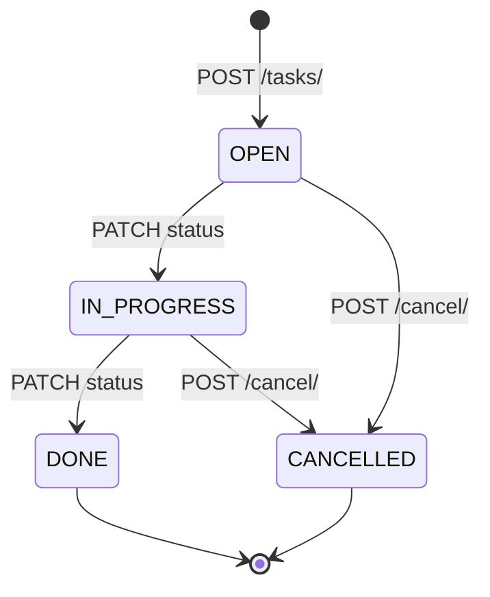
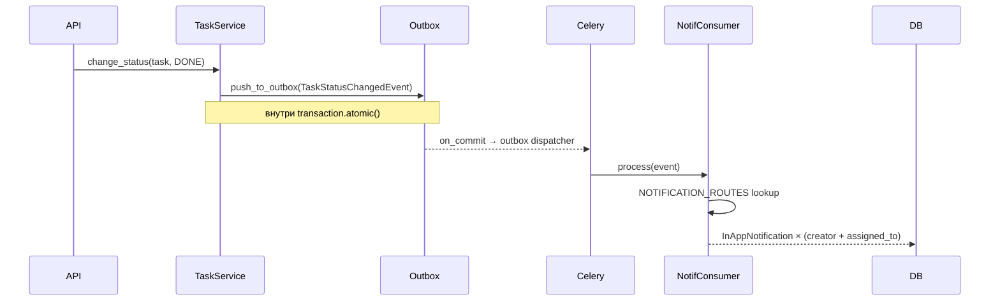

# feat: Sprint C — Operational Maturity

## Summary

Четыре трека операционной зрелости, выполняемые последовательно по приоритету:

- **C4** — верификация реального банковского файла `kl_to_1c.txt` на существующем парсере; до 5 точечных правок `KlTo1CParser`
- **C3** — создание тестовых пользователей 4 ролей + RBAC matrix документ + browser QA
- **C2** — новый домен `apps/tasks/` (создание/назначение/выполнение поручений + уведомления)
- **C1** — KPI-страница руководителя `/dashboard/director` с агрегатами из существующих моделей

---

## Problem Frame

После Sprint B ERP содержит полный операционный контур. Проблема не в функциональности — в том, что система работает на тестовых данных и без реальных пользователей. Sprint C переводит ERP из «демо-стенда» в рабочий инструмент компании.

Блокирующая проблема: директор не может ставить поручения менеджерам внутри системы (используют Telegram), не видит KPI по реальным данным, сотрудники ещё не зарегистрированы с правильными ролями.

---

## Requirements

Из `docs/brainstorms/2026-06-23-sprint-c-requirements.md`:

| # | Требование |
|---|-----------|
| R1 | Загрузка `kl_to_1c.txt` → `status=parsed`, счёт и остатки верны, все строки распознаны |
| R2 | 4 тестовых пользователя с ролями director/manager/accountant/foreman; RBAC matrix задокументирован |
| R3 | `POST /api/v1/tasks/` создаёт задачу, назначает ответственного, принимает `due_date` и `entity_type+entity_id` |
| R4 | Смена статуса задачи на DONE триггерит уведомление creator и assigned_to |
| R5 | `GET /api/v1/dashboard/director/` возвращает 5 KPI-виджетов; страница видна только роли director+ |
| R6 | ObjectStage-«просроченные» = объекты с `status=IN_PROGRESS AND planned_end_date < today` |

---

## Key Technical Decisions

**KTD-1: Director endpoint в существующем dashboard router**
`GET /api/v1/dashboard/director/` добавляется в `apps/common/api/dashboard.py`. Новый `apps/dashboard/` модуль не создаётся — избегаем Django-app sprawl, паттерн уже задан.

**KTD-2: «Просроченные» = объекты, не этапы**
`ObjectStage` не имеет `planned_end_date`. Виджет считает `SupplyObject.objects.filter(status='IN_PROGRESS', planned_end_date__lt=today, planned_end_date__isnull=False)`.

**KTD-3: Tasks entity link — polymorphic soft-link**
`Task.entity_type` (str) + `Task.entity_id` (UUID) без ORM FK на другие домены. ADR-0005 запрещает cross-domain model imports. Frontend резолвит ссылку по entity_type самостоятельно.

**KTD-4: Tasks permissions — data migration**
Новые `Permission` записи `(read, tasks)`, `(write, tasks)`, `(delete, tasks)` добавляются в `apps/common/migrations/` как data migration (RunPython), привязываются к ролям через `RolePermission`. Не management command — должно применяться при `make migrate`.

**KTD-5: TaskStatusChangedEvent в apps/common/events/**
Событие объявляется в `apps/common/events/tasks.py` (паттерн `ContractActivatedEvent`). Handler регистрируется в `NOTIFICATION_ROUTES` в `apps/notifications/handlers/__init__.py`. Получатели: creator + assigned_to (два отдельных in-app).

**KTD-6: C4 parser fix scope**
До 5 точечных правок в `apps/payments/parsers/kl_to_1c.py`. Если реальный файл выявит структурную несовместимость — остановиться и создать issue, не переписывать парсер.

**KTD-7: SDK regeneration gate между C1-backend и C1-frontend**
После добавления `DirectorDashboardSchema` на бэкенде: `make openapi-gen` (или эквивалент) для регенерации TypeScript SDK. Frontend U8 зависит от сгенерированных типов.

---

## High-Level Technical Design

### Tasks Domain State Machine



При переходе в `DONE` и `CANCELLED` → `TaskStatusChangedEvent` → Outbox → `notification` queue.

### Notification Event Flow (C2)



### Implementation Unit Dependencies

```
U1 (C4 parser)    ──┐
U2 (C3 roles)     ──┤  независимые
                    │
U3 (tasks models) ──┐
U4 (tasks API)    ←─U3
U5 (tasks events) ←─U4
U6 (tasks frontend)←U4,U5
                    │
U7 (director API) ──┐
U8 (director UI)  ←─U7
```

---

## Output Structure

Новая директория `apps/tasks/`:

```
apps/tasks/
  __init__.py
  apps.py
  api.py
  events.py
  models/
    __init__.py
    task.py
    task_attachment.py
  repositories/
    __init__.py
    task_repo.py
  services/
    __init__.py
    task_service.py
  queries/
    __init__.py
    task_queries.py
  schemas/
    __init__.py
    task_dto.py
  migrations/
    __init__.py
    0001_initial.py
  tests/
    __init__.py
    unit/
      test_task_service.py
    queries/
      test_task_queries.py
    permissions/
      test_task_rbac.py
```

---

## Implementation Units

### U1. C4 — Bank Statement Real-File Verification + Parser Fixes

**Goal:** Загрузить реальный файл `kl_to_1c.txt` через существующий API, верифицировать корректность парсинга, исправить найденные краевые случаи.

**Requirements:** R1

**Dependencies:** нет

**Files:**
- `apps/payments/parsers/kl_to_1c.py` — modify (edge case fixes)
- `apps/payments/parsers/tests/test_kl_to_1c_real_file.py` — create (regression fixture)
- `apps/payments/tests/fixtures/kl_to_1c_sample.txt` — create (sanitized version for CI)

**Approach:**
1. Загрузить `kl_to_1c.txt` через `POST /api/v1/payments/statements/` (curl или через UI)
2. Если `status=parse_failed`: читать `parse_error`, найти строку в парсере, исправить
3. Если `status=parsed`: верифицировать `account_number`, `opening_balance`, `closing_balance`, подсчитать строки
4. Проверить направление (debit/credit) на конкретных транзакциях: ЕНП = debit, поступление от СОСТРА = credit
5. Добавить параметризованный тест с sanitized fixture (заменить реальные ИНН на `999999999999`, суммы округлить)

Известные риски парсера, на которые смотреть:
- CRLF (`\r\n`) в Windows-1251 файле — `splitlines()` должен справляться, но проверить
- `НазначениеПлатежа` vs `НазначениеПлатежа1..6` — уже обрабатывается, верифицировать
- Пустой `ДатаСписано` И `ДатаПоступило` одновременно — fallback на `Дата`
- Сумма с пробелами как разделителями тысяч (`1 143 258.28`) — текущий `replace(",", ".")` не снимет пробелы
- Многострочный `НазначениеПлатежа` с переносом (нестандарт)

**Patterns to follow:** `apps/payments/parsers/kl_to_1c.py` (existing), `apps/payments/tests/test_matching_service.py` (test structure)

**Test scenarios:**
- Загрузить валидный kl_to_1c.txt → `status=parsed`, `account_number='40702810601320000266'`
- `opening_balance` = 1143258.28 ± 0.01, `closing_balance` = 28772.19 ± 0.01
- Количество строк `status=parsed` = (количество `СекцияДокумент` в файле)
- Строка с `НазначениеПлатежа` содержащая «зарплата» → `direction=debit`
- Строка входящего платежа от ООО «СОСТРА» → `direction=credit`, `counterparty_inn` корректен
- Сумма с пробелами (если найдётся) → `parse_status=parsed`, amount корректен
- Файл с BOM или UTF-8 заголовком → `can_parse()` возвращает False, статус `parse_failed`

**Verification:** `POST /api/v1/payments/statements/` с реальным файлом → HTTP 201, body `.status == "parsed"`, `.failed_lines == 0`. Все тесты в `test_kl_to_1c_real_file.py` проходят.

---

### U2. C3 — Role Validation Setup

**Goal:** Создать 4 тестовых пользователя с ролями, задокументировать RBAC matrix, провести browser QA.

**Requirements:** R2

**Dependencies:** нет

**Files:**
- `apps/users/management/commands/create_test_users.py` — create
- `docs/solutions/rbac/sprint-c-role-validation.md` — create (RBAC matrix + результаты QA)

**Approach:**
Management command создаёт или обновляет пользователей idempotently:

| username | role | email |
|---------|------|-------|
| `dir_test` | director | dir_test@test.com |
| `mgr_test` | manager | mgr_test@test.com |
| `acc_test` | accountant | acc_test@test.com |
| `foreman_test` | foreman | foreman_test@test.com |

Все пароли: `Test123!`. Команда: `python manage.py create_test_users`.

RBAC matrix в документе — таблица «Действие × Роль» для всех ключевых операций:
- Создать/изменить/удалить: контрагент, договор, объект, файл, задачу, выписку
- Читать: контрагент, договор, объект, финансы, дашборд директора
- Публиковать CMS, просматривать выписки, назначать роли

Browser QA (после U3-U4, когда задачи готовы):
- Войти под каждой ролью, пройти golden path
- Зафиксировать каждую 403 — ожидаемую и неожиданную
- Результаты записать в `docs/solutions/rbac/sprint-c-role-validation.md`

**Patterns to follow:** `apps/finance/management/commands/seed_finance_dev.py`

**Test scenarios:**
- `python manage.py create_test_users` — exit 0, все 4 пользователя существуют
- Повторный запуск — idempotent, не создаёт дубликатов
- `dir_test` может открыть `/dashboard/director` → HTTP 200
- `foreman_test` открывает `/dashboard/director` → redirect или 403
- `acc_test` видит `GET /api/v1/payments/statements/` → 200
- `foreman_test` пытается создать договор → 403

**Verification:** 4 пользователя в БД, management command idempotent. RBAC matrix doc создан.

---

### U3. C2 — Tasks Domain: Models + Migrations + RBAC Seed

**Goal:** Создать модели `Task` и `TaskAttachment`, миграции, засеять RBAC permissions.

**Requirements:** R3

**Dependencies:** нет

**Files:**
- `apps/tasks/models/task.py` — create
- `apps/tasks/models/task_attachment.py` — create
- `apps/tasks/migrations/0001_initial.py` — create
- `apps/common/migrations/00NN_seed_tasks_permissions.py` — create (data migration)
- `config/settings/base.py` — modify (добавить `apps.tasks` в `LOCAL_APPS`)
- `config/urls.py` — modify (зарегистрировать tasks router)

**Approach:**

`Task` наследует `BaseEnterpriseModel` (поля: id, created_at, updated_at, deleted_at, is_deleted, version, tenant_id, is_legal_hold).

Дополнительные поля:
- `title`: `CharField(max_length=255)`
- `description`: `TextField(blank=True)`
- `status`: `CharField(choices=TaskStatus)` — OPEN/IN_PROGRESS/DONE/CANCELLED
- `priority`: `CharField(choices=TaskPriority)` — LOW/NORMAL/HIGH, default NORMAL
- `created_by_id`: `UUIDField(db_index=True)`
- `assigned_to_id`: `UUIDField(null=True, blank=True, db_index=True)`
- `due_date`: `DateField(null=True, blank=True)`
- `entity_type`: `CharField(max_length=50, blank=True, default='')` — `contract|object|contragent|request|''`
- `entity_id`: `UUIDField(null=True, blank=True)`
- `closed_at`: `DateTimeField(null=True, blank=True)`
- `closed_by_id`: `UUIDField(null=True, blank=True)`

`TaskAttachment`:
- `task_id`: `UUIDField(db_index=True)` (no FK, ADR-0005)
- `file_id`: `UUIDField(db_index=True)`
- `attached_by_id`: `UUIDField()`

Data migration: `Permission.objects.get_or_create(action='read', resource='tasks')` × 3 действия; привязать к ролям через `RolePermission`.

Роли → permissions:
- `director`: read+write+delete tasks
- `manager`: read+write tasks
- `accountant`: read tasks
- `foreman`: read tasks (только свои — логика в service layer)

Индексы: `(tenant_id, status, is_deleted)`, `(tenant_id, assigned_to_id, is_deleted, -id)`.

**Patterns to follow:** `apps/requests/models/request.py`, `apps/common/models/base.py`, `apps/common/models/rbac.py`

**Test scenarios:**
- Миграция прогоняется вперёд без ошибок: `migrate`
- Миграция откатывается назад: `migrate apps.tasks zero`
- `Permission` записи `(read, tasks)`, `(write, tasks)`, `(delete, tasks)` существуют после migrate
- Роль `director` имеет все 3 permissions, `foreman` имеет только `(read, tasks)`
- Создание `Task` без `entity_type` валидно (blank=True)
- `Task.is_legal_hold=True` блокирует мутации (через BaseEnterpriseModel)

**Verification:** `make migrate` exit 0, `make makemigrations --check` exit 0 после.

---

### U4. C2 — Tasks Backend: Repository + Service + Queries + API

**Goal:** Реализовать CRUD-сервис и REST API для задач.

**Requirements:** R3

**Dependencies:** U3

**Files:**
- `apps/tasks/repositories/task_repo.py` — create
- `apps/tasks/services/task_service.py` — create
- `apps/tasks/queries/task_queries.py` — create
- `apps/tasks/schemas/task_dto.py` — create
- `apps/tasks/api.py` — create
- `apps/tasks/tests/unit/test_task_service.py` — create
- `apps/tasks/tests/queries/test_task_queries.py` — create
- `apps/tasks/tests/permissions/test_task_rbac.py` — create

**Approach:**

`TaskRepository`: `get_queryset()` → тenant-scoped, is_deleted=False. `get_by_id(task_id)` проверяет tenant. `save(task)` через `EnterpriseSreRepository` (CAS update).

`TaskService`:
- `create(tenant_id, created_by, payload) → Task`
- `update(task, payload) → Task` — title/description/priority/due_date/assigned_to
- `change_status(task, new_status, changed_by) → Task` — валидирует transition graph, устанавливает `closed_at`/`closed_by_id` при DONE/CANCELLED. Записывает `TaskStatusChangedEvent` в Outbox через `transaction.on_commit()`
- `cancel(task, cancelled_by) → Task` — alias на `change_status(CANCELLED)`
- `attach_file(task, file_id, attached_by) → TaskAttachment`
- `detach_file(task, file_id) → None`

Разрешённые переходы: OPEN→IN_PROGRESS, OPEN→CANCELLED, IN_PROGRESS→DONE, IN_PROGRESS→CANCELLED.

`task_queries.py`: `get_tasks_page(cursor, limit, status, assigned_to, entity_type, entity_id)` → cursor pagination по id. Читает с replica (Query Side).

API endpoints:
```
GET    /api/v1/tasks/                    permission: read, tasks
POST   /api/v1/tasks/                    permission: write, tasks
GET    /api/v1/tasks/{id}/               permission: read, tasks
PATCH  /api/v1/tasks/{id}/               permission: write, tasks
POST   /api/v1/tasks/{id}/status/        permission: write, tasks
POST   /api/v1/tasks/{id}/cancel/        permission: write, tasks
POST   /api/v1/tasks/{id}/files/         permission: write, tasks
DELETE /api/v1/tasks/{id}/files/{fid}/   permission: write, tasks
```

PATCH защищён: только creator или assigned_to может менять свою задачу (дополнительная проверка в service, не только RBAC).

**Patterns to follow:** `apps/requests/api.py`, `apps/requests/queries/request_queries.py`, `apps/contragents/repositories/contragent_repo.py`, `apps/payments/services/bank_statement_service.py`

**Execution note:** Начинать с `TaskService.create` + `TaskService.change_status` — они несут основную бизнес-логику и должны быть покрыты unit-тестами до построения API.

**Test scenarios:**
- `TaskService.create()` с корректными данными → Task с status=OPEN
- `TaskService.create()` с `entity_type='contract'` + `entity_id=UUID` → сохраняется
- `TaskService.change_status(OPEN → IN_PROGRESS)` → статус изменён
- `TaskService.change_status(DONE → IN_PROGRESS)` → `ValueError` (недопустимый переход)
- `TaskService.change_status(→ DONE)` → `closed_at` установлен, `closed_by_id` установлен
- `TaskService.attach_file()` → `TaskAttachment` создан
- API `POST /api/v1/tasks/` без аутентификации → 403
- API `PATCH /api/v1/tasks/{id}/` чужим пользователем (не creator, не assigned_to) → 403
- `GET /api/v1/tasks/?assigned_to={user_id}` → только задачи этого пользователя в tenant
- `GET /api/v1/tasks/?entity_type=contract&entity_id={uuid}` → задачи по договору
- Cursor pagination: корректный `next_cursor` при `limit < total`

**Verification:** Все тесты в `apps/tasks/tests/` pass. `POST /api/v1/tasks/` возвращает 201 с корректным телом. RBAC: foreman не может создать задачу через API (403).

---

### U5. C2 — Tasks Events + Notifications

**Goal:** Задача переведённая в DONE/CANCELLED публикует событие через Outbox → уведомление creator и assigned_to.

**Requirements:** R4

**Dependencies:** U4

**Files:**
- `apps/common/events/tasks.py` — create
- `apps/notifications/handlers/task_handlers.py` — create
- `apps/notifications/handlers/__init__.py` — modify (добавить в NOTIFICATION_ROUTES)
- `apps/notifications/tests/test_notifications.py` — modify (добавить тест TaskStatusChangedEvent)

**Approach:**

`TaskStatusChangedEvent` (в `apps/common/events/tasks.py`):
```
@dataclass(slots=True, frozen=True)
fields: event_id, event_version, occurred_at, correlation_id, tenant_id,
        task_id, task_title, new_status, changed_by_id, creator_id, assigned_to_id
```

`TaskStatusChangedHandler` (в `apps/notifications/handlers/task_handlers.py`):
- `event_type = TaskStatusChangedEvent.EVENT_TYPE`
- `get_recipient_ids()`: возвращает `[creator_id, assigned_to_id]` (дедуплицировать если совпадают)
- `get_title()`: «Задача выполнена» / «Задача отменена»
- `get_body()`: включает `task_title` из payload

В `U4.TaskService.change_status()` — `TransactionalOutboxService.push_to_outbox(event)` внутри `transaction.atomic()`, dispatch через `transaction.on_commit()`.

Celery queue: `notifications` (согласно rule 4.15).

**Patterns to follow:** `apps/common/events/contracts.py`, `apps/notifications/handlers/contract_handlers.py`, `apps/notifications/handlers/__init__.py`, `apps/payments/services/bank_statement_service.py` (on_commit pattern)

**Test scenarios:**
- `TaskStatusChangedEvent.EVENT_TYPE` зарегистрирован в `NOTIFICATION_ROUTES`
- Handler получает `creator_id` и `assigned_to_id` как recipients
- Если `creator_id == assigned_to_id` → 1 уведомление, не 2
- `get_title()` при `new_status=DONE` → «Задача выполнена»
- `get_title()` при `new_status=CANCELLED` → «Задача отменена»
- Смена статуса в OPEN→IN_PROGRESS НЕ публикует событие (только DONE/CANCELLED)
- Integration: `TaskService.change_status(→ DONE)` → `OutboxRecord` создан в той же транзакции

**Verification:** `test_all_event_types_registered` в `test_notifications.py` включает `TaskStatusChangedEvent.EVENT_TYPE`. Тест смены статуса на DONE проверяет наличие OutboxRecord.

---

### U6. C2 — Tasks Frontend

**Goal:** UI для создания, просмотра и управления задачами.

**Requirements:** R3, R4

**Dependencies:** U4 (API готов), U5 (уведомления готовы)

**Files:**
- `frontend/src/shared/api/tasks.ts` — create
- `frontend/src/app/dashboard/tasks/page.tsx` — create (список)
- `frontend/src/app/dashboard/tasks/[id]/page.tsx` — create (детали)
- `frontend/src/app/dashboard/layout.tsx` — modify (добавить ссылку «Задачи» в sidebar)

**Approach:**

После добавления бэкенд-эндпоинтов (U4): регенерировать TypeScript SDK (`make openapi-gen`), затем импортировать из `generated/schema`.

`tasks.ts`: хуки `useTasks(filters)`, `useTask(id)`, `useCreateTask()`, `useUpdateTask(id)`, `useChangeTaskStatus(id)`, `useCancelTask(id)`, `useAttachTaskFile(id)`, `useDetachTaskFile(id)`.

Список задач (`/dashboard/tasks/`):
- Фильтры: status, assigned_to (себе / все — зависит от роли)
- Кнопка «Новая задача» → inline form или modal
- Колонки: заголовок, приоритет, ответственный, срок, статус, entity-ссылка
- Cursor pagination: кнопка «Загрузить ещё»

Детали задачи (`/dashboard/tasks/[id]/`):
- Заголовок, описание, приоритет, срок
- Смена статуса: кнопка с доступными переходами
- Секция «Файлы» — attach/detach (аналог `ContragentDetailPage.FilesTab`)
- Entity-ссылка: если `entity_type=contract` → `<Link href="/dashboard/contracts/{entity_id}">`

Sidebar: ссылка «Задачи» отображается всем ролям (задачи видны всем, доступ ограничен на уровне API).

**Patterns to follow:** `frontend/src/shared/api/contragents.ts`, `frontend/src/app/dashboard/contragents/[id]/page.tsx` (FilesTab, tabs pattern), `frontend/src/shared/api/payments.ts`

**Test scenarios:**
- `POST /api/v1/tasks/` с `entity_type=contract` → task создана, в списке отображается с ссылкой на договор
- Смена статуса через UI → кнопка «Выполнить» переводит в DONE, кнопка исчезает
- Кнопка «Отменить» доступна создателю, недоступна при status=DONE
- Attach file: dropdown доступных файлов, файл появляется в списке после прикрепления
- foreman_test видит только свои задачи (assigned_to = себе)
- Пустой список задач → корректный empty state, нет JS-ошибок в консоли

**Verification:** browser QA — golden path создания/выполнения задачи для всех 4 ролей без JS-ошибок.

---

### U7. C1 — Director Dashboard Backend

**Goal:** Endpoint `GET /api/v1/dashboard/director/` с 5 KPI-виджетами, кеш 60 сек.

**Requirements:** R5, R6

**Dependencies:** нет (данные в существующих моделях)

**Files:**
- `apps/common/api/dashboard.py` — modify (добавить endpoint и schema)
- `apps/common/queries/director_queries.py` — create
- `apps/common/cache/dashboard_cache.py` — modify (добавить director cache key)
- `apps/common/tests/test_director_dashboard.py` — create

**Approach:**

Новая schema `DirectorDashboardSchema`:
```
requests_by_status: {new, assigned, processing, converted, closed}
objects_in_progress_count: int
objects_top5: [{id, name, status}]
overdue_objects_count: int          # KTD-2: planned_end_date < today, status=IN_PROGRESS
payments_credit_month: Decimal      # BankStatementLine credit sum for current month
payments_debit_month: Decimal       # BankStatementLine debit sum for current month
open_contracts_count: int           # status not in (CLOSED, CANCELLED)
period_from: date                   # начало текущего месяца
period_to: date                     # сегодня
```

`director_queries.py` — все функции читают с `get_tenant_id()`, tenant-scoped:
- `get_requests_by_status() → dict[str, int]` — `values('status').annotate(count=Count('id'))`
- `get_objects_summary() → dict` — один QuerySet для in_progress_count + top5 + overdue_count
- `get_payments_month_summary(date_from, date_to) → dict` — фильтр по `BankStatementLine.transaction_date`, `statement__status=IMPORTED`, sum по direction

Permission: `read, dashboard` (уже существует в БД). Отдельное разрешение `read, dashboard.director` не создаётся — архитектурная простота.

Cache key: `dashboard:director:v1:tenant:{tenant_id}`, TTL 60 сек (от 30 сек основного дашборда).

Endpoint:
```python
@router.get("/director/", response={200: DirectorDashboardSchema, 403: dict})
@require_permission("read", "dashboard")
def get_director_dashboard(request):
    ...
```

**Patterns to follow:** `apps/common/api/dashboard.py` (существующий), `apps/common/queries/outbox_queries.py`, `apps/requests/queries/request_queries.py`

**Test scenarios:**
- `GET /api/v1/dashboard/director/` с `read:dashboard` permission → 200
- `GET /api/v1/dashboard/director/` без permission → 403
- `requests_by_status` содержит все 5 статусов (0 если нет данных)
- `overdue_objects_count`: объект с `planned_end_date=yesterday, status=IN_PROGRESS` считается; с `planned_end_date=tomorrow` не считается
- `overdue_objects_count`: объект без `planned_end_date` не считается (IS NOT NULL)
- `payments_credit_month`: суммирует только IMPORTED statements текущего месяца
- Кеш: второй запрос в пределах 60 сек — нет дополнительных DB queries (патч cache)

**Verification:** Endpoint возвращает корректные данные при наличии хотя бы одного объекта, заявки, выписки. Тест с assert_num_queries проверяет кеш.

---

### U8. C1 — Director Dashboard Frontend

**Goal:** Новая страница `/dashboard/director` с 5 KPI-виджетами.

**Requirements:** R5

**Dependencies:** U7 (regenerate SDK после добавления `DirectorDashboardSchema`)

**Files:**
- `frontend/src/shared/api/dashboard.ts` — modify (добавить `useDirectorDashboard`)
- `frontend/src/app/dashboard/director/page.tsx` — create
- `frontend/src/app/dashboard/layout.tsx` — modify (добавить ссылку «Дашборд» в sidebar, видимую director)

**Approach:**

После `make openapi-gen` — `DirectorDashboardSchema` доступна из `components['schemas']`.

`useDirectorDashboard()`: `GET /api/v1/dashboard/director/`, `staleTime: 60_000`, `refetchInterval: 60_000`.

Страница: 2×3 сетка KPI-карточек:

| Карточка | Метрика |
|---------|---------|
| Заявки | Breakdown по статусам (5 цветных чипов) |
| Объекты в работе | Count + список топ-5 с именами |
| Просроченные этапы | Count с акцентом (красный если > 0) |
| Поступления | Sum credit текущего месяца |
| Расходы | Sum debit текущего месяца |
| Договоры | Count незакрытых |

Кнопка «Обновить» → `queryClient.invalidateQueries(['dashboard-director'])`.

RBAC на фронте: страница не проверяет роль сама; если `useDirectorDashboard()` вернёт 403 — показать «Доступ запрещён».

Sidebar link: под ролевым guard — `useCan('dashboard.read')` или проверка role === 'director'.

**Patterns to follow:** `frontend/src/app/dashboard/page.tsx` (существующий дашборд), `frontend/src/shared/api/dashboard.ts`

**Test scenarios:**
- `dir_test` открывает `/dashboard/director` → все 5 карточек рендерятся без ошибок
- При `overdue_objects_count > 0` — карточка имеет красный акцент
- `foreman_test` открывает `/dashboard/director` → 403 от API → страница показывает «Доступ запрещён»
- При 0 заявках — breakdown показывает нули, не JS-ошибку
- Кнопка «Обновить» тригерит refetch (Network tab показывает новый запрос)

**Verification:** browser QA под `dir_test` — все 5 виджетов с реальными данными. Под `foreman_test` — 403 без crash.

---

## Scope Boundaries

### В плане
- KlTo1CParser fixes (до 5, без архитектурных изменений)
- 4 тестовых пользователя + RBAC matrix + browser QA
- `apps/tasks/` — полный новый домен (U3-U6)
- `GET /api/v1/dashboard/director/` + `/dashboard/director` страница (U7-U8)

### Deferred to Follow-Up Work
- Задачи с комментариями/тредами (Sprint D)
- Real-time WebSocket обновление дашборда (Sprint D)
- Drill-down KPI по клику (Sprint D)
- Импорт клиентов/договоров из 1С (ждём файл)
- Excel-формат банковских выписок

### Не входит в Sprint C
- Push-уведомления через браузер (Web Push API)
- Мобильное приложение
- Автоматическое связывание задач с договорами через AI
- BI / аналитика

---

## Open Questions

| # | Вопрос | Статус |
|---|--------|--------|
| Q1 | Какой make-target регенерирует TypeScript SDK? | Уточнить перед U8 (`make openapi-gen` или другой) |
| Q2 | `payments_credit_month` — считать только IMPORTED statements или также PARSED? | Уточнить при реализации U7; default: только IMPORTED |

---

## Risks & Dependencies

| Риск | Вероятность | Митигация |
|------|-------------|-----------|
| kl_to_1c.txt выявит > 5 краевых случаев | Средняя | Остановиться на 5 правках; остальное — issues для Sprint D |
| TaskStatusChangedEvent listener не зарегистрирован → silent drop | Низкая | Тест `test_all_event_types_registered` падает при забытой регистрации |
| SDK regeneration сломает существующие frontend типы | Низкая | `tsc --noEmit` перед коммитом |
| RBAC_ENFORCEMENT_MODE=OFF в dev — тесты прав не проверяются | Высокая | Тесты permissions явно переключают режим через settings override |
| Director dashboard кеш 60 сек устаревает при активных операциях | Приемлемо | Кнопка «Обновить» снимает staleness по требованию |
